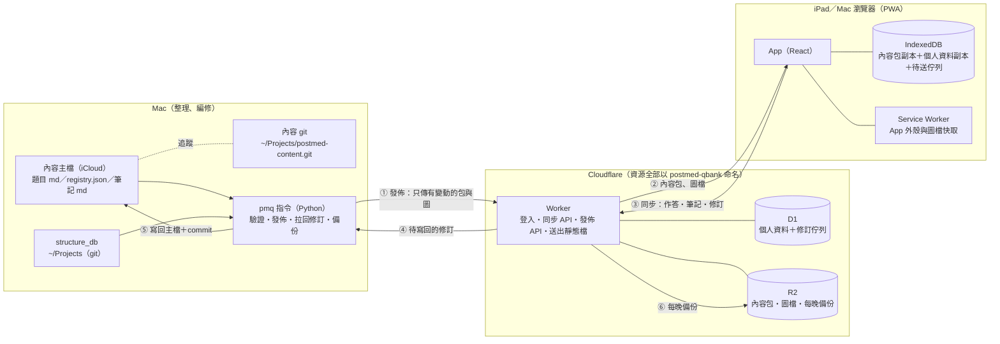
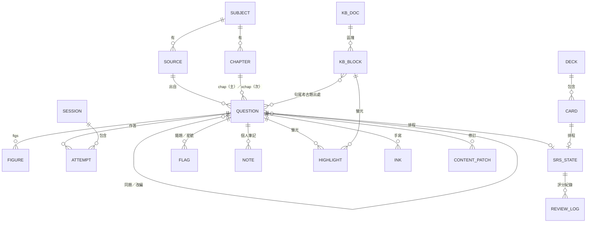

# 後醫題庫網 規格書

版本：2026-11-10 定案稿 v2（已併入使用者對 Q1–Q27 的回答；尚未實作）。專案代號 `postmed-qbank`。

使用者的原始回答在 [04_待決問題.md](04_待決問題.md)；本文件是併入後的結果。實作時兩者若不一致，以本文件為準並回報。仍未定的事列在 §14，都不卡第 0–2 階段；遇到 §14 的項目或本文件沒寫到的決定，停下來問，不要自己選。

---

## 0. 現況盤點（2026-11-10 實測）

| 項目 | 數量／大小 | 位置 | 格式 |
|---|---|---|---|
| 物理題目 | 9,302 題（後醫 1,188、轉學考 1,010、教材 2,169、原文書 4,935） | `01_題庫製作/物理/02_原卷題庫/` | 每題一個 `.md`：YAML front matter ＋ `## ques`／`## idea`／`## sol` |
| 物理索引 | 9,302 列 | `01_題庫製作/物理/analysis/question_index.jsonl` | 由 `question_bank.py index` 產生 |
| 物理章節 | Ch01–Ch30 | `analysis/chapters.yaml`、`tags.yaml` | YAML |
| 物理圖 | registry 1,087 組（approved 1,081、text 5、pending 1；manual_edit 466） | `analysis/圖片審核/registry.json`、`assets/重繪/<章>/<圖ID>/traced.svg`（另有 `traced_q.svg` 題目版） | SVG，文字用 Times New Roman |
| 物理原題圖 | 1,080 檔、46 MB | `assets/原題圖/` | PNG |
| 生化題目 | 3,743 題（後西醫 1,492、後中醫 387、後獸醫 720、私醫 160、醫事國考 984） | `01_題庫製作/生化/02_原卷題庫/` | 一份考卷一個 `.md`；每題是 `ID:`／`source:`／`chap:`／`xchap:`／`ques:`／`ans:`／`sol:` 區塊 |
| 生化圖 | 444 檔、65 MB；題目裡 83 處 `` | `01_題庫製作/生化/assets/images/` | PNG |
| 生化章節 | A1–D7，33 章、437 子目 | `analysis/biochem_taxonomy.json` | JSON |
| structure_db | 分子 390、反應 220、路徑 366；SVG 1,956 檔、75 MB | 程式與資料在 `~/Projects/structure_db`（git），輸出在 `82_考題整理/structure_db/out/` | `index.json` ＋ SVG；手修版在 `data/manual/` |
| 學習筆記 | 生化＋物理現行約 60 份 `.md`（全部 229 份含封存） | `02_學習筆記/` | Markdown：標題＋巢狀列點＋表格＋``；生化筆記在句尾標考古題出處，如（中興-115-42） |
| 舊站 | `postmed-tools`（LaTeX／SVG 編輯器）、`postmed-library`（公開、圖庫與考題分析） | `web_tools/` | Cloudflare Pages |
| SVG 編輯器核心 | 一份共用檔 | `scripts/svg_editor/svg_editor.js`＋`.css` | `SvgEditor.open({svgUrl, refUrl, sol, onSave, onClose})` |

盤點時看到、會影響設計的事：

1. **物理的 `status` 是自由文字**（「書附答案與AI盲解一致」「本地推導／條件解候選」等 15 種以上），不能直接拿來當篩選條件，搬遷時要對應成固定代碼（§4.4）。
2. **物理的選項寫在 `ques` 本文裡**，有的每個選項一行，有的 `(A)…(B)…` 擠在同一行；要點選作答就得解析（§4.5）。
3. **生化 ID 不是流水號**，是 `KMU-115-01` 這種「校-年-題」。已定：ID 不動。重複的 1 個是 `KMU-111-16`：同一題在 `高醫_111_生物生化.md` 的第 1 行與第 334 行各出現一次。
4. **生化沒有任何「詳解來源／是否確認」欄位**。已定（依使用者記憶）：答案都是官方公布答案，詳解都是 Gemini Batch 產生，沒有人工逐題看過。
5. **iCloud 會把檔案卸載成 dataless**：這次掃 `assets/重繪` 的 SVG 超過兩分鐘還沒跑完。發佈工具不能每次全掃，要用雜湊快取、只讀有變動的檔案（§7.2）。
6. 這台 Mac 有 Node 22.19、pnpm、git、sqlite3；沒有全域 wrangler。

---

## 1. 五個必須決定的事：結論

### 1.1 單一資料來源

**每一種資料只有一個主檔，分兩類：**

| 資料 | 以誰為準 | 網站上的角色 |
|---|---|---|
| 題目、選項、答案、詳解、圖、章節、標籤、講義筆記（從檔案來的「內容」） | **Mac 上現有的檔案**（iCloud 裡原位不動），另加 git 追蹤歷史 | 發佈出去的唯讀副本（內容包） |
| 作答紀錄、錯題、複習排程、個人筆記、螢光筆、手寫、卡片（在網站上產生的「個人資料」） | **雲端資料庫 D1** | 各裝置的 IndexedDB 是離線副本 |

**iPad 上改的錯字寫到哪裡：** 寫進 D1 的「修訂佇列」（`content_patch`）。

1. 你在 iPad 按「編輯」改完存檔 → 產生一筆修訂，隨同步送到雲端。
2. 所有裝置立刻把這筆修訂疊在原內容上顯示，所以看起來是**馬上改好了**。
3. 在 Mac 執行 `pmq patches pull`：把修訂寫回對應的 `.md` 主檔、git commit。
4. 下次 `pmq publish` 後，修訂標成已合併，疊加層消失。
5. 如果 Mac 上同一段在這期間也被改過（雜湊對不上），這筆修訂標成「衝突」，兩個版本都留著，在 Mac 上人工選；不會自動覆蓋任何一邊。

**為什麼不以雲端資料庫當題目主檔：** 你現有的整條製作線（Python 擷取、`build_chapters`、`build_pdf`、Gemini Batch、Codex／Gemini 直接改檔、Typora 匯出）全部讀寫這些 `.md`。主檔搬上雲，這些工具都要改成「先匯出、改完再匯入」，而且會出現兩邊同時改的問題。iPad 上的編修量小（錯字、補一句詳解），用修訂佇列寫回就夠。

**為什麼不是「搬進 git、離開 iCloud」：** 題庫資料夾裡有來源 PDF 和 Typora／GoodNotes 依賴的相對路徑，搬動代價大。做法是檔案留在 iCloud，`.git` 目錄放在 iCloud 外（`~/Projects/postmed-content.git`，用 `--git-dir`／`--work-tree`），只追蹤文字檔（md、yaml、json、svg），不追蹤 PNG 和 PDF。這樣 iCloud 不會弄壞 `.git`，iCloud 產生的「檔名 2」衝突副本也會在 `git status` 現形。（使用者已同意。）

**之後若要把主檔搬出 iCloud**（使用者想解決 iCloud 讀檔慢，但還沒決定哪些要搬，見 §14-1）：所有主檔路徑只寫在一個設定檔 `tools/pmq/pmq.toml`，程式其他地方不得寫死路徑。這樣搬家只要改設定檔，網站與個人資料完全不受影響。

### 1.2 資料 schema

見 §4。重點：題目用**不變的 ID** 當唯一鍵；個人資料全部用「項目鍵」`<類型>:<ID>`（如 `q:PHY-007836`、`card:01J…`）指向內容，不複製內容；內容改版不影響個人資料。

### 1.3 刷題模式

做六種，全部做間隔複習（FSRS 演算法）。各模式要記的資料見 §5。

### 1.4 公式與圖

- 公式：**KaTeX ＋ mhchem 擴充**（`\ce{}`），在裝置上即時排版；發佈前用同一版 KaTeX 把全庫公式跑一遍，排不出來的列成清單。
- SVG：題目內用 `` 顯示（向量、可快取）；點一下開全螢幕檢視器，雙指縮放到 8 倍，縮放時改實際尺寸而不是 CSS scale，所以放大不糊。深色模式下圖一律放在白色紙卡上；純黑白的物理線稿可切換「反相」。細節見 §6。

### 1.5 備份與匯出

三層，全部是開放格式（NDJSON、Markdown、SVG、CSV），不依賴 Cloudflare 才能讀：

1. 內容：Mac 主檔＋git 歷史＋iCloud；每週把 git bundle 傳一份到 R2。
2. 個人資料：Worker 每晚把 D1 的個人資料表倒成 `backup/YYYY-MM-DD.ndjson.gz` 存 R2（保留 30 天＋每月一份）；D1 本身另有 30 天 Time Travel。
3. 整包匯出：網站「設定 → 匯出全部」下載一個 zip；Mac 上 `pmq backup pull` 抓同一包放進 `99_封存/題庫網備份/`。`pmq restore` 可以把這包灌回一個全新的 D1。

---

## 2. 其他要你判斷的事：結論

### 2.1 離線刷題：做

這個架構是「內容包下載到裝置、作答先寫在裝置、再同步」，所以離線不是另外加的功能，而是預設行為。

| | 做 | 不做 |
|---|---|---|
| 好處 | 捷運、飛機、訊號差時照常刷題；每次點選都不用等網路，手感快；斷線不會丟作答 | 程式較簡單 |
| 代價 | 要寫同步與衝突規則（§8）；iPad 要「加入主畫面」使用，否則 Safari 可能在 7 天沒開後清掉本機資料；更新版本要處理 Service Worker；實機測試項目變多 | 每題都要連線；連線中斷時那幾題的作答會遺失，除非仍然做一個暫存佇列——而那已經是離線功能的一半 |

限制要先知道：iPad 的 Safari 沒有背景同步，同步只在 App 開著時發生（開啟、回到前景、恢復連線、每 60 秒）。Safari 分頁和主畫面 App 的儲存空間是分開的，請固定用主畫面版本。

### 2.2 Apple Pencil 手寫：可以做，排在第 6 階段

每題下方一塊可展開的手寫區，用 Pointer Events 讀筆的壓力，只有筆會畫、手指仍然是捲動。存的是向量筆畫（不是圖片），一頁通常 5–100 KB，跟著同步。物理題每次重做時清空，其他科永久保存；暫不做匯出。細節 §9.6。

### 2.3 SVG 編輯器：整合進新站，但核心不分叉

- 放在新站的 `/tools/svg`，進入時才載入；題目圖旁邊多一個「✎ 編輯圖」。
- 同一個網域的好處：一次登入、iPad 上只有一個主畫面 App；改好的圖可以走同一條修訂佇列寫回 `assets/重繪/…/traced.svg`（registry 標 `manual_edit`）或 structure_db 的 `data/manual/`。
- 核心仍然只有 `scripts/svg_editor/` 那一份，新站在建置時複製進來，不另改一份。Mac 上的 `serve.py`（8766）和 `sdb serve` 照舊可用。
- 舊站 `postmed-tools` 的草稿存在那個網域的 IndexedDB，換網域後看不到。使用者已確認那些草稿都用不到，不需要搬；新站確認可用後就刪舊站。

### 2.4 平台與費用

- **全部放 Cloudflare：一個 Worker（含靜態檔）＋ D1 ＋ R2。不用 Supabase，不用 Pages。**
  - 你的帳號已經付了 Workers Paid 和 R2 Paid，這個專案的用量（一個人）遠低於內含額度，預期**新增月費 0**。
  - 不用 Supabase：免費方案閒置一週會暫停、多一個平台要備份和管理，而 D1 已經夠用。
  - 不用 Pages：現有 token 沒有 Pages 權限，而且 Worker 的靜態檔功能可以在送出每個檔案前先檢查登入。
- **擋外人：Worker 內建單一密碼登入**，不用 Cloudflare Access。理由：Access 要動帳號層級的 Zero Trust 設定（和護理站同一個帳號），而且它的轉址登入和離線 PWA、Service Worker 互相干擾。單一密碼的做法見 §10。（使用者已同意。）
- **與護理國考網站同一個 Cloudflare 帳號**（使用者已決定），照 §11 的硬性規則做。護理站目前 R2 用 927.51 MB、沒有用 D1（2026-11-10 使用者提供）。
- 月費上限是新台幣 160 元；網址先用 workers.dev。

### 2.5 iPad 與電腦功能完全一致

網站不分辨「這是 iPad 還是電腦」，兩邊是同一份程式、同一組功能（包含所有編輯功能）。差別只有兩個，都由 CSS 自動判斷：

- **畫面寬度**：寬的時候導覽在左側，窄的時候在底部。
- **輸入方式**：觸控時按鈕與間距放大、支援滑動；有鍵盤時多了快捷鍵。

不得做「只有電腦版才有」或「只有 iPad 才有」的功能；唯一的例外是 Apple Pencil 手寫（電腦上可檢視，用滑鼠也能畫）。iPhone 只要求能正常瀏覽，不特別最佳化。

---

## 3. 架構



資料流向只有這六條。內容只會從 Mac 流向網站（①②），唯一的回流是修訂佇列（④⑤）。

### 3.1 技術選型

| 層 | 選擇 | 理由 |
|---|---|---|
| 前端 | React＋TypeScript＋Vite，單頁 App | 實作模型最熟、最不容易走偏；單頁才能離線 |
| 樣式 | CSS 變數當設計代碼＋Tailwind | 深淺色靠變數切換 |
| 本機資料 | IndexedDB，用 Dexie；畫面用 `useLiveQuery` | iPad Safari 上最成熟；不用瀏覽器內 SQLite（Safari 的檔案系統 API 仍有坑） |
| Markdown | markdown-it（表格、`==螢光==`）＋DOMPurify 白名單（`img` 的 `src/width/alt`、`u`、`sub`、`sup`、`br`、`table` 系列、`span`） | 現有 md 就是這些語法 |
| 公式 | KaTeX＋mhchem | §6.1 |
| 複習排程 | `ts-fsrs` | FSRS 是 Anki 現行演算法，之後匯入匯出 Anki 才對得上 |
| 手寫 | Pointer Events＋`perfect-freehand` | 向量筆畫、有壓力感 |
| 後端 | Cloudflare Worker＋Hono | 只有登入、同步、發佈、備份四件事 |
| 資料庫 | D1（SQLite） | 帳號已含；可整份匯出成 SQLite |
| 檔案 | R2，物件以內容雜湊命名、永不覆寫 | 發佈只傳新雜湊 |
| Mac 工具 | Python 指令 `pmq`（PyYAML、jsonschema；Anki 另需 zstandard） | 與現有製作工具同語言，可直接重用 `scripts/物理/naming.py` 等 |
| 內容契約 | `schema/*.json`（JSON Schema）＋共用測試案例 | Python 和 TypeScript 兩邊跑同一批案例 |

### 3.2 專案位置與磁碟預算

```
~/Projects/postmed-qbank/        # git；不放 iCloud
  app/        前端
  worker/     Worker 與 D1 migrations
  tools/pmq/  Python 指令
  schema/     內容契約與共用測試案例
  docs/       這四份文件的副本
```

| 項目 | 上限 | 做法 |
|---|---|---|
| `node_modules` | 400 MB | 用 pnpm；相依套件只裝 §3.1 列的 |
| 前端建置成品 `dist/` | 20 MB（不含 LaTeX 工具的 MathJax 字型） | 不產生 zip |
| 發佈時的暫存 | 0（常態） | 內容包在記憶體裡組好直接上傳；圖檔從原位讀、直接傳 |
| 雜湊快取 | < 5 MB | `~/Library/Caches/postmed-qbank/hashes.json` |
| 內容 git | 預估 < 150 MB | 只追蹤文字檔 |

所有指令在動手前先看 `df`，剩餘空間低於 2 GB 就停止並說明（沿用舊站 `build.py` 的規則）。

---

## 4. 資料 schema

### 4.1 內容包（發佈到 R2，唯讀）

```
c/manifest.json                     目前版本：各檔的雜湊、題數、產生時間
c/taxonomy-<hash>.json              科目、章節樹、來源清單
c/index/<SUBJECT>-<hash>.json       該科所有題目的篩選用欄位（不含本文）
c/pack/<SUBJECT>/<章>-<hash>.json   題目本文，一章一包
c/kb/<SUBJECT>/<doc>-<hash>.json    講義筆記，一份一包（第 4 階段）
c/fig/<庫>-<hash>.json              圖庫索引（物理 registry、structure_db）
a/<sha256>.<副檔名>                 圖檔，永久快取
```

`manifest.json` 是唯一會被覆寫的檔；其他檔名含雜湊，內容沒變就不重傳、裝置也不重新下載。

### 4.2 科目、章節、來源

```jsonc
// taxonomy
{
  "subjects": [
    {"id": "PHY", "name": "物理", "id_pattern": "^PHY-\\d{6}$"},
    {"id": "BCH", "name": "生化", "id_pattern": "^[A-Z]+-[0-9A-Za-z-]+$"}   // 沿用現有 ID（KMU-115-01），不改流水號；顯示照寫「高醫 115 01｜KMU-115-01」
    // 之後加 CHE、BIO、ENG：只要加一筆、寫一個轉接器、給章節樹
  ],
  "chapters": [
    // id 全站唯一 = <科目>:<原代碼>；parent 形成樹
    {"id": "PHY:Ch15", "subject": "PHY", "parent": "PHY:磁學", "title": "電磁感應", "order": 15},
    {"id": "BCH:A1-1-1", "subject": "BCH", "parent": "BCH:A1-1", "title": "通用結構與 α-碳特性", "order": 1}
  ],
  "source_kinds": [
    // 可擴充；題目的 source.kind 只能用這裡登記過的
    {"id": "postmed_w", "name": "後西醫"}, {"id": "postmed_c", "name": "後中醫"},
    {"id": "postmed_v", "name": "後獸醫"}, {"id": "private_med", "name": "私醫"},
    {"id": "transfer", "name": "轉學考"}, {"id": "national", "name": "醫事國考"},
    {"id": "textbook", "name": "原文書"}, {"id": "cram", "name": "補習班教材"},
    {"id": "ai", "name": "AI 生成"}, {"id": "self", "name": "自編"}
  ],
  "sources": [
    // 一份考卷或一本書的一個單元
    {"sid": "PHY-SRC-000028", "subject": "PHY", "kind": "postmed_w", "school": "高醫", "year": 115,
     "paper": "物理化學", "book": null, "unit": null, "count": 45}
  ]
}
```

### 4.3 題目

```jsonc
{
  "id": "PHY-007836",                 // 不變的唯一鍵
  "subject": "PHY",
  "label": "特訓班2 正課班作業十四 Q5",  // 顯示時固定寫成「label｜id」
  "source": {"sid": "PHY-SRC-000050", "kind": "cram", "school": null, "year": null,
             "paper": null, "book": "特訓班2", "unit": "正課班作業十四", "qno": "5"},
  "alt_sources": [                    // 同題的其他出處（物理 all_sources／related）
    {"id": "PHY-000917", "label": "高醫 109 37", "relation": "same"}   // same｜adapted
  ],
  "canonical": "PHY-000917",          // 同題群組的代表題；沒有同題就等於自己
  "chap": "PHY:Ch15",                 // 主要章節，只有一個
  "xchap": [],                        // 次要章節（生化 xchap）
  "tags": {"topic": ["動生電動勢"], "type": ["非選擇題"], "method": ["運動回路磁通"]},
  "qtype": "single",                  // single｜multi｜text｜numeric
  "group": null,                      // 題組：{"gid": "…", "stem": "共用題幹 md", "order": 2}
  "ques": "題幹與選項的原始 Markdown（與主檔一字不差）",
  "opt": [["A", 212, 230], ["B", 231, 260]],  // 選項在 ques 裡的起訖位置；解析不出來就是 null
  "answer": {
    "mode": "single",                 // single｜all｜any｜text｜numeric｜pending（沿用物理 ans.mode）
    "keys": ["C"],                    // 選擇題
    "text": null,                     // 非選擇題的答案文字
    "trust": "key",                   // official｜key｜teacher｜ai｜pending（§4.4）
    "ai_agree": true,                 // 兩道 AI 盲解一致
    "note": ""
  },
  "source_answer": null,              // 教材原答與現行答案不同時，原答另存（物理 source_answer）
  "idea": "解題思路 md（生化沒有，為空字串）",
  "sol": "詳解 md",
  "sol_meta": {
    "origin": "ai",                   // official｜teacher｜ai｜human｜mixed
    "model": "gemini-3.8-flash",      // origin 含 ai 時
    "human_verified": false,          // 使用者本人修訂過答案或詳解，或手動標為已確認，才是 true（§4.4）
    "verified_at": null,
    "issues": ["零電動勢需 BA 恆定…"], // 物理 status.issues
    "raw": {"question": "…", "answer": "…", "solution": "…"}  // 原 status 文字原樣保留
  },
  "figs": [
    {"fid": "F2ca6a0de79", "role": "q",        // q｜sol
     "src": "a/<sha>.svg", "w": 286, "h": 197, "mono": true,
     "fallback": "a/<sha>.png", "alt": "原題圖"}
  ],
  "extraction": "pdf_text",
  "h": {"ques": "<sha1>", "idea": "<sha1>", "sol": "<sha1>"}  // 各欄位雜湊，修訂寫回時比對用
}
```

`ques`／`idea`／`sol` 裡的圖一律改寫成 ``；裝置依 `figs` 找到檔案。主檔裡的原始路徑不動。

索引檔（`c/index/…`）每題只留：`id, label, sid, kind, school, year, chap, xchap, tags, qtype, has_fig, trust, human_verified, pack, canonical`。篩選、計數、出題都只靠索引，本文按需從包裡取。

### 4.4 「詳解來源／是否已人工確認」的對應規則

**物理**（依序判斷，先中先停）：

| 條件 | `answer.trust` |
|---|---|
| `ans.provenance` 有 `kind: official` | `official` |
| 有 `kind: annotated`（答案表、書附答案） | `key` |
| 有 `kind: tutor`，或有 `source_answer.kind: teacher_solution` 且與現行答案相同 | `teacher` |
| `ans.mode: pending` | `pending` |
| 其他 | `ai` |

- `ai_agree` = `round2_verification.state` 含「兩道AI一致」，或 `status.answer` 以「書附答案與AI盲解一致」開頭。
- `sol_meta.origin`：`origin` 有 `teacher_solution` 且詳解是老師原解轉錄 → `teacher`；老師核心式＋AI 補寫 → `mixed`；其餘 → `ai`。
- `human_verified`：**搬遷時全部設 `false`**。現有「已驗證」305 題的審查者是 `independent_agent`（AI），不算人工。（使用者已同意。）
- 對應不到任何一條的 `status` 字串：列進驗證報告，設 `trust: ai`，不擋發佈。

**生化**：全部設 `answer.trust: official`、`sol_meta.origin: ai`、`human_verified: false`。這是依使用者的記憶，第 0 階段要抽 20 題（每個來源類別 4 題）對照 `01_來源索引/` 的答案確認；有不符就回報，不自行改標。

**使用方式的前提**（使用者說明）：不會逐題確認；預設把內容當成正確的，只有讀到和自己認知不同時才去修正。所以：

- 介面**不顯示「未確認」字樣**（否則每一題都有警告，等於沒有資訊）。只顯示來源徽章；`human_verified` 為 true 時才多顯示「✓ 已確認」。設定頁有開關可改成兩種都顯示。
- `human_verified` 變成 true 的兩個途徑：(1) 使用者修訂了該題的答案或詳解——存檔時自動一併標記；(2) 題目 ⋯ 選單裡手動按「標為已確認」。
- 兩者都走修訂佇列（欄位 `human_verified`）→ `pmq patches pull` 寫回主檔（物理：front matter 加 `human_review: {date, by: user}`；生化：加一行 `verified: 2026-11-10`）→ 下次發佈後 `human_verified: true`。
- 出題設定可用「已確認／未確認」篩選。
- 覺得有問題但還沒空改的題目，用「存疑」標記（`flag.doubt`），之後可篩出來集中處理。

### 4.5 選項解析（Python 與 TypeScript 必須一致）

需要兩邊都有：發佈時 Python 算 `opt` 並出報告；裝置上有人改了 `ques`（修訂疊加）時 TypeScript 要重算。

規則：

1. 在 `ques` 裡找標記 `(A)`…`(H)` 或全形 `（A）`；標記前面必須是行首、空白或全形標點，後面不是 `)`。`$…$` 與 `$$…$$` 範圍內的不算。
2. 必須從 A 開始、字母連續、至少 2 個，否則 `opt = null`。
3. 同一串字母出現兩輪（題幹先引用 `(A)`、後面才是選項）時，取**最後一輪**完整序列。
4. 每個選項的範圍從標記後到下一個標記前（去頭尾空白）；最後一個選項到該段落結束，後面若還有圖或文字，歸題幹的「選項後補充」，顯示在選項下方。
5. `answer.mode` 是 `text`／`numeric`／`pending`，或 `opt = null` → 以「自評題」顯示（§5.1）。

`schema/fixtures/options.json` 放至少 40 個案例（含同行多選項、選項內有公式、選項是圖、題幹引用選項字母、全形括號），兩邊測試都要全過。發佈報告列出 `answer.mode` 是選擇題但 `opt = null` 的題目。

### 4.6 個人資料（D1；裝置上有相同的表）

所有表都有 `seq`（伺服器給的遞增序號，同步用）。標「只增」的表永不修改、永不刪除；其他表以 `updated_at` 較新者為準，刪除用 `deleted = 1` 標記。

```sql
-- 作答：只增
CREATE TABLE attempt (
  id TEXT PRIMARY KEY,            -- ULID，裝置產生
  item TEXT NOT NULL,             -- 'q:PHY-007836'
  session_id TEXT,
  mode TEXT NOT NULL,             -- practice｜wrong｜review｜exam
  chosen TEXT,                    -- JSON：["C"]；自評題為 null
  correct INTEGER,                -- 1｜0；自評題由你按「對／錯」
  confidence INTEGER,             -- 1 猜的｜2 普通｜3 很確定
  elapsed_ms INTEGER,
  content_h TEXT,                 -- 當時題目 ques 的雜湊（之後題目改過也查得出當時版本）
  device TEXT NOT NULL,
  created_at INTEGER NOT NULL,    -- 毫秒
  seq INTEGER
);

-- 一次刷題或一場模擬考
CREATE TABLE session (
  id TEXT PRIMARY KEY, mode TEXT NOT NULL,
  filter TEXT NOT NULL,           -- JSON：科目、章節、來源、年份、學校、狀態、題數、順序
  items TEXT NOT NULL,            -- JSON：題目 ID 順序（續做用）
  cursor INTEGER NOT NULL DEFAULT 0,
  started_at INTEGER NOT NULL, ended_at INTEGER,
  time_limit_s INTEGER, score REAL,   -- 模擬考
  device TEXT NOT NULL, updated_at INTEGER NOT NULL, deleted INTEGER DEFAULT 0, seq INTEGER
);

-- 複習排程（可由 review_log 重算）
CREATE TABLE srs_state (
  item TEXT PRIMARY KEY,          -- 'q:…' 或 'card:…'
  due INTEGER NOT NULL, stability REAL, difficulty REAL,
  reps INTEGER, lapses INTEGER, state INTEGER,   -- ts-fsrs 的 Card 欄位
  last_review INTEGER, suspended INTEGER DEFAULT 0,
  updated_at INTEGER NOT NULL, seq INTEGER
);

-- 每次複習的評分：只增
CREATE TABLE review_log (
  id TEXT PRIMARY KEY, item TEXT NOT NULL,
  rating INTEGER NOT NULL,        -- 1 Again｜2 Hard｜3 Good｜4 Easy
  state_before INTEGER, elapsed_days REAL, scheduled_days REAL,
  duration_ms INTEGER, attempt_id TEXT,
  device TEXT NOT NULL, reviewed_at INTEGER NOT NULL, seq INTEGER
);

-- 標記：錯題、星號、存疑、已掌握
CREATE TABLE flag (
  item TEXT NOT NULL, kind TEXT NOT NULL,   -- wrong｜star｜doubt｜mastered
  value INTEGER NOT NULL,                   -- 1｜0
  updated_at INTEGER NOT NULL, seq INTEGER,
  PRIMARY KEY (item, kind)
);

-- 個人筆記（掛在題目、筆記區塊或卡片上）
CREATE TABLE note (
  id TEXT PRIMARY KEY, target TEXT NOT NULL,  -- 'q:PHY-…'｜'kb:<doc>#<bid>'
  body_md TEXT NOT NULL,
  updated_at INTEGER NOT NULL, deleted INTEGER DEFAULT 0, seq INTEGER
);

-- 螢光筆與註記
CREATE TABLE highlight (
  id TEXT PRIMARY KEY, target TEXT NOT NULL,  -- 'q:PHY-…/sol'｜'kb:<doc>#<bid>'
  quote TEXT NOT NULL, prefix TEXT, suffix TEXT,   -- 被標的字與前後各 32 字：內容改版後靠這個重新定位
  start INTEGER, end INTEGER,                      -- 當時的字元位置（加速用）
  color TEXT NOT NULL, comment_md TEXT,
  updated_at INTEGER NOT NULL, deleted INTEGER DEFAULT 0, seq INTEGER
);

-- 手寫
CREATE TABLE ink (
  id TEXT PRIMARY KEY, target TEXT NOT NULL, page INTEGER NOT NULL DEFAULT 0,
  strokes BLOB NOT NULL,          -- 壓縮後的筆畫 JSON，單頁上限 1 MB
  w INTEGER, h INTEGER,
  updated_at INTEGER NOT NULL, deleted INTEGER DEFAULT 0, seq INTEGER
);

-- 修訂佇列（iPad 改內容）
CREATE TABLE content_patch (
  id TEXT PRIMARY KEY,
  target TEXT NOT NULL,           -- 'q:PHY-007836'｜'kb:<doc>#<bid>'｜'fig:<fid>'
  field TEXT NOT NULL,            -- ques｜idea｜sol｜answer｜chap｜tags｜human_verified｜block｜insert_after｜delete｜svg
  base_h TEXT NOT NULL,           -- 改之前該欄位的雜湊
  value TEXT NOT NULL,            -- 新內容（svg 則是 R2 鍵）
  status TEXT NOT NULL,           -- pending｜merged｜conflict｜rejected
  note TEXT, device TEXT NOT NULL,
  created_at INTEGER NOT NULL, updated_at INTEGER NOT NULL, seq INTEGER
);

-- 卡片（第 5 階段；Anki 匯入、自建、由題目或筆記轉成）
CREATE TABLE deck (id TEXT PRIMARY KEY, name TEXT NOT NULL, subject TEXT, parent TEXT,
                   updated_at INTEGER NOT NULL, deleted INTEGER DEFAULT 0, seq INTEGER);
CREATE TABLE card (
  id TEXT PRIMARY KEY, deck_id TEXT NOT NULL,
  kind TEXT NOT NULL,             -- basic｜reverse｜cloze
  front_md TEXT NOT NULL, back_md TEXT NOT NULL,
  tags TEXT,                      -- JSON
  origin TEXT,                    -- JSON：{"from":"anki","guid":"…","model":"…","ord":0}｜{"from":"q","id":"PHY-…"}｜{"from":"kb",…}
  updated_at INTEGER NOT NULL, deleted INTEGER DEFAULT 0, seq INTEGER
);
CREATE TABLE media (sha TEXT PRIMARY KEY, mime TEXT, bytes INTEGER, created_at INTEGER, seq INTEGER);  -- 檔案本體在 R2 m/<sha>

CREATE TABLE setting (key TEXT PRIMARY KEY, value TEXT NOT NULL, updated_at INTEGER NOT NULL, seq INTEGER);

-- 不同步的伺服器表
CREATE TABLE auth_session (token_hash TEXT PRIMARY KEY, label TEXT, created_at INTEGER, last_seen INTEGER, expires_at INTEGER);
CREATE TABLE auth_fail (at INTEGER NOT NULL);
CREATE TABLE meta (key TEXT PRIMARY KEY, value TEXT);   -- sync_seq、目前 manifest 雜湊
```

### 4.7 關聯一覽



左半（SUBJECT 到 KB_BLOCK）在內容包裡，右半在 D1。兩邊只靠 ID 字串相連，沒有外鍵；題目被下架時個人資料留著，介面顯示「此題已下架」。

---

## 5. 刷題模式

### 5.1 作答流程（各模式共用）

- **選擇題**：點選項 →（複選題再按「送出」）→ 立刻顯示對錯與正解 → 答對時出現三顆小鈕「猜的／普通／很確定」（可不按，預設普通）→ 展開思路與詳解。
- **自評題**（非選擇、選項解析失敗）：按「顯示答案」→ 自己按「對／錯」。
- 詳解區固定顯示來源徽章：答案的 `官方答案`／`答案表`／`老師`／`AI`，詳解的 `老師詳解`／`AI 詳解`；已確認的題目多一個 `✓ 已確認`（顯示規則見 §4.4）；`sol_meta.issues` 有內容時顯示「⚠ 疑點」可展開。
- 每題記一筆 `attempt`；同一題在同一場重答，再記一筆。

### 5.2 模式與要記的資料

| 模式 | 題目怎麼選 | 寫入 | 讀取 |
|---|---|---|---|
| **自訂刷題** | 科目 → 來源類別／學校／年份／書與單元／章節／標籤，再加狀態（沒做過、做錯過、有星號、已確認詳解…）、題數、順序（原順序／隨機） | `session`（篩選條件與題目順序）、`attempt` | 索引、`attempt`（算「沒做過」） |
| **原卷模擬** | 選一份考卷（學校×年份）；可計時；交卷前不顯示答案 | `session`（`time_limit_s`、`score`）、`attempt`（`mode=exam`） | 同上 |
| **錯題重練** | `flag.wrong = 1` 的題目，可再套科目／章節 | `attempt`、`flag` | `flag`、`attempt` |
| **今日複習** | `srs_state.due ≤ 現在` 的題目與卡片，依到期時間 | `attempt`、`review_log`、`srs_state` | `srs_state` |
| **弱點章節** | 依各章答對率與作答數排序，挑一章進自訂刷題 | 同自訂刷題 | `attempt` 彙總 |
| **續做** | 未結束的 `session` | `session.cursor` | `session` |

出題設定的預設值：來源類別只勾後醫（使用者以後醫題目為主）；原文書、AI 生成預設不勾。上次用的條件會記住。

### 5.3 錯題規則

- 答錯 → `flag(wrong)=1`，並自動加入間隔複習。
- 離開錯題本：之後在**不同日**連續答對 2 次，或手動按「已掌握」（`flag(mastered)=1`）。
- 「猜對」（`confidence=1`）不算答對次數。
- **粗心錯不追蹤**：答錯後的結果區有一顆「粗心錯，不追蹤」。按下後這題不進錯題本、也不進複習排程（`flag.wrong = 0`、`srs_state.suspended = 1`）；作答紀錄本身照樣記為答錯。之後可在單題頁的 ⋯ 選單恢復。這個功能的細節使用者說之後再調整，先做成這樣。

### 5.4 間隔複習

- 演算法 FSRS，目標記憶率預設 0.90，可在設定調。
- 進入排程的時機：答錯自動加入（可用 §5.3 的「粗心錯，不追蹤」取消）；任何題目可手動「加入複習」；卡片建立即加入。
- 每日上限沿用 Anki 預設：複習 200、新卡 20；設定頁可改。
- 評分對應：答錯 → Again；答對且「猜的」→ Hard；答對 → Good；答對且「很確定」且用時低於該題型中位數一半 → Easy。卡片則直接顯示四顆評分鈕。
- `review_log` 只增，所以排程參數之後可以重新最佳化，`srs_state` 可以整個重算。
- 選項順序**先不打亂**。使用者其實偏好打亂，但條件是不增加製作難度；它確實會增加，原因有兩個：詳解大量引用選項字母（「(A) 正確：…」），以及要辨識「(A)與(B)」這類互相引用的選項，漏判一題就會出現壞題。列入日後待辦，屆時的做法是「只打亂顯示順序、選項仍標原本的字母」（詳解不用改），並對含有選項互相引用字樣的題目自動略過。
- 同題群組（`canonical` 相同）共用一個排程：複習時出代表題，其他同題視為已複習。

---

## 6. 公式與圖

### 6.1 公式

- 分隔符：`$…$` 行內、`$$…$$` 獨立；化學式用 `\ce{…}`（mhchem）。現有生化題目多用 Unicode 上下標（CO₂、NAD⁺），原樣顯示，不轉換。
- KaTeX 設定：`throwOnError: false`、`strict: "ignore"`；排版失敗時顯示原始碼加紅色底線，不讓整題壞掉。
- `pmq check math`：用 Node 跑與前端同版的 KaTeX，把全庫每個公式排一次，輸出失敗清單（題目 ID＋公式原文＋錯誤訊息）。第 0 階段要先跑出這份清單；若有 KaTeX 不支援的寫法，在主檔修正或加巨集表（`schema/katex-macros.json`，前端與檢查工具共用）。
- 長公式與寬表格外包一層可橫向捲動的容器，不撐破版面。
- 現有 LaTeX 編輯器（MathLive＋MathJax）是「製作公式圖片」的工具，原樣搬到 `/tools/latex`，和題目顯示用的 KaTeX 互不相干。

### 6.2 SVG

| 問題 | 做法 |
|---|---|
| 清晰度 | 題目內用 ``，寬度 = min(容器寬, 原始寬 × 1.6)；1.6 倍沿用全冊 PDF 的設定。 |
| 放大 | 點圖開全螢幕檢視器：雙指縮放（1–8 倍）、拖曳、雙擊還原。縮放時改 `` 的實際寬高並用捲動定位，不用 CSS `transform: scale`（Safari 會把放大後的向量圖當點陣圖拉伸而變糊）。 |
| 深色模式 | 圖一律放在白色圓角紙卡上。`mono: true`（發佈時檢查 SVG 只用到黑、白、灰）的圖，檢視器提供「反相」切換並記住選擇。彩色的生化路徑圖不反相。 |
| 字型 | 物理 SVG 用 Times New Roman（iPad 與 Mac 內建）。用 `` 載入的 SVG 抓不到網頁字型，所以發佈時檢查：SVG 裡的 `font-family` 必須在白名單（Times New Roman、Times、Helvetica、Arial、serif、sans-serif），否則列入報告。structure_db 的字若是外框路徑則不受影響。 |
| 題目版與解答版 | 物理 registry 有 `traced_q.svg`（題目版，不含受力箭頭等）時：題幹用題目版，詳解用完整版 `traced.svg`。 |
| 沒有 SVG 的圖 | 用 `fallback` 的 PNG（物理原題圖、生化圖）；生化 `` 換算成 px（1 cm = 37.8 px）當最大寬度。 |
| 檔案大小 | 發佈時不改寫 SVG 內容（保持與主檔相同，編輯器才能回寫）；傳輸靠 Worker 的壓縮。單檔超過 500 KB 列入報告。 |

---

## 7. Mac 指令 `pmq`

### 7.1 指令

| 指令 | 作用 |
|---|---|
| `pmq check` | 讀全部主檔、轉成內容契約、驗證；只出報告，不上傳、不改任何主檔 |
| `pmq check math` | §6.1 |
| `pmq publish [--subject PHY]` | 驗證通過後上傳有變動的包與圖，最後換 manifest |
| `pmq patches list` / `pull` / `resolve <id>` | 看修訂佇列／寫回主檔並 commit／處理衝突 |
| `pmq backup pull` | 下載個人資料整包到 `99_封存/題庫網備份/`，只留最近 8 份 |
| `pmq restore <zip>` | 灌回指定的 D1（預設拒絕非空的資料庫） |
| `pmq anki inspect <檔>` / `import <檔>` / `export <deck>` | 第 5 階段；`inspect` 只讀，列出牌組、卡片數、樣板、媒體大小 |
| `pmq usage` | 列出本專案 D1 大小、R2 用量、近 30 天請求數（§11） |

### 7.2 發佈規則

1. **主檔唯讀**：`check` 與 `publish` 絕不寫入 `01_題庫製作/`、`02_學習筆記/`、`structure_db/`。只有 `patches pull` 會寫主檔，而且寫之前該檔必須沒有未 commit 的變更。
2. **轉接器**：每科一個（`adapters/physics.py`、`adapters/biochem.py`），輸出同一份內容契約。物理的 `label` 沿用現有 `web_tools/library/physics_catalog.py` 的 `source_label()` 規則（由主檔檔名推得：`高醫_115_01` → `高醫 115 01`；`特訓班2_先修作業二_05` → `特訓班2 先修作業二 Q5`），把這個函式連同測試搬進 `pmq`，確保「來源｜ID」寫法與現在的圖庫一致。新科目 = 新增一個轉接器＋ `taxonomy` 一筆。
3. **雜湊快取**：以（路徑、大小、修改時間）當鍵快取 sha256；沒變的檔不重讀，避免觸發 iCloud 下載。
4. **圖檔挑選**：物理只傳 registry 裡 `status: approved` 的 `traced.svg`／`traced_q.svg`（`reuse_of` 指向主圖）；`manual_edit` 的圖照傳、不重繪；`status: text` 的不當圖。題目引用了圖但 registry 沒有通過的 SVG → 傳原題圖 PNG 當 `fallback`。structure_db 以 `data/manual/` 的手修版優先。
5. **上傳走 Worker 的管理 API**（`PUT /api/admin/blob/<key>`，Bearer 管理金鑰），不用 Cloudflare API token，也不用 R2 的 S3 金鑰。先 `POST /api/admin/have` 問哪些雜湊已存在，只傳沒有的。
6. **換版是原子的**：所有檔案傳完才 `POST /api/admin/manifest`；中途失敗，線上仍是舊版。
7. **擋發佈的錯誤**：ID 重複（兩筆內容完全相同時只取一筆並警告，不擋）、ID 不符科目格式、`chap` 不在章節樹、JSON Schema 不過、圖檔讀不到。**只警告**：選項解析失敗、status 對應不到、公式排版失敗、SVG 字型不在白名單。
8. 舊的包與圖不立刻刪；`pmq publish --prune` 刪除超過 30 天且不在最近 3 版 manifest 裡的 `c/` 物件。`a/` 圖檔只在明確指定時清理。

### 7.3 修訂寫回

- 物理：找到該 ID 的 `.md`，只替換對應區段（`## ques`／`## idea`／`## sol` 的本文，或 front matter 的單一鍵），其餘位元組不動。寫 front matter 時不可整份重新序列化（會改掉鍵的順序與 YAML 錨點如 `&id001`）；只做該鍵的行級替換。
- 生化：在 `02_原卷題庫/` 的考卷檔裡找到 `ID: <id>` 的區塊，只替換對應欄位的行範圍。**`03_分章題庫/` 一律不動**（使用者產分章 PDF 要用）。因此網站上的修訂不會自動出現在分章 PDF；`pmq patches pull` 結束時列出這次改到的生化題 ID，讓使用者決定要不要手動同步到分章檔。
- 筆記：替換該區塊的行範圍。
- 圖：把 R2 上的新 SVG 寫到 `assets/重繪/<章>/<fid>/traced.svg`，舊檔先複製到 `手修備份/`，registry 設 `manual_edit`（沿用 `serve.py` 的 `/api/save` 邏輯，最好直接呼叫它的函式）；structure_db 的圖寫到 `~/Projects/structure_db/data/manual/`。
- 每筆修訂一個 commit，訊息含修訂 ID 與「來源｜ID」。
- `base_h` 與主檔目前雜湊不同 → 不寫，標 `conflict`。

---

## 8. 同步

- 裝置第一次開啟時產生 `device` 代號（設定頁可改成「iPad」「Mac」）。
- 所有寫入先進 IndexedDB 和「待送佇列」，畫面立刻更新。
- **推**：`POST /api/sync/push {device, rows: [{table, row}]}`，每批最多 500 列。伺服器在一個交易裡處理：
  - 只增表（`attempt`、`review_log`）：`INSERT OR IGNORE`（重送無害）。
  - 其他表：`updated_at` 比現有的新才覆寫；相同時 `device` 字串較大者勝。
  - 每一列寫入時給新的 `seq`。
- **拉**：`GET /api/sync/pull?since=<seq>`，回傳 `seq` 大於游標的所有列與新游標；裝置套用同樣的「較新者勝」規則。
- `srs_state` 兩台裝置離線時各自複習同一項：以 `last_review` 較新者為準，兩邊的 `review_log` 都保留；設定頁有「重算排程」可從 `review_log` 重建。
- 觸發時機：App 開啟、回到前景、`online` 事件、有待送資料時每 60 秒、手動按同步。
- 畫面右上角常駐同步狀態：已同步／待送 N 筆／離線／錯誤（點開看原因）。
- 內容更新：每次同步順便比對 `manifest` 雜湊；有新版就在背景下載變動的包，下載完成後在下一題之間切換，不打斷作答中的題目。
- 修訂疊加：`content_patch.status = pending` 且 `base_h` 等於目前包裡該欄位雜湊 → 顯示 `value`，並標「已修訂・待寫回」。雜湊不符 → 顯示包的內容，標「修訂待處理」。

---

## 9. 頁面與操作流程

### 9.1 頁面清單

| 路徑 | 頁面 | 階段 |
|---|---|---|
| `/login` | 輸入密碼 | 1 |
| `/` | 今日：到期複習數、續做、錯題數、各科進度、同步狀態 | 1（複習數在 2） |
| `/practice` | 出題設定（篩選器＋符合題數即時顯示） | 1 |
| `/s/:sessionId` | 刷題畫面 | 1 |
| `/q/:id` | 單題頁（可分享的固定網址；從搜尋、筆記連結進來） | 1 |
| `/papers` | 原卷：學校 × 年份方格，顯示做過與得分 | 2 |
| `/review` | 今日複習 | 2 |
| `/wrong` | 錯題本 | 2 |
| `/browse` | 題庫瀏覽與搜尋 | 2 |
| `/stats` | 統計：每日題數、各章答對率、複習負擔預測 | 2 |
| `/analysis` | 考題分析：各科通用的「章節 × 學校 × 年份」出題比例（由索引即時算出，新科目自動有）；物理原有的各章公式與易錯提示在第 7 階段補上 | 2（物理加值在 7） |
| `/patches` | 修訂佇列（待寫回、衝突） | 3 |
| `/kb`、`/kb/:doc` | 資料庫（講義筆記）目錄與閱讀 | 4 |
| `/cards`、`/cards/:deck` | 卡片 | 5 |
| `/figures` | 生化圖庫（原 structure_db）：搜尋、看圖、貼紙下載；不搬資料卡。物理圖庫優先度低，做不做見 §14-4 | 7 |
| `/tools/svg`、`/tools/latex` | 編輯器 | 7 |
| `/settings` | 外觀、裝置名稱、離線下載、同步、匯出全部、登出其他裝置、內容檢查報告 | 1 起逐步加 |

主導覽：iPad 橫向是左側欄，直向與手機是底部分頁列（今日／刷題／複習／資料庫／更多）。

### 9.2 刷題畫面（最重要的一頁）

```
┌──────────────────────────────────────────────────────────┐
│ ←  3 / 20   ▓▓▓░░░░░░░   ☆ 星號   ⋯（存疑・編輯・加入複習・標為已確認）│
├──────────────────────────────────────────────────────────┤
│ 高醫 115 01｜PHY-000001          Ch23 壓力・靜水壓        │
│                                                          │
│ 題幹（Markdown＋公式）                                   │
│ ┌────────────┐                                           │
│ │  題圖（點擊放大）                                       │
│ └────────────┘                                           │
│ ┌──────────────────────────────────────────────────────┐ │
│ │ (A) 1.088×10² Pa                                     │ │  每個選項整列可點
│ ├──────────────────────────────────────────────────────┤ │  高度 ≥ 56 px
│ │ (B) …                                                │ │
│ └──────────────────────────────────────────────────────┘ │
│ ── 作答後 ─────────────────────────────────────────────── │
│ 正解 (C)   [答案表] [AI 詳解]  ⚠ 疑點   [粗心錯，不追蹤]  │
│ 思路 …                                                   │
│ 詳解 …                                                   │
│ 相關筆記：2-3 PDH › Regulation of PDH complex            │
│ 我的筆記  [＋]                                           │
│ 手寫區    [展開]                                         │
└──────────────────────────────────────────────────────────┘
```

- 左右滑換題（滑動距離超過寬度 25% 或速度夠快才換；垂直捲動、圖片檢視器開啟、手寫區使用中時不觸發）。鍵盤：← → 換題、A–E 作答、空白鍵顯示答案。
- 可點區域一律 ≥ 44×44 px；選項列 ≥ 56 px。
- 深色模式跟隨系統，設定頁可強制。
- 沒作答就滑到下一題：不記 `attempt`，該題在本場標「略過」。

### 9.3 操作流程

**iPad 刷題並同步**：開主畫面 App →（背景同步）→ 刷題 → 選科目與章節 → 開始 → 作答 → 看詳解 → 滑到下一題 → … → 結束頁（答對率、錯題清單、「重做錯題」）。回到 Mac 開網站，今日頁顯示同一場的結果。

**iPad 改錯字**：題目右上 ⋯ → 編輯 → 選欄位（題幹與選項／思路／詳解／答案／章節）→ Markdown 原始碼編輯，下方即時預覽 → 儲存 → 題目立刻顯示新內容並標「已修訂・待寫回」。之後在 Mac：`pmq patches pull` → `pmq publish`。

**Mac 新增或修改題目**：照現在的方式改 `.md` → `pmq check` → `pmq publish` → iPad 下次同步自動拿到。

### 9.4 資料庫（講義筆記）— 第 4 階段

- 每份 `.md` 轉成區塊樹：標題、列點（含層級）、段落、表格（Markdown 或 HTML）、圖、公式、引言。**以列點為主的呈現**：每個標題與有子項的列點都可以收合；可只展開到第 N 層。
- 區塊 ID（`bid`）= 雜湊（文件、標題路徑、內文正規化後前 40 字、同路徑下第幾個）。**不在 `.md` 裡插入任何 ID**，Typora 裡的檔案保持乾淨。
- 句尾的考古題出處（如「（中興-115-42、醫學-115-1-93）」）自動轉成連結到題目；反過來，題目詳解下方列出「相關筆記」。對應不到題目的出處列進發佈報告。
- 螢光筆：選字後出現浮動色票（使用者自己的六色：黃／藍／紫／粉／綠／橘）與「加註」。存 `highlight`（引文＋前後文）。筆記改版後重新定位：先找同區塊，再找同標題下，再找全文；找不到的進「失聯的螢光」清單，不刪。
- 編輯：點區塊右側 ✎ → 改這一個區塊的 Markdown；可「在下方插入列點」、刪除區塊。都走修訂佇列。
- 匯出：任一文件可下載 `.md`（含未寫回的修訂）、可列印成 PDF。
- **從 AI 貼上**：編輯器收到貼上的內容時，若是帶格式的 HTML（從 ChatGPT、Claude、Gemini 網頁選取複製），用 turndown 轉成 Markdown——保留標題、巢狀列點、表格、粗體；公式的 `\( … \)`、`\[ … \]` 轉成 `$ … $`、`$$ … $$`。若是純文字的 Markdown，原樣貼入。題目欄位的編輯器用同一套。
- 範圍：生化 B1–B4 與物理先上。生物（Ch01–Ch30）、化學（Ch00–Ch16＋有機加強）、英文先只建章節目錄（空的），章節名稱取自 `02_學習筆記/01_生物`、`04_化學` 現有的資料夾名稱。
- 在網站上新建一整份筆記：要做（§14-2 已決定）。按「新增一份空白筆記」→ 寫回時放 `02_學習筆記/<科目>/_收件匣/`。

### 9.5 卡片與 Anki — 第 5 階段

- 卡片三種：基本、正反、克漏字（`{{c1::…}}`）。內容是 Markdown，公式與圖和題目共用顯示元件。
- 建立方式：手動；題目或筆記列點上按「做成卡片」；匯入。
- Anki：`.apkg`／`.colpkg` 的匯入匯出在 Mac 用 `pmq anki`（Python 讀寫 Anki 的 SQLite，支援新舊兩種封裝）；網站上支援 Anki 的純文字（TSV）匯入匯出。Anki 的 HTML 欄位轉成 Markdown，媒體檔進 R2。
- 使用者的情況：約一萬張，先搬物理與英文；有圖片；英文有聲音；要保留 Anki 既有進度；匯出回 Anki 時也要帶新站的進度；兩邊會來回使用。
- **第一步是檢查，不是匯入**：`pmq anki inspect <檔>` 只讀不寫，列出牌組、卡片數、卡片樣板種類、是否使用 FSRS、媒體檔數量與大小（圖片、聲音分開算）。使用者看過這份報告後再決定匯入哪些牌組、要不要聲音。
- 聲音：預設不匯入。若要，放 R2、播放時才下載，不放進離線快取。
- 進度匯入：Anki 已啟用 FSRS 的卡片直接讀它的穩定度與難度；沒有的，把該卡的複習紀錄（revlog）依序重播給 FSRS 算出狀態。複習紀錄一併存進 `review_log`。
- 進度匯出：`.apkg` 內含排程與複習紀錄。
- **來回使用的限制，以及因此採用的做法**：Anki 匯入 `.apkg` 時，對收藏裡已經存在的卡片不會合併或覆寫複習進度。所以「同一副牌兩邊都複習、再互相合併進度」做不到。採用**以牌組為單位搬家**：一副牌同一時間只在一邊複習；搬回 Anki 時匯成一副新牌（或先刪掉 Anki 裡的舊牌再匯入）。這一點需要使用者確認能接受，見 §14-3。

### 9.6 手寫 — 第 6 階段

- 題目下方「手寫區」，預設收合；展開後高度可拉長，可加頁。
- 只有 `pointerType === "pen"` 會畫；手指照常捲動頁面。工具：筆（3 色、3 種粗細）、螢光筆、橡皮擦（整筆刪除）、復原、清空。
- 筆畫存向量點（x、y、壓力，座標取到 0.1 px），壓縮後存 `ink.strokes`；停筆 2 秒自動存。
- 保存規則是每科一個設定（`taxonomy.subjects[].ink`）：物理 = `per_attempt`，每次重新作答這一題時手寫區是空白的，上一次的筆畫刪除；其他科 = `keep`，永久保存、可手動清空。
- 暫不做匯出。
- 使用者的 iPad 是 iPad Air（M 系列晶片），支援 Apple Pencil 的壓力感應。

---

## 10. 登入與安全

- 密碼：一組長密語。Worker secret `AUTH_HASH` 存 PBKDF2-SHA256（100,000 次、16 位元組鹽）的結果，不存明文。
- 登入成功：產生 32 位元組隨機代碼，雜湊後存 `auth_session`，以 `HttpOnly; Secure; SameSite=Lax` cookie 發給瀏覽器，效期 180 天，每次使用順延。設定頁可看到所有登入中的裝置並個別登出。
- 防猜：15 分鐘內失敗 5 次就鎖 15 分鐘（全站，因為只有一個使用者）；每次失敗固定延遲 1 秒。
- **沒有有效 cookie 時，除了 `/login` 頁和它需要的幾個靜態檔，其他一律回 401**——包含內容包、圖檔、App 程式。Worker 設定成每個請求都先經過檢查才送靜態檔。
- 管理 API（`/api/admin/*`）只認 `Authorization: Bearer <ADMIN_TOKEN>`；金鑰存在 Mac 鑰匙圈（`security add-generic-password`），不寫進任何檔案、不放 iCloud。
- 全站回 `X-Robots-Tag: noindex, nofollow, noarchive`；CSP 限制只載入本站資源。
- 題目與筆記的 Markdown 一律經 DOMPurify；SVG 只用 `` 顯示（瀏覽器不會執行其中的 script）。SVG 編輯器裡的內嵌編輯沿用它既有的清理。

---

## 11. 保護護理國考網站

同一個 Cloudflare 帳號下的硬性規則，寫進實作指示，實作模型不得違反：

1. 本專案只建立並只碰這三個資源：Worker `postmed-qbank`、D1 `postmed-qbank`、R2 bucket `postmed-qbank`。
2. 網址用 `postmed-qbank.<帳號>.workers.dev`（使用者已同意）。**不新增、不修改任何網域、DNS、路由、WAF、Zero Trust、帳號層級設定。**
3. 部署只能透過 `scripts/deploy.sh`：它先檢查 `wrangler.toml` 裡的 `name`、`database_name`、`bucket_name` 都等於 `postmed-qbank`，不符就中止。禁止直接執行其他 `wrangler` 寫入類指令（`delete`、`d1 execute` 對其他資料庫、`r2 object` 對其他 bucket、`secret` 對其他 Worker、`pages` 任何指令）。
4. 列出帳號資源的唯讀指令可以用，但輸出中其他專案的名稱不得出現在任何後續指令的參數裡。
5. 日常發佈（`pmq publish`）完全不使用 Cloudflare API token，只呼叫本站的管理 API——所以發佈這件事在技術上碰不到護理站。
6. 用量上限（自訂，超過就停止並通知你）：D1 ≤ 1 GB、R2 ≤ 3 GB；`pmq usage` 每次發佈後自動跑一次。護理站目前 R2 用 927.51 MB、沒有用 D1，加上本專案上限後 R2 合計約 4 GB，在 R2 每月內含的 10 GB 以內（內含額度以當時官方文件為準）。
7. 舊專案 `postmed-tools`、`postmed-library` 在你明確同意前不刪、不改。
8. **部署由使用者本人執行**：使用者自己 `wrangler login`、自己跑 `scripts/deploy.sh`。實作模型不持有、不要求、不讀取任何 Cloudflare token 或登入憑證；需要部署時，模型把要執行的指令與預期輸出寫清楚，交給使用者執行，再依使用者貼回的結果繼續。第 1 階段要交付一份 `docs/部署步驟.md`：第一次建立資源、之後每次更新、設定密碼與管理金鑰、失敗時怎麼還原，每一步寫出指令、會看到什麼、看到什麼代表不對。

Cloudflare 的 API token 無法限定「只能改某一個 Worker」（Workers 與 D1 權限是帳號層級），所以第 3 點是靠流程而不是靠權限擋；第 8 點讓會動到帳號的動作只經過使用者的手。

---

## 12. 明確不做

- 多人帳號、權限、分享連結。
- 伺服器端全文搜尋（搜尋在裝置上做）。
- 在網站上執行 PDF 擷取、Gemini Batch、重繪圖（這些留在 Mac 的現有工具）。
- 自動合併有衝突的修訂。
- 修改或重新格式化主檔（除了修訂寫回的那一小段）。
- 匯入 `題目分析/data/` 的舊模擬考作答紀錄。
- 在網站上呼叫 AI 產生內容（AI 生成的題目與筆記仍在 Mac 上產生成檔案；網站只標示與篩選，預設不混進刷題）。
- 依各校規則倒扣計分（第一版只算答對題數與用時）。

---

## 13. 視覺設計與 UI 檢查

使用者的要求：整體簡潔；藍色調；色調與護理國考測驗網站相近；實作時用相關 Skill 檢查。

### 13.1 色彩代碼

淺色模式的數值取自護理站 `rnhighpass-quiz/src/app/globals.css`（2026-11-10 讀取；**只讀，不得修改那個專案的任何檔案**）。護理站沒有深色模式，深色那一欄是本專案訂的。

**2026-11-10 第 1A 階段定案**：兩欄都用 WCAG 相對亮度公式算過，內文 ≥ 4.5:1、圖示與外框 ≥ 3:1，全部合格。實際數值以 `app/src/ui/tokens.css` 為準；`/dev/ui` 的「色彩」區會即時列出每一組的對比。

| 代碼 | 用途 | 淺色 | 深色 |
|---|---|---|---|
| `--page` | 頁面底 | `#F7F8FB` | `#0F1420` |
| `--card` | 卡片、題目區 | `#FFFFFF` | `#171D2B` |
| `--sidebar` | 側欄、底部分頁列 | `#F1F3F8` | `#131928` |
| `--hover` | 滑過、按下 | `#ECEEF3` | `#1F2738` |
| `--border` | 卡片邊線、分隔線（裝飾用） | `#E3E6EC` | `#2A3347` |
| `--border-strong` | 輸入框、勾選框外框（與底色 ≥ 3:1）〔1A 新增〕 | `#868C99` | `#6B7791` |
| `--text-strong` | 題幹、詳解內文 | `#26262B` | `#E8ECF4` |
| `--text` | 一般文字 | `#444441` | `#C5CCDA` |
| `--text-muted` | 輔助字（來源、頁碼） | `#6B6B70`〔1A 由 `#6E6E73` 調深：在 `--hover` 上原本只有 4.37〕 | `#8E97A8` |
| `--blue-light` | 選中選項底、徽章底 | `#D7E1F2` | `#1F3152` |
| `--blue-mid` | 次要按鈕滑過 | `#B6CCF0` | `#2E4A7A` |
| `--blue-accent` | 進度條、圖示（只放在 card／page 上） | `#6592CD` | `#8FB3E8` |
| `--blue-deep` | 連結、強調字、主要按鈕底 | `#2C5A96` | `#A9C6F0` |
| `--blue-ink` | 淺藍底上的字 | `#0E2240` | `#E3EDFB` |
| `--on-deep` | `--blue-deep` 底上的字〔1A 新增〕 | `#FFFFFF` | `#0E2240` |
| `--focus` | 焦點框〔1A 新增〕 | `#2C5A96` | `#8FB3E8` |
| `--correct` / 底 / 字 | 答對 | `#639922` / `#EAF3DE` / `#27500A` | `#8CC152` / `#1E2D14` / `#C6E6A0` |
| `--incorrect` / 底 / 字 | 答錯 | `#E24B4A` / `#FCEBEB` / `#791F1F` | `#F07A79` / `#3A1A1A` / `#F7C1C0` |
| `--warning` / 底 / 字 | 疑點、待寫回。`--warning` 本身只當色塊或邊線（淺色在白底只有 2.2:1），文字用「字」那一色〔底與字是 1A 新增〕 | `#EF9F27` / `#FCF1DC` / `#6B4406` | `#F2B552` / `#33270F` / `#F5D08A` |
| `--paper` / `--paper-ink` | 圖片紙卡（深淺色都是白底） | `#FFFFFF` / `#26262B` | 同左 |
| `--hl-yellow` `-blue` `-purple` `-pink` `-green` `-orange` | 螢光筆（2026-11-11 換成使用者的六色；螢光裡的字一律 `--paper-ink`） | `#FFFF00` `#87EAFF` `#E4B7FF` `#FF88D5` `#BDFFB6` `#FFB9B8` | 同左 |

- 白字只能放在 `--blue-deep` 底上（深色模式下 `--blue-deep` 是淺色，所以按鈕上的字一律用 `--on-deep`，不要寫死白色）；`--blue-light`、`--blue-mid` 底上用 `--blue-ink`。
- `--blue-accent` 在 `--sidebar` 與 `--blue-light` 上不到 3:1，不要放在這兩種底上。
- 圓角：卡片 12 px、按鈕 8 px（同護理站）、小選項 6 px。

### 13.2 簡潔的具體規則

- 全站只有藍色一個主色；綠、紅、橘只用在答對、答錯、警示。科目用文字標示，不各配一個顏色。
- 不用漸層、插圖、裝飾性圖案、陰影堆疊（護理站首頁的雲與波浪不要搬過來）。卡片是白底加一條細邊線。
- 字體用系統字（iPad 與 Mac 上是蘋方），不下載網頁字型——離線時也不會缺字。題幹與詳解字級 17 px 起，行高 1.6。
- 一個畫面只有一個主要按鈕。
- 動畫只用在換題、面板開合、作答回饋，150–300 ms；系統開了「減少動態效果」時全部關掉。

### 13.3 用哪些 Skill 檢查

每個有畫面的階段，交付前都要跑下面的檢查，結果寫進驗收紀錄（發現幾項、修了幾項、留下哪些）：

| Skill | 檢查什麼 | 什麼時候 |
|---|---|---|
| `taste-color` | 色彩代碼的對比與深色對應 | 第 1 階段訂色時；之後有新顏色時 |
| `mobile-native` | 觸控手感：點擊延遲、100vh、輸入框放大頁面、瀏海安全區、長按選字、下拉重新整理搶捲動 | 每階段 |
| `taste-accessibility` | 對比、鍵盤操作、焦點、標籤、點擊區大小、減少動態 | 每階段 |
| `taste-design-review` | 截圖審查：層級、一致性、是否簡潔 | 每階段；淺色與深色、iPad 橫向與直向各一張 |
| `break-ui` | 用最壞的資料測：超長題幹、超長公式、寬表格、10 個選項、沒有詳解、超長來源名稱 | 第 1、4、5 階段 |
| `taste-typography` | 字級、行長、行高 | 第 1、4 階段 |

這些檢查是在電腦上看程式與截圖；iPad 上的實際手感仍要使用者本人驗（[03_分階段計畫.md](03_分階段計畫.md) 各階段的實機項目）。

### 13.4 UI 系統

要做，但做小的。理由：第一版介面由 Fable 做，之後的功能與維護都由 Opus 接手；沒有一套現成的元件與規則，每加一頁風格就會偏一點。它的價值不在第一版，而在讓之後每一次修改都自動長得一樣。範圍只到這個網站自己要用的東西，不做成通用的元件庫。

由第 1A 階段交付四樣：

| 交付物 | 位置 | 內容 |
|---|---|---|
| 代碼 | `app/src/ui/tokens.css` | §13.1 的顏色，加上字級、間距、圓角、動畫時間。全站的數值只能出自這裡 |
| 元件 | `app/src/ui/` | 按鈕、圖示按鈕、徽章、卡片、清單列、選項列（未選／已選／答對／答錯／停用）、分段切換、勾選與開關、篩選群組、分頁、進度條、底部面板與側面板、對話框、提示訊息、空白狀態、載入骨架、同步狀態、導覽外殼、頁首；內容顯示用的 Markdown 區塊、題圖、圖片檢視器、來源徽章 |
| 展示頁 | `/dev/ui`（正式站上也保留，登入後可看） | 每個元件的每種狀態，以及各種頁面樣板，淺色深色並列。改了元件就在這裡看結果 |
| 規範 | `docs/UI規範.md` | 元件與樣板各用在哪、新畫面怎麼組、文字語氣（按鈕用動詞、錯誤訊息說怎麼辦）、什麼不准做 |

頁面樣板（第 2 階段以後直接拿來接功能）：清單頁、複習卡片、原卷方格與計時列、圖表卡、資料庫閱讀頁、編輯面板、題目下方的筆記區與手寫區外框。清單見 [03_分階段計畫.md](03_分階段計畫.md) 第 1A 階段。

接手的模型要遵守的規則寫在分階段計畫的共同規則第 9 條。

---

## 14. 仍未定的事

都不卡第 0–2 階段。做到相關階段前要問使用者。

1. **哪些主檔要搬出 iCloud**（卡：無；使用者想解決 iCloud 讀檔慢）。使用者尚未想清楚。建議與立即可做的緩解見 [04_待決問題.md](04_待決問題.md) 的「回覆檢查」。在決定前，主檔留在原位。
2. ~~**在網站上新建一整份筆記**~~ **已決定（2026-11-11）：要做。** 網站上有「新增一份空白筆記」按鈕（iPad 與電腦都一樣）；寫回 Mac 時新檔放在 `02_學習筆記/<科目>/_收件匣/`，由使用者再搬到正確位置。
3. **Anki 以牌組為單位搬家**（卡第 5 階段），見 §9.5。另需使用者匯出 `.apkg` 交給 `pmq anki inspect`。
4. **物理圖庫要不要做、長什麼樣**（卡第 7 階段）。使用者說題目資料庫比圖庫重要，沒有圖庫也可以，要做的話形式要改。
5. **生化圖庫的名稱**：先叫「生化圖庫」；加入生物圖之後再改名（名稱只是一個設定值）。
6. **生化的資料卡哪些要搬**（卡第 7 階段）：使用者說暫不搬，之後再看。
