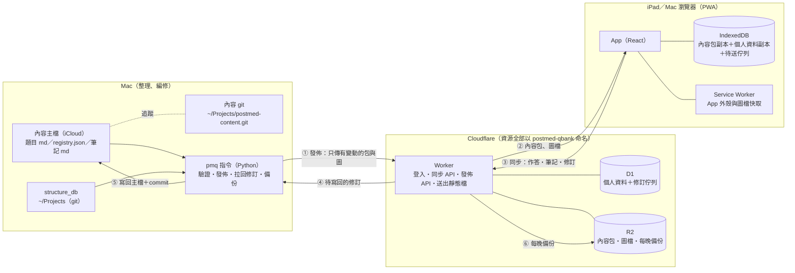
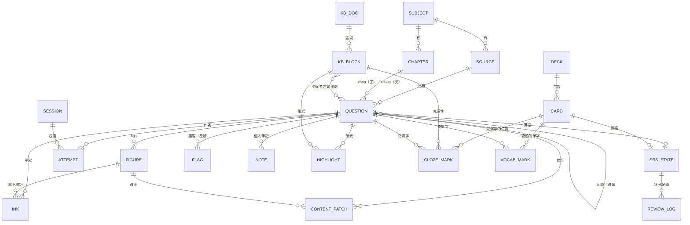

# 後醫題庫網 規格書

版本：2026-11-10 定案稿 v2（已併入使用者對 Q1–Q27 的回答；尚未實作）。專案代號 `postmed-qbank`。

**2026-11-11 增補（Fable 規劃，尚未實作）**：§9.7 圖上標記與改圖、§9.8 選字挖空與膠帶、§9.9 題目瀏覽；連帶更新 §4.6（`ink` 的用法、新表 `cloze_mark`）、§9.1、§9.4（記住上次閱讀的位置）、§9.6、§13.1、§14-7 到 §14-11。對應的階段是 [03_分階段計畫.md](03_分階段計畫.md) 的 2B、4B、5B、6、7。使用者同日已回答 §14-7、8、9、11；§9.8 的挖空與膠帶要等使用者補截圖才定案。

**2026-11-12 增補（Fable 規劃，尚未實作）**：使用者補了克漏字與膠帶的說明，並提出三件新的事。§9.8 改寫定案（克漏字、膠帶，新增遮圖卡）；新增 §9.10 所見即所得編輯與註記卡（取代「原始碼＋預覽」與側邊面板）、§9.11 英文（題組、單字、文法）；連帶更新 §4.6（`cloze_mark` 拿掉顏色、`card.fields`、新表 `vocab_mark`）、§9.1、§9.3–§9.5、§9.7、§12、§13.1、§14-10 到 §14-16。對應的階段是 [03_分階段計畫.md](03_分階段計畫.md) 的 3B、5B、5C、8A、8B、8C、9。

使用者的原始回答在 [04_待決問題.md](04_待決問題.md)；本文件是併入後的結果。實作時兩者若不一致，以本文件為準並回報。仍未定的事列在 §14，都不卡第 0–2 階段；遇到 §14 的項目或本文件沒寫到的決定，停下來問，不要自己選。

---

## 0. 現況盤點（2026-11-10 實測）

| 項目 | 數量／大小 | 位置 | 格式 |
|---|---|---|---|
| 物理題目 | 9,302 題（後醫 1,188、轉學考 1,010、教材 2,169、原文書 4,935） | `01_題庫製作/物理/02_原卷題庫/` | 每題一個 `.md`：YAML front matter ＋ `## ques`／`## idea`／`## sol` |
| 物理索引 | 9,302 列 | `01_題庫製作/物理/analysis/question_index.jsonl` | 由 `question_bank.py index` 產生 |
| 物理章節 | Ch01–Ch30 | `analysis/chapters.yaml`、`tags.yaml` | YAML |
| 物理圖 | registry 1,087 組（approved 1,081、text 5、pending 1；manual_edit 466） | `analysis/圖片審核/registry.json`、`assets/重繪/<章>/<圖ID>/traced.svg`（另有 `traced_q.svg` 題目版） | SVG，文字用 Times New Roman |
| 物理原題圖 | 1,080 檔、46 MB | `assets/原題圖/` | PNG |
| 生化題目 | 3,743 題（後西醫 1,492、後中醫 387、後獸醫 720、私醫 160、醫事國考 984） | `01_題庫製作/生化/02_原卷題庫/` | 一份考卷一個 `.md`；每題是 `ID:`／`source:`／`chap:`／`xchap:`／`ques:`／`ans:`／`sol:` 區塊 |
| 生化圖 | 444 檔、65 MB；題目裡 83 處 `` | `01_題庫製作/生化/assets/images/` | PNG |
| 生化章節 | A1–D7，33 章、437 子目 | `analysis/biochem_taxonomy.json` | JSON |
| structure_db | 分子 390、反應 220、路徑 366；SVG 1,956 檔、75 MB | 程式與資料在 `~/Projects/structure_db`（git），輸出在 `82_考題整理/structure_db/out/` | `index.json` ＋ SVG；手修版在 `data/manual/` |
| 學習筆記 | 生化＋物理現行約 60 份 `.md`（全部 229 份含封存） | `02_學習筆記/` | Markdown：標題＋巢狀列點＋表格＋``；生化筆記在句尾標考古題出處，如（中興-115-42） |
| 舊站 | `postmed-tools`（LaTeX／SVG 編輯器）、`postmed-library`（公開、圖庫與考題分析） | `web_tools/` | Cloudflare Pages |
| SVG 編輯器核心 | 一份共用檔 | `scripts/svg_editor/svg_editor.js`＋`.css` | `SvgEditor.open({svgUrl, refUrl, sol, onSave, onClose})` |

盤點時看到、會影響設計的事：

1. **物理的 `status` 是自由文字**（「書附答案與AI盲解一致」「本地推導／條件解候選」等 15 種以上），不能直接拿來當篩選條件，搬遷時要對應成固定代碼（§4.4）。
2. **物理的選項寫在 `ques` 本文裡**，有的每個選項一行，有的 `(A)…(B)…` 擠在同一行；要點選作答就得解析（§4.5）。
3. **生化 ID 不是流水號**，是 `KMU-115-01` 這種「校-年-題」。已定：ID 不動。重複的 1 個是 `KMU-111-16`：同一題在 `高醫_111_生物生化.md` 的第 1 行與第 334 行各出現一次。
4. **生化沒有任何「詳解來源／是否確認」欄位**。已定（依使用者記憶）：答案都是官方公布答案，詳解都是 Gemini Batch 產生，沒有人工逐題看過。
5. **iCloud 會把檔案卸載成 dataless**：這次掃 `assets/重繪` 的 SVG 超過兩分鐘還沒跑完。發佈工具不能每次全掃，要用雜湊快取、只讀有變動的檔案（§7.2）。
6. 這台 Mac 有 Node 22.19、pnpm、git、sqlite3；沒有全域 wrangler。

---

## 1. 五個必須決定的事：結論

### 1.1 單一資料來源

**每一種資料只有一個主檔，分兩類：**

| 資料 | 以誰為準 | 網站上的角色 |
|---|---|---|
| 題目、選項、答案、詳解、圖、章節、標籤、講義筆記（從檔案來的「內容」） | **Mac 上現有的檔案**（iCloud 裡原位不動），另加 git 追蹤歷史 | 發佈出去的唯讀副本（內容包） |
| 作答紀錄、錯題、複習排程、個人筆記、螢光筆、手寫、卡片（在網站上產生的「個人資料」） | **雲端資料庫 D1** | 各裝置的 IndexedDB 是離線副本 |

**iPad 上改的錯字寫到哪裡：** 寫進 D1 的「修訂佇列」（`content_patch`）。

1. 你在 iPad 按「編輯」改完存檔 → 產生一筆修訂，隨同步送到雲端。
2. 所有裝置立刻把這筆修訂疊在原內容上顯示，所以看起來是**馬上改好了**。
3. 在 Mac 執行 `pmq patches pull`：把修訂寫回對應的 `.md` 主檔、git commit。
4. 下次 `pmq publish` 後，修訂標成已合併，疊加層消失。
5. 如果 Mac 上同一段在這期間也被改過（雜湊對不上），這筆修訂標成「衝突」，兩個版本都留著，在 Mac 上人工選；不會自動覆蓋任何一邊。

**為什麼不以雲端資料庫當題目主檔：** 你現有的整條製作線（Python 擷取、`build_chapters`、`build_pdf`、Gemini Batch、Codex／Gemini 直接改檔、Typora 匯出）全部讀寫這些 `.md`。主檔搬上雲，這些工具都要改成「先匯出、改完再匯入」，而且會出現兩邊同時改的問題。iPad 上的編修量小（錯字、補一句詳解），用修訂佇列寫回就夠。

**為什麼不是「搬進 git、離開 iCloud」：** 題庫資料夾裡有來源 PDF 和 Typora／GoodNotes 依賴的相對路徑，搬動代價大。做法是檔案留在 iCloud，`.git` 目錄放在 iCloud 外（`~/Projects/postmed-content.git`，用 `--git-dir`／`--work-tree`），只追蹤文字檔（md、yaml、json、svg），不追蹤 PNG 和 PDF。這樣 iCloud 不會弄壞 `.git`，iCloud 產生的「檔名 2」衝突副本也會在 `git status` 現形。（使用者已同意。）

**之後若要把主檔搬出 iCloud**（使用者想解決 iCloud 讀檔慢，但還沒決定哪些要搬，見 §14-1）：所有主檔路徑只寫在一個設定檔 `tools/pmq/pmq.toml`，程式其他地方不得寫死路徑。這樣搬家只要改設定檔，網站與個人資料完全不受影響。

### 1.2 資料 schema

見 §4。重點：題目用**不變的 ID** 當唯一鍵；個人資料全部用「項目鍵」`<類型>:<ID>`（如 `q:PHY-007836`、`card:01J…`）指向內容，不複製內容；內容改版不影響個人資料。

### 1.3 刷題模式

做六種，全部做間隔複習（FSRS 演算法）。各模式要記的資料見 §5。

### 1.4 公式與圖

- 公式：**KaTeX ＋ mhchem 擴充**（`\ce{}`），在裝置上即時排版；發佈前用同一版 KaTeX 把全庫公式跑一遍，排不出來的列成清單。
- SVG：題目內用 `` 顯示（向量、可快取）；點一下開全螢幕檢視器，雙指縮放到 8 倍，縮放時改實際尺寸而不是 CSS scale，所以放大不糊。深色模式下圖一律放在白色紙卡上；純黑白的物理線稿可切換「反相」。細節見 §6。

### 1.5 備份與匯出

三層，全部是開放格式（NDJSON、Markdown、SVG、CSV），不依賴 Cloudflare 才能讀：

1. 內容：Mac 主檔＋git 歷史＋iCloud；每週把 git bundle 傳一份到 R2。
2. 個人資料：Worker 每晚把 D1 的個人資料表倒成 `backup/YYYY-MM-DD.ndjson.gz` 存 R2（保留 30 天＋每月一份）；D1 本身另有 30 天 Time Travel。
3. 整包匯出：網站「設定 → 匯出全部」下載一個 zip；Mac 上 `pmq backup pull` 抓同一包放進 `99_封存/題庫網備份/`。`pmq restore` 可以把這包灌回一個全新的 D1。

---

## 2. 其他要你判斷的事：結論

### 2.1 離線刷題：做

這個架構是「內容包下載到裝置、作答先寫在裝置、再同步」，所以離線不是另外加的功能，而是預設行為。

| | 做 | 不做 |
|---|---|---|
| 好處 | 捷運、飛機、訊號差時照常刷題；每次點選都不用等網路，手感快；斷線不會丟作答 | 程式較簡單 |
| 代價 | 要寫同步與衝突規則（§8）；iPad 要「加入主畫面」使用，否則 Safari 可能在 7 天沒開後清掉本機資料；更新版本要處理 Service Worker；實機測試項目變多 | 每題都要連線；連線中斷時那幾題的作答會遺失，除非仍然做一個暫存佇列——而那已經是離線功能的一半 |

限制要先知道：iPad 的 Safari 沒有背景同步，同步只在 App 開著時發生（開啟、回到前景、恢復連線、每 60 秒）。Safari 分頁和主畫面 App 的儲存空間是分開的，請固定用主畫面版本。

### 2.2 Apple Pencil 手寫：可以做，排在第 6 階段

每題下方一塊可展開的手寫區，用 Pointer Events 讀筆的壓力，只有筆會畫、手指仍然是捲動。存的是向量筆畫（不是圖片），一頁通常 5–100 KB，跟著同步。物理題每次重做時清空，其他科永久保存；暫不做匯出。細節 §9.6。

### 2.3 SVG 編輯器：整合進新站，但核心不分叉

- 放在新站的 `/tools/svg`，進入時才載入；題目圖旁邊多一個「✎ 編輯圖」。
- 同一個網域的好處：一次登入、iPad 上只有一個主畫面 App；改好的圖可以走同一條修訂佇列寫回 `assets/重繪/…/traced.svg`（registry 標 `manual_edit`）或 structure_db 的 `data/manual/`。
- 核心仍然只有 `scripts/svg_editor/` 那一份，新站在建置時複製進來，不另改一份。Mac 上的 `serve.py`（8766）和 `sdb serve` 照舊可用。
- 舊站 `postmed-tools` 的草稿存在那個網域的 IndexedDB，換網域後看不到。使用者已確認那些草稿都用不到，不需要搬；新站確認可用後就刪舊站。

### 2.4 平台與費用

- **全部放 Cloudflare：一個 Worker（含靜態檔）＋ D1 ＋ R2。不用 Supabase，不用 Pages。**
  - 你的帳號已經付了 Workers Paid 和 R2 Paid，這個專案的用量（一個人）遠低於內含額度，預期**新增月費 0**。
  - 不用 Supabase：免費方案閒置一週會暫停、多一個平台要備份和管理，而 D1 已經夠用。
  - 不用 Pages：現有 token 沒有 Pages 權限，而且 Worker 的靜態檔功能可以在送出每個檔案前先檢查登入。
- **擋外人：Worker 內建單一密碼登入**，不用 Cloudflare Access。理由：Access 要動帳號層級的 Zero Trust 設定（和護理站同一個帳號），而且它的轉址登入和離線 PWA、Service Worker 互相干擾。單一密碼的做法見 §10。（使用者已同意。）
- **與護理國考網站同一個 Cloudflare 帳號**（使用者已決定），照 §11 的硬性規則做。護理站目前 R2 用 927.51 MB、沒有用 D1（2026-11-10 使用者提供）。
- 月費上限是新台幣 160 元；網址先用 workers.dev。

### 2.5 iPad 與電腦功能完全一致

網站不分辨「這是 iPad 還是電腦」，兩邊是同一份程式、同一組功能（包含所有編輯功能）。差別只有兩個，都由 CSS 自動判斷：

- **畫面寬度**：寬的時候導覽在左側，窄的時候在底部。
- **輸入方式**：觸控時按鈕與間距放大、支援滑動；有鍵盤時多了快捷鍵。

不得做「只有電腦版才有」或「只有 iPad 才有」的功能；唯一的例外是 Apple Pencil 手寫（電腦上可檢視，用滑鼠也能畫）。iPhone 只要求能正常瀏覽，不特別最佳化。

---

## 3. 架構



資料流向只有這六條。內容只會從 Mac 流向網站（①②），唯一的回流是修訂佇列（④⑤）。

### 3.1 技術選型

| 層 | 選擇 | 理由 |
|---|---|---|
| 前端 | React＋TypeScript＋Vite，單頁 App | 實作模型最熟、最不容易走偏；單頁才能離線 |
| 樣式 | CSS 變數當設計代碼＋Tailwind | 深淺色靠變數切換 |
| 本機資料 | IndexedDB，用 Dexie；畫面用 `useLiveQuery` | iPad Safari 上最成熟；不用瀏覽器內 SQLite（Safari 的檔案系統 API 仍有坑） |
| Markdown | markdown-it（表格、`==螢光==`）＋DOMPurify 白名單（`img` 的 `src/width/alt`、`u`、`sub`、`sup`、`br`、`table` 系列、`span`） | 現有 md 就是這些語法 |
| 公式 | KaTeX＋mhchem | §6.1 |
| 複習排程 | `ts-fsrs` | FSRS 是 Anki 現行演算法，之後匯入匯出 Anki 才對得上 |
| 手寫 | Pointer Events＋`perfect-freehand` | 向量筆畫、有壓力感 |
| 後端 | Cloudflare Worker＋Hono | 只有登入、同步、發佈、備份四件事 |
| 資料庫 | D1（SQLite） | 帳號已含；可整份匯出成 SQLite |
| 檔案 | R2，物件以內容雜湊命名、永不覆寫 | 發佈只傳新雜湊 |
| Mac 工具 | Python 指令 `pmq`（PyYAML、jsonschema；Anki 另需 zstandard） | 與現有製作工具同語言，可直接重用 `scripts/物理/naming.py` 等 |
| 內容契約 | `schema/*.json`（JSON Schema）＋共用測試案例 | Python 和 TypeScript 兩邊跑同一批案例 |

### 3.2 專案位置與磁碟預算

```
~/Projects/postmed-qbank/        # git；不放 iCloud
  app/        前端
  worker/     Worker 與 D1 migrations
  tools/pmq/  Python 指令
  schema/     內容契約與共用測試案例
  docs/       這四份文件的副本
```

| 項目 | 上限 | 做法 |
|---|---|---|
| `node_modules` | 400 MB | 用 pnpm；相依套件只裝 §3.1 列的 |
| 前端建置成品 `dist/` | 20 MB（不含 LaTeX 工具的 MathJax 字型） | 不產生 zip |
| 發佈時的暫存 | 0（常態） | 內容包在記憶體裡組好直接上傳；圖檔從原位讀、直接傳 |
| 雜湊快取 | < 5 MB | `~/Library/Caches/postmed-qbank/hashes.json` |
| 內容 git | 預估 < 150 MB | 只追蹤文字檔 |

所有指令在動手前先看 `df`，剩餘空間低於 2 GB 就停止並說明（沿用舊站 `build.py` 的規則）。

---

## 4. 資料 schema

### 4.1 內容包（發佈到 R2，唯讀）

```
c/manifest.json                     目前版本：各檔的雜湊、題數、產生時間
c/taxonomy-<hash>.json              科目、章節樹、來源清單
c/index/<SUBJECT>-<hash>.json       該科所有題目的篩選用欄位（不含本文）
c/pack/<SUBJECT>/<章>-<hash>.json   題目本文，一章一包
c/kb/<SUBJECT>/<doc>-<hash>.json    講義筆記，一份一包（第 4 階段）
c/fig/<庫>-<hash>.json              圖庫索引（物理 registry、structure_db）
a/<sha256>.<副檔名>                 圖檔，永久快取
```

`manifest.json` 是唯一會被覆寫的檔；其他檔名含雜湊，內容沒變就不重傳、裝置也不重新下載。

### 4.2 科目、章節、來源

```jsonc
// taxonomy
{
  "subjects": [
    {"id": "PHY", "name": "物理", "id_pattern": "^PHY-\\d{6}$"},
    {"id": "BCH", "name": "生化", "id_pattern": "^[A-Z]+-[0-9A-Za-z-]+$"}   // 沿用現有 ID（KMU-115-01），不改流水號；顯示照寫「高醫 115 01｜KMU-115-01」
    // 之後加 CHE、BIO、ENG：只要加一筆、寫一個轉接器、給章節樹
  ],
  "chapters": [
    // id 全站唯一 = <科目>:<原代碼>；parent 形成樹
    {"id": "PHY:Ch15", "subject": "PHY", "parent": "PHY:磁學", "title": "電磁感應", "order": 15},
    {"id": "BCH:A1-1-1", "subject": "BCH", "parent": "BCH:A1-1", "title": "通用結構與 α-碳特性", "order": 1}
  ],
  "source_kinds": [
    // 可擴充；題目的 source.kind 只能用這裡登記過的
    {"id": "postmed_w", "name": "後西醫"}, {"id": "postmed_c", "name": "後中醫"},
    {"id": "postmed_v", "name": "後獸醫"}, {"id": "private_med", "name": "私醫"},
    {"id": "transfer", "name": "轉學考"}, {"id": "national", "name": "醫事國考"},
    {"id": "textbook", "name": "原文書"}, {"id": "cram", "name": "補習班教材"},
    {"id": "ai", "name": "AI 生成"}, {"id": "self", "name": "自編"}
  ],
  "sources": [
    // 一份考卷或一本書的一個單元
    {"sid": "PHY-SRC-000028", "subject": "PHY", "kind": "postmed_w", "school": "高醫", "year": 115,
     "paper": "物理化學", "book": null, "unit": null, "count": 45}
  ]
}
```

### 4.3 題目

```jsonc
{
  "id": "PHY-007836",                 // 不變的唯一鍵
  "subject": "PHY",
  "label": "特訓班2 正課班作業十四 Q5",  // 顯示時固定寫成「label｜id」
  "source": {"sid": "PHY-SRC-000050", "kind": "cram", "school": null, "year": null,
             "paper": null, "book": "特訓班2", "unit": "正課班作業十四", "qno": "5"},
  "alt_sources": [                    // 同題的其他出處（物理 all_sources／related）
    {"id": "PHY-000917", "label": "高醫 109 37", "relation": "same"}   // same｜adapted
  ],
  "canonical": "PHY-000917",          // 同題群組的代表題；沒有同題就等於自己
  "chap": "PHY:Ch15",                 // 主要章節，只有一個
  "xchap": [],                        // 次要章節（生化 xchap）
  "tags": {"topic": ["動生電動勢"], "type": ["非選擇題"], "method": ["運動回路磁通"]},
  "qtype": "single",                  // single｜multi｜text｜numeric
  "group": null,                      // 題組：{"gid": "…", "stem": "共用題幹 md", "order": 2}
  "ques": "題幹與選項的原始 Markdown（與主檔一字不差）",
  "opt": [["A", 212, 230], ["B", 231, 260]],  // 選項在 ques 裡的起訖位置；解析不出來就是 null
  "answer": {
    "mode": "single",                 // single｜all｜any｜text｜numeric｜pending（沿用物理 ans.mode）
    "keys": ["C"],                    // 選擇題
    "text": null,                     // 非選擇題的答案文字
    "trust": "key",                   // official｜key｜teacher｜ai｜pending（§4.4）
    "ai_agree": true,                 // 兩道 AI 盲解一致
    "note": ""
  },
  "source_answer": null,              // 教材原答與現行答案不同時，原答另存（物理 source_answer）
  "idea": "解題思路 md（生化沒有，為空字串）",
  "sol": "詳解 md",
  "sol_meta": {
    "origin": "ai",                   // official｜teacher｜ai｜human｜mixed
    "model": "gemini-3.8-flash",      // origin 含 ai 時
    "human_verified": false,          // 使用者本人修訂過答案或詳解，或手動標為已確認，才是 true（§4.4）
    "verified_at": null,
    "issues": ["零電動勢需 BA 恆定…"], // 物理 status.issues
    "raw": {"question": "…", "answer": "…", "solution": "…"}  // 原 status 文字原樣保留
  },
  "figs": [
    {"fid": "F2ca6a0de79", "role": "q",        // q｜sol
     "src": "a/<sha>.svg", "w": 286, "h": 197, "mono": true,
     "fallback": "a/<sha>.png", "alt": "原題圖"}
  ],
  "extraction": "pdf_text",
  "h": {"ques": "<sha1>", "idea": "<sha1>", "sol": "<sha1>"}  // 各欄位雜湊，修訂寫回時比對用
}
```

`ques`／`idea`／`sol` 裡的圖一律改寫成 ``；裝置依 `figs` 找到檔案。主檔裡的原始路徑不動。

索引檔（`c/index/…`）每題只留：`id, label, sid, kind, school, year, chap, xchap, tags, qtype, has_fig, trust, human_verified, pack, canonical`。篩選、計數、出題都只靠索引，本文按需從包裡取。

### 4.4 「詳解來源／是否已人工確認」的對應規則

**物理**（依序判斷，先中先停）：

| 條件 | `answer.trust` |
|---|---|
| `ans.provenance` 有 `kind: official` | `official` |
| 有 `kind: annotated`（答案表、書附答案） | `key` |
| 有 `kind: tutor`，或有 `source_answer.kind: teacher_solution` 且與現行答案相同 | `teacher` |
| `ans.mode: pending` | `pending` |
| 其他 | `ai` |

- `ai_agree` = `round2_verification.state` 含「兩道AI一致」，或 `status.answer` 以「書附答案與AI盲解一致」開頭。
- `sol_meta.origin`：`origin` 有 `teacher_solution` 且詳解是老師原解轉錄 → `teacher`；老師核心式＋AI 補寫 → `mixed`；其餘 → `ai`。
- `human_verified`：**搬遷時全部設 `false`**。現有「已驗證」305 題的審查者是 `independent_agent`（AI），不算人工。（使用者已同意。）
- 對應不到任何一條的 `status` 字串：列進驗證報告，設 `trust: ai`，不擋發佈。

**生化**：全部設 `answer.trust: official`、`sol_meta.origin: ai`、`human_verified: false`。這是依使用者的記憶，第 0 階段要抽 20 題（每個來源類別 4 題）對照 `01_來源索引/` 的答案確認；有不符就回報，不自行改標。

**使用方式的前提**（使用者說明）：不會逐題確認；預設把內容當成正確的，只有讀到和自己認知不同時才去修正。所以：

- 介面**不顯示「未確認」字樣**（否則每一題都有警告，等於沒有資訊）。只顯示來源徽章；`human_verified` 為 true 時才多顯示「✓ 已確認」。設定頁有開關可改成兩種都顯示。
- `human_verified` 變成 true 的兩個途徑：(1) 使用者修訂了該題的答案或詳解——存檔時自動一併標記；(2) 題目 ⋯ 選單裡手動按「標為已確認」。
- 兩者都走修訂佇列（欄位 `human_verified`）→ `pmq patches pull` 寫回主檔（物理：front matter 加 `human_review: {date, by: user}`；生化：加一行 `verified: 2026-11-10`）→ 下次發佈後 `human_verified: true`。
- 出題設定可用「已確認／未確認」篩選。
- 覺得有問題但還沒空改的題目，用「存疑」標記（`flag.doubt`），之後可篩出來集中處理。

### 4.5 選項解析（Python 與 TypeScript 必須一致）

需要兩邊都有：發佈時 Python 算 `opt` 並出報告；裝置上有人改了 `ques`（修訂疊加）時 TypeScript 要重算。

規則：

1. 在 `ques` 裡找標記 `(A)`…`(H)` 或全形 `（A）`；標記前面必須是行首、空白或全形標點，後面不是 `)`。`$…$` 與 `$$…$$` 範圍內的不算。
2. 必須從 A 開始、字母連續、至少 2 個，否則 `opt = null`。
3. 同一串字母出現兩輪（題幹先引用 `(A)`、後面才是選項）時，取**最後一輪**完整序列。
4. 每個選項的範圍從標記後到下一個標記前（去頭尾空白）；最後一個選項到該段落結束，後面若還有圖或文字，歸題幹的「選項後補充」，顯示在選項下方。
5. `answer.mode` 是 `text`／`numeric`／`pending`，或 `opt = null` → 以「自評題」顯示（§5.1）。

`schema/fixtures/options.json` 放至少 40 個案例（含同行多選項、選項內有公式、選項是圖、題幹引用選項字母、全形括號），兩邊測試都要全過。發佈報告列出 `answer.mode` 是選擇題但 `opt = null` 的題目。

### 4.6 個人資料（D1；裝置上有相同的表）

所有表都有 `seq`（伺服器給的遞增序號，同步用）。標「只增」的表永不修改、永不刪除；其他表以 `updated_at` 較新者為準，刪除用 `deleted = 1` 標記。

```sql
-- 作答：只增
CREATE TABLE attempt (
  id TEXT PRIMARY KEY,            -- ULID，裝置產生
  item TEXT NOT NULL,             -- 'q:PHY-007836'
  session_id TEXT,
  mode TEXT NOT NULL,             -- practice｜wrong｜review｜exam
  chosen TEXT,                    -- JSON：["C"]；自評題為 null
  correct INTEGER,                -- 1｜0；自評題由你按「對／錯」
  confidence INTEGER,             -- 1 猜的｜2 普通｜3 很確定
  elapsed_ms INTEGER,
  content_h TEXT,                 -- 當時題目 ques 的雜湊（之後題目改過也查得出當時版本）
  device TEXT NOT NULL,
  created_at INTEGER NOT NULL,    -- 毫秒
  seq INTEGER
);

-- 一次刷題或一場模擬考
CREATE TABLE session (
  id TEXT PRIMARY KEY, mode TEXT NOT NULL,
  filter TEXT NOT NULL,           -- JSON：科目、章節、來源、年份、學校、狀態、題數、順序
  items TEXT NOT NULL,            -- JSON：題目 ID 順序（續做用）
  cursor INTEGER NOT NULL DEFAULT 0,
  started_at INTEGER NOT NULL, ended_at INTEGER,
  time_limit_s INTEGER, score REAL,   -- 模擬考
  device TEXT NOT NULL, updated_at INTEGER NOT NULL, deleted INTEGER DEFAULT 0, seq INTEGER
);

-- 複習排程（可由 review_log 重算）
CREATE TABLE srs_state (
  item TEXT PRIMARY KEY,          -- 'q:…' 或 'card:…'
  due INTEGER NOT NULL, stability REAL, difficulty REAL,
  reps INTEGER, lapses INTEGER, state INTEGER,   -- ts-fsrs 的 Card 欄位
  last_review INTEGER, suspended INTEGER DEFAULT 0,
  updated_at INTEGER NOT NULL, seq INTEGER
);

-- 每次複習的評分：只增
CREATE TABLE review_log (
  id TEXT PRIMARY KEY, item TEXT NOT NULL,
  rating INTEGER NOT NULL,        -- 1 Again｜2 Hard｜3 Good｜4 Easy
  state_before INTEGER, elapsed_days REAL, scheduled_days REAL,
  duration_ms INTEGER, attempt_id TEXT,
  device TEXT NOT NULL, reviewed_at INTEGER NOT NULL, seq INTEGER
);

-- 標記：錯題、星號、存疑、已掌握
CREATE TABLE flag (
  item TEXT NOT NULL, kind TEXT NOT NULL,   -- wrong｜star｜doubt｜mastered
  value INTEGER NOT NULL,                   -- 1｜0
  updated_at INTEGER NOT NULL, seq INTEGER,
  PRIMARY KEY (item, kind)
);

-- 個人筆記（掛在題目、筆記區塊或卡片上）
CREATE TABLE note (
  id TEXT PRIMARY KEY, target TEXT NOT NULL,  -- 'q:PHY-…'｜'kb:<doc>#<bid>'
  body_md TEXT NOT NULL,
  updated_at INTEGER NOT NULL, deleted INTEGER DEFAULT 0, seq INTEGER
);

-- 螢光筆與註記
CREATE TABLE highlight (
  id TEXT PRIMARY KEY, target TEXT NOT NULL,  -- 'q:PHY-…/sol'｜'kb:<doc>#<bid>'
  quote TEXT NOT NULL, prefix TEXT, suffix TEXT,   -- 被標的字與前後各 32 字：內容改版後靠這個重新定位
  start INTEGER, end INTEGER,                      -- 當時的字元位置（加速用）
  color TEXT NOT NULL, comment_md TEXT,
  updated_at INTEGER NOT NULL, deleted INTEGER DEFAULT 0, seq INTEGER
);

-- 手寫（題目下方的手寫區 §9.6）與圖上標記（§9.7）共用這張表
CREATE TABLE ink (
  id TEXT PRIMARY KEY,            -- 'ink:' + target + '#' + page（同一個對象同一頁只有一列，兩台裝置不會各建一列）
  target TEXT NOT NULL,           -- 手寫區：'q:PHY-007836'
                                  -- 圖上標記：'q:PHY-007836/fig:<fid>@q'（@q 題目版｜@sol 解答版）
                                  --           'kb:<doc>/fig:<fid>'｜'card:<id>/m:<sha>'
  page INTEGER NOT NULL DEFAULT 0,   -- 圖上標記固定 0
  strokes BLOB NOT NULL,          -- 壓縮後的筆畫 JSON（同步走 JSON，所以存成 deflate＋base64 的字串），單頁上限 1 MB
                                  -- 內容：{v:1, src:"a/<sha>.svg", strokes:[{tool:"pen"|"hl", color, size, pts:[[x,y,壓力],…]}]}
                                  -- tool 之後可擴充（例如圖上膠帶），讀到不認得的 tool 要略過、不可丟掉
  w INTEGER, h INTEGER,           -- 座標空間：手寫區是畫布大小；圖上標記是那張圖的 w × h（figs 裡的值），不是螢幕像素
  updated_at INTEGER NOT NULL, deleted INTEGER DEFAULT 0, seq INTEGER
);

-- 修訂佇列（iPad 改內容）
CREATE TABLE content_patch (
  id TEXT PRIMARY KEY,
  target TEXT NOT NULL,           -- 'q:PHY-007836'｜'kb:<doc>#<bid>'｜'fig:<fid>'
  field TEXT NOT NULL,            -- ques｜idea｜sol｜answer｜chap｜tags｜human_verified｜block｜insert_after｜delete｜svg｜svg_q
                                  -- svg＝完整版（traced.svg、structure_db 的圖）；svg_q＝物理的題目版（traced_q.svg）。§9.7
  base_h TEXT NOT NULL,           -- 改之前該欄位的雜湊
  value TEXT NOT NULL,            -- 新內容（svg 則是 R2 鍵）
  status TEXT NOT NULL,           -- pending｜merged｜conflict｜rejected
  note TEXT, device TEXT NOT NULL,
  created_at INTEGER NOT NULL, updated_at INTEGER NOT NULL, seq INTEGER
);

-- 卡片（第 5 階段；Anki 匯入、自建、由題目或筆記轉成）
CREATE TABLE deck (id TEXT PRIMARY KEY, name TEXT NOT NULL, subject TEXT, parent TEXT,
                   updated_at INTEGER NOT NULL, deleted INTEGER DEFAULT 0, seq INTEGER);
CREATE TABLE card (
  id TEXT PRIMARY KEY, deck_id TEXT NOT NULL,
  kind TEXT NOT NULL,             -- basic｜reverse｜cloze｜occlusion（遮圖卡，5C）｜vocab（單字卡，8B）
                                  -- occlusion：front_md 是 Anki 內建遮圖卡的寫法（{{c1::image-occlusion:rect:…}} 加一張圖），§9.8
  front_md TEXT NOT NULL, back_md TEXT NOT NULL,
  fields TEXT,                    -- 8B 新增（migration 0003）。JSON：有欄位的卡（vocab）的各欄位 Markdown；
                                  -- 有值時以它為準，front_md／back_md 由它產生。其他種類是 NULL
  tags TEXT,                      -- JSON
  origin TEXT,                    -- JSON：{"from":"anki","guid":"…","model":"…","ord":0}｜{"from":"q","id":"PHY-…"}｜{"from":"kb",…}
  updated_at INTEGER NOT NULL, deleted INTEGER DEFAULT 0, seq INTEGER
);
CREATE TABLE media (sha TEXT PRIMARY KEY, mime TEXT, bytes INTEGER, created_at INTEGER, seq INTEGER);  -- 檔案本體在 R2 m/<sha>

-- 克漏字（第 5B 階段，§9.8；migration 0002）：筆記或題目內文上被挖成克漏字的一段字，對應克漏字卡的一個編號。
-- 卡片本身仍是普通的克漏字卡（card.front_md 裡的 {{cN::…}}）；這張表只記「它在原文的哪裡」。
-- 膠帶顏色不存：由那張卡的複習紀錄算出來（沒錯過藍、錯 1 次橘、2 次以上紅）。
CREATE TABLE cloze_mark (
  id TEXT PRIMARY KEY,
  target TEXT NOT NULL,           -- 同 highlight：'kb:<doc>#<bid>'｜'q:PHY-…/sol'｜'q:PHY-…/idea'（題幹不能挖）
  quote TEXT NOT NULL, prefix TEXT, suffix TEXT,   -- 定位方式與 highlight 完全相同（共用同一個函式）
  start INTEGER, end INTEGER,
  note TEXT NOT NULL,             -- 卡片那一則筆記的鍵（＝card.origin.note）；同一個區塊（題目則是同一段）的挖空共用一則
  n INTEGER NOT NULL,             -- 克漏字編號 1、2…；同號一起遮、是同一張卡
  hint TEXT,                      -- 提示（{{c1::答案::提示}}）
  updated_at INTEGER NOT NULL, deleted INTEGER DEFAULT 0, seq INTEGER
);

-- 查過的單字（第 8B 階段，§9.11；migration 0003）：做題時在哪裡查了哪個字、連到哪張單字卡。
-- 「這個字出現在哪些題目」是內容包裡的索引（pmq 算的），不在這張表；這張表只記使用者自己的查詢與手動連結。
CREATE TABLE vocab_mark (
  id TEXT PRIMARY KEY,
  lemma TEXT NOT NULL,            -- 原形（小寫）
  card TEXT,                      -- 連到的單字卡 ID；還沒有卡時是 NULL
  target TEXT NOT NULL,           -- 'q:ENG-000058/ques'｜'g:<gid>'（題組的文章）｜'kb:<doc>#<bid>'
  quote TEXT NOT NULL, prefix TEXT, suffix TEXT,   -- 定位方式與 highlight 相同
  start INTEGER, end INTEGER,
  kind TEXT NOT NULL,             -- lookup（查過）｜link（手動連到現有的卡）
  updated_at INTEGER NOT NULL, deleted INTEGER DEFAULT 0, seq INTEGER
);

CREATE TABLE setting (key TEXT PRIMARY KEY, value TEXT NOT NULL, updated_at INTEGER NOT NULL, seq INTEGER);

-- 不同步的伺服器表
CREATE TABLE auth_session (token_hash TEXT PRIMARY KEY, label TEXT, created_at INTEGER, last_seen INTEGER, expires_at INTEGER);
CREATE TABLE auth_fail (at INTEGER NOT NULL);
CREATE TABLE meta (key TEXT PRIMARY KEY, value TEXT);   -- sync_seq、目前 manifest 雜湊
```

### 4.7 關聯一覽



資料表的改動都是只增不改（2026-11-12 規劃；這就是分階段計畫所說「改資料庫欄位前的那一次討論」）：`0002` 新增 `cloze_mark`（5B）；`0003` 在 `card` 加一個可以是空的欄位 `fields`、新增 `vocab_mark`（8B）。遮圖卡不需要改表。每次跑 migration 前先備份，跑完核對既有各表的筆數與內容不變。

左半（SUBJECT 到 KB_BLOCK）在內容包裡，右半在 D1。兩邊只靠 ID 字串相連，沒有外鍵；題目被下架時個人資料留著，介面顯示「此題已下架」。

---

## 5. 刷題模式

### 5.1 作答流程（各模式共用）

- **選擇題**：點選項 →（複選題再按「送出」）→ 立刻顯示對錯與正解 → 答對時出現三顆小鈕「猜的／普通／很確定」（可不按，預設普通）→ 展開思路與詳解。
- **自評題**（非選擇、選項解析失敗）：按「顯示答案」→ 自己按「對／錯」。
- 詳解區固定顯示來源徽章：答案的 `官方答案`／`答案表`／`老師`／`AI`，詳解的 `老師詳解`／`AI 詳解`；已確認的題目多一個 `✓ 已確認`（顯示規則見 §4.4）；`sol_meta.issues` 有內容時顯示「⚠ 疑點」可展開。
- 每題記一筆 `attempt`；同一題在同一場重答，再記一筆。

### 5.2 模式與要記的資料

| 模式 | 題目怎麼選 | 寫入 | 讀取 |
|---|---|---|---|
| **自訂刷題** | 科目 → 來源類別／學校／年份／書與單元／章節／標籤，再加狀態（沒做過、做錯過、有星號、已確認詳解…）、題數、順序（原順序／隨機） | `session`（篩選條件與題目順序）、`attempt` | 索引、`attempt`（算「沒做過」） |
| **原卷模擬** | 選一份考卷（學校×年份）；可計時；交卷前不顯示答案 | `session`（`time_limit_s`、`score`）、`attempt`（`mode=exam`） | 同上 |
| **錯題重練** | `flag.wrong = 1` 的題目，可再套科目／章節 | `attempt`、`flag` | `flag`、`attempt` |
| **今日複習** | `srs_state.due ≤ 現在` 的題目與卡片，依到期時間 | `attempt`、`review_log`、`srs_state` | `srs_state` |
| **弱點章節** | 依各章答對率與作答數排序，挑一章進自訂刷題 | 同自訂刷題 | `attempt` 彙總 |
| **續做** | 未結束的 `session` | `session.cursor` | `session` |

出題設定的預設值：來源類別只勾後醫（使用者以後醫題目為主）；原文書、AI 生成預設不勾。上次用的條件會記住。

### 5.3 錯題規則

- 答錯 → `flag(wrong)=1`，並自動加入間隔複習。
- 離開錯題本：之後在**不同日**連續答對 2 次，或手動按「已掌握」（`flag(mastered)=1`）。
- 「猜對」（`confidence=1`）不算答對次數。
- **粗心錯不追蹤**：答錯後的結果區有一顆「粗心錯，不追蹤」。按下後這題不進錯題本、也不進複習排程（`flag.wrong = 0`、`srs_state.suspended = 1`）；作答紀錄本身照樣記為答錯。之後可在單題頁的 ⋯ 選單恢復。這個功能的細節使用者說之後再調整，先做成這樣。

### 5.4 間隔複習

- 演算法 FSRS，目標記憶率預設 0.90，可在設定調。
- 進入排程的時機：答錯自動加入（可用 §5.3 的「粗心錯，不追蹤」取消）；任何題目可手動「加入複習」；卡片建立即加入。
- 每日上限沿用 Anki 預設：複習 200、新卡 20；設定頁可改。
- 評分對應：答錯 → Again；答對且「猜的」→ Hard；答對 → Good；答對且「很確定」且用時低於該題型中位數一半 → Easy。卡片則直接顯示四顆評分鈕。
- `review_log` 只增，所以排程參數之後可以重新最佳化，`srs_state` 可以整個重算。
- 選項順序**先不打亂**。使用者其實偏好打亂，但條件是不增加製作難度；它確實會增加，原因有兩個：詳解大量引用選項字母（「(A) 正確：…」），以及要辨識「(A)與(B)」這類互相引用的選項，漏判一題就會出現壞題。列入日後待辦，屆時的做法是「只打亂顯示順序、選項仍標原本的字母」（詳解不用改），並對含有選項互相引用字樣的題目自動略過。
- 同題群組（`canonical` 相同）共用一個排程：複習時出代表題，其他同題視為已複習。

---

## 6. 公式與圖

### 6.1 公式

- 分隔符：`$…$` 行內、`$$…$$` 獨立；化學式用 `\ce{…}`（mhchem）。現有生化題目多用 Unicode 上下標（CO₂、NAD⁺），原樣顯示，不轉換。
- KaTeX 設定：`throwOnError: false`、`strict: "ignore"`；排版失敗時顯示原始碼加紅色底線，不讓整題壞掉。
- `pmq check math`：用 Node 跑與前端同版的 KaTeX，把全庫每個公式排一次，輸出失敗清單（題目 ID＋公式原文＋錯誤訊息）。第 0 階段要先跑出這份清單；若有 KaTeX 不支援的寫法，在主檔修正或加巨集表（`schema/katex-macros.json`，前端與檢查工具共用）。
- 長公式與寬表格外包一層可橫向捲動的容器，不撐破版面。
- 現有 LaTeX 編輯器（MathLive＋MathJax）是「製作公式圖片」的工具，原樣搬到 `/tools/latex`，和題目顯示用的 KaTeX 互不相干。

### 6.2 SVG

| 問題 | 做法 |
|---|---|
| 清晰度 | 題目內用 ``，寬度 = min(容器寬, 原始寬 × 1.6)；1.6 倍沿用全冊 PDF 的設定。 |
| 放大 | 點圖開全螢幕檢視器：雙指縮放（1–8 倍）、拖曳、雙擊還原。縮放時改 `` 的實際寬高並用捲動定位，不用 CSS `transform: scale`（Safari 會把放大後的向量圖當點陣圖拉伸而變糊）。 |
| 深色模式 | 圖一律放在白色圓角紙卡上。`mono: true`（發佈時檢查 SVG 只用到黑、白、灰）的圖，檢視器提供「反相」切換並記住選擇。彩色的生化路徑圖不反相。 |
| 字型 | 物理 SVG 用 Times New Roman（iPad 與 Mac 內建）。用 `` 載入的 SVG 抓不到網頁字型，所以發佈時檢查：SVG 裡的 `font-family` 必須在白名單（Times New Roman、Times、Helvetica、Arial、serif、sans-serif），否則列入報告。structure_db 的字若是外框路徑則不受影響。 |
| 題目版與解答版 | 物理 registry 有 `traced_q.svg`（題目版，不含受力箭頭等）時：題幹用題目版，詳解用完整版 `traced.svg`。 |
| 沒有 SVG 的圖 | 用 `fallback` 的 PNG（物理原題圖、生化圖）；生化 `` 換算成 px（1 cm = 37.8 px）當最大寬度。 |
| 檔案大小 | 發佈時不改寫 SVG 內容（保持與主檔相同，編輯器才能回寫）；傳輸靠 Worker 的壓縮。單檔超過 500 KB 列入報告。 |

---

## 7. Mac 指令 `pmq`

### 7.1 指令

| 指令 | 作用 |
|---|---|
| `pmq check` | 讀全部主檔、轉成內容契約、驗證；只出報告，不上傳、不改任何主檔 |
| `pmq check math` | §6.1 |
| `pmq publish [--subject PHY]` | 驗證通過後上傳有變動的包與圖，最後換 manifest |
| `pmq patches list` / `pull` / `resolve <id>` | 看修訂佇列／寫回主檔並 commit／處理衝突 |
| `pmq backup pull` | 下載個人資料整包到 `99_封存/題庫網備份/`，只留最近 8 份 |
| `pmq restore <zip>` | 灌回指定的 D1（預設拒絕非空的資料庫） |
| `pmq anki inspect <檔>` / `import <檔>` / `export <deck>` | 第 5 階段；`inspect` 只讀，列出牌組、卡片數、樣板、媒體大小 |
| `pmq usage` | 列出本專案 D1 大小、R2 用量、近 30 天請求數（§11） |

### 7.2 發佈規則

1. **主檔唯讀**：`check` 與 `publish` 絕不寫入 `01_題庫製作/`、`02_學習筆記/`、`structure_db/`。只有 `patches pull` 會寫主檔，而且寫之前該檔必須沒有未 commit 的變更。
2. **轉接器**：每科一個（`adapters/physics.py`、`adapters/biochem.py`），輸出同一份內容契約。物理的 `label` 沿用現有 `web_tools/library/physics_catalog.py` 的 `source_label()` 規則（由主檔檔名推得：`高醫_115_01` → `高醫 115 01`；`特訓班2_先修作業二_05` → `特訓班2 先修作業二 Q5`），把這個函式連同測試搬進 `pmq`，確保「來源｜ID」寫法與現在的圖庫一致。新科目 = 新增一個轉接器＋ `taxonomy` 一筆。
3. **雜湊快取**：以（路徑、大小、修改時間）當鍵快取 sha256；沒變的檔不重讀，避免觸發 iCloud 下載。
4. **圖檔挑選**：物理只傳 registry 裡 `status: approved` 的 `traced.svg`／`traced_q.svg`（`reuse_of` 指向主圖）；`manual_edit` 的圖照傳、不重繪；`status: text` 的不當圖。題目引用了圖但 registry 沒有通過的 SVG → 傳原題圖 PNG 當 `fallback`。structure_db 以 `data/manual/` 的手修版優先。
5. **上傳走 Worker 的管理 API**（`PUT /api/admin/blob/<key>`，Bearer 管理金鑰），不用 Cloudflare API token，也不用 R2 的 S3 金鑰。先 `POST /api/admin/have` 問哪些雜湊已存在，只傳沒有的。
6. **換版是原子的**：所有檔案傳完才 `POST /api/admin/manifest`；中途失敗，線上仍是舊版。
7. **擋發佈的錯誤**：ID 重複（兩筆內容完全相同時只取一筆並警告，不擋）、ID 不符科目格式、`chap` 不在章節樹、JSON Schema 不過、圖檔讀不到。**只警告**：選項解析失敗、status 對應不到、公式排版失敗、SVG 字型不在白名單。
8. 舊的包與圖不立刻刪；`pmq publish --prune` 刪除超過 30 天且不在最近 3 版 manifest 裡的 `c/` 物件。`a/` 圖檔只在明確指定時清理。

### 7.3 修訂寫回

- 物理：找到該 ID 的 `.md`，只替換對應區段（`## ques`／`## idea`／`## sol` 的本文，或 front matter 的單一鍵），其餘位元組不動。寫 front matter 時不可整份重新序列化（會改掉鍵的順序與 YAML 錨點如 `&id001`）；只做該鍵的行級替換。
- 生化：在 `02_原卷題庫/` 的考卷檔裡找到 `ID: <id>` 的區塊，只替換對應欄位的行範圍。**`03_分章題庫/` 一律不動**（使用者產分章 PDF 要用）。因此網站上的修訂不會自動出現在分章 PDF；`pmq patches pull` 結束時列出這次改到的生化題 ID，讓使用者決定要不要手動同步到分章檔。
- 筆記：替換該區塊的行範圍。
- 圖：把 R2 上的新 SVG 寫到 `assets/重繪/<章>/<fid>/traced.svg`，舊檔先複製到 `手修備份/`，registry 設 `manual_edit`（沿用 `serve.py` 的 `/api/save` 邏輯，最好直接呼叫它的函式）；structure_db 的圖寫到 `~/Projects/structure_db/data/manual/`。
- 每筆修訂一個 commit，訊息含修訂 ID 與「來源｜ID」。
- `base_h` 與主檔目前雜湊不同 → 不寫，標 `conflict`。

---

## 8. 同步

- 裝置第一次開啟時產生 `device` 代號（設定頁可改成「iPad」「Mac」）。
- 所有寫入先進 IndexedDB 和「待送佇列」，畫面立刻更新。
- **推**：`POST /api/sync/push {device, rows: [{table, row}]}`，每批最多 500 列。伺服器在一個交易裡處理：
  - 只增表（`attempt`、`review_log`）：`INSERT OR IGNORE`（重送無害）。
  - 其他表：`updated_at` 比現有的新才覆寫；相同時 `device` 字串較大者勝。
  - 每一列寫入時給新的 `seq`。
- **拉**：`GET /api/sync/pull?since=<seq>`，回傳 `seq` 大於游標的所有列與新游標；裝置套用同樣的「較新者勝」規則。
- `srs_state` 兩台裝置離線時各自複習同一項：以 `last_review` 較新者為準，兩邊的 `review_log` 都保留；設定頁有「重算排程」可從 `review_log` 重建。
- 觸發時機：App 開啟、回到前景、`online` 事件、有待送資料時每 60 秒、手動按同步。
- 畫面右上角常駐同步狀態：已同步／待送 N 筆／離線／錯誤（點開看原因）。
- 內容更新：每次同步順便比對 `manifest` 雜湊；有新版就在背景下載變動的包，下載完成後在下一題之間切換，不打斷作答中的題目。
- 修訂疊加：`content_patch.status = pending` 且 `base_h` 等於目前包裡該欄位雜湊 → 顯示 `value`，並標「已修訂・待寫回」。雜湊不符 → 顯示包的內容，標「修訂待處理」。

---

## 9. 頁面與操作流程

### 9.1 頁面清單

| 路徑 | 頁面 | 階段 |
|---|---|---|
| `/login` | 輸入密碼 | 1 |
| `/` | 今日：到期複習數、續做、錯題數、各科進度、同步狀態 | 1（複習數在 2） |
| `/practice` | 出題設定（篩選器＋符合題數即時顯示） | 1 |
| `/s/:sessionId` | 刷題畫面 | 1 |
| `/q/:id` | 單題頁（可分享的固定網址；從搜尋、筆記連結進來） | 1 |
| `/papers` | 原卷：學校 × 年份方格，顯示做過與得分 | 2 |
| `/review` | 今日複習 | 2 |
| `/wrong` | 錯題本 | 2 |
| `/browse` | 題庫瀏覽與搜尋。2B 起改成入口頁：繼續瀏覽、搜尋、依來源或章節選範圍（§9.9） | 2（入口頁在 2B） |
| `/browse/:subject/s/:sid`、`/browse/:subject/c/:chap` | 題目瀏覽（閱讀頁）：不用作答，照考卷或章節順序看題目、答案、詳解；記住上次看到哪裡（§9.9） | 2B |
| `/stats` | 統計：每日題數、各章答對率、複習負擔預測 | 2 |
| `/analysis` | 考題分析：各科通用的「章節 × 學校 × 年份」出題比例（由索引即時算出，新科目自動有）；物理原有的各章公式與易錯提示在第 7 階段補上 | 2（物理加值在 7） |
| `/patches` | 修訂佇列（待寫回、衝突） | 3 |
| `/kb`、`/kb/:doc` | 資料庫（講義筆記）目錄與閱讀；4B 起記住每份筆記上次讀到哪裡，目錄頁有「繼續閱讀」 | 4（記住位置在 4B） |
| `/cards`、`/cards/:deck` | 卡片；5B 起克漏字用膠帶顯示（§9.8）；5C 加遮圖卡；8B 加單字卡樣板（§9.11） | 5 |
| `/vocab` | 常考單字：每個單字在考古題出現幾次、我會不會；篩出「常考而我不會」（§9.11） | 8B |
| `/figures` | 生化圖庫（原 structure_db）：搜尋、看圖、貼紙下載；不搬資料卡。物理圖庫優先度低，做不做見 §14-4 | 7 |
| `/tools/svg`、`/tools/latex` | 編輯器 | 7 |
| `/settings` | 外觀、裝置名稱、離線下載、同步、匯出全部、登出其他裝置、內容檢查報告 | 1 起逐步加 |

主導覽：iPad 橫向是左側欄，直向與手機是底部分頁列（今日／刷題／複習／資料庫／更多）。

### 9.2 刷題畫面（最重要的一頁）

```
┌──────────────────────────────────────────────────────────┐
│ ←  3 / 20   ▓▓▓░░░░░░░   ☆ 星號   ⋯（存疑・編輯・加入複習・標為已確認）│
├──────────────────────────────────────────────────────────┤
│ 高醫 115 01｜PHY-000001          Ch23 壓力・靜水壓        │
│                                                          │
│ 題幹（Markdown＋公式）                                   │
│ ┌────────────┐                                           │
│ │  題圖（點擊放大）                                       │
│ └────────────┘                                           │
│ ┌──────────────────────────────────────────────────────┐ │
│ │ (A) 1.088×10² Pa                                     │ │  每個選項整列可點
│ ├──────────────────────────────────────────────────────┤ │  高度 ≥ 56 px
│ │ (B) …                                                │ │
│ └──────────────────────────────────────────────────────┘ │
│ ── 作答後 ─────────────────────────────────────────────── │
│ 正解 (C)   [答案表] [AI 詳解]  ⚠ 疑點   [粗心錯，不追蹤]  │
│ 思路 …                                                   │
│ 詳解 …                                                   │
│ 相關筆記：2-3 PDH › Regulation of PDH complex            │
│ 我的筆記  [＋]                                           │
│ 手寫區    [展開]                                         │
└──────────────────────────────────────────────────────────┘
```

- 左右滑換題（滑動距離超過寬度 25% 或速度夠快才換；垂直捲動、圖片檢視器開啟、手寫區使用中時不觸發）。鍵盤：← → 換題、A–E 作答、空白鍵顯示答案。
- 可點區域一律 ≥ 44×44 px；選項列 ≥ 56 px。
- 深色模式跟隨系統，設定頁可強制。
- 沒作答就滑到下一題：不記 `attempt`，該題在本場標「略過」。

### 9.3 操作流程

**iPad 刷題並同步**：開主畫面 App →（背景同步）→ 刷題 → 選科目與章節 → 開始 → 作答 → 看詳解 → 滑到下一題 → … → 結束頁（答對率、錯題清單、「重做錯題」）。回到 Mac 開網站，今日頁顯示同一場的結果。

**iPad 改錯字**：題目右上 ⋯ → 編輯 → 選欄位（題幹與選項／思路／詳解／答案／章節）→ Markdown 原始碼編輯，下方即時預覽（3B 起改成在題目上就地編輯、所見即所得，§9.10）→ 儲存 → 題目立刻顯示新內容並標「已修訂・待寫回」。之後在 Mac：`pmq patches pull` → `pmq publish`。

**Mac 新增或修改題目**：照現在的方式改 `.md` → `pmq check` → `pmq publish` → iPad 下次同步自動拿到。

### 9.4 資料庫（講義筆記）— 第 4 階段

- 每份 `.md` 轉成區塊樹：標題、列點（含層級）、段落、表格（Markdown 或 HTML）、圖、公式、引言。**以列點為主的呈現**：每個標題與有子項的列點都可以收合；可只展開到第 N 層。
- 區塊 ID（`bid`）= 雜湊（文件、標題路徑、內文正規化後前 40 字、同路徑下第幾個）。**不在 `.md` 裡插入任何 ID**，Typora 裡的檔案保持乾淨。
- 句尾的考古題出處（如「（中興-115-42、醫學-115-1-93）」）自動轉成連結到題目；反過來，題目詳解下方列出「相關筆記」。對應不到題目的出處列進發佈報告。
- 螢光筆：選字後出現浮動色票（使用者自己的六色：黃／藍／紫／粉／綠／橘）與「加註」。存 `highlight`（引文＋前後文）。筆記改版後重新定位：先找同區塊，再找同標題下，再找全文；找不到的進「失聯的螢光」清單，不刪。
- 編輯：點區塊右側 ✎ → 改這一個區塊的 Markdown；可「在下方插入列點」、刪除區塊。都走修訂佇列。**3B 起改成就地、所見即所得的編輯，註記改用註記卡，不再開側邊面板；頁首的「筆記模式」拿掉（§9.10）。**
- 選字框（3B、5B、8B 之後的完整樣子）：六色螢光、加註、手寫註記、克漏字（§9.8）、查單字（英文字才出現，§9.11）、編輯。
- 匯出：任一文件可下載 `.md`（含未寫回的修訂）、可列印成 PDF。
- **從 AI 貼上**：編輯器收到貼上的內容時，若是帶格式的 HTML（從 ChatGPT、Claude、Gemini 網頁選取複製），用 turndown 轉成 Markdown——保留標題、巢狀列點、表格、粗體；公式的 `\( … \)`、`\[ … \]` 轉成 `$ … $`、`$$ … $$`。若是純文字的 Markdown，原樣貼入。題目欄位的編輯器用同一套。
- 範圍：生化 B1–B4 與物理先上。生物（Ch01–Ch30）、化學（Ch00–Ch16＋有機加強）、英文先只建章節目錄（空的），章節名稱取自 `02_學習筆記/01_生物`、`04_化學` 現有的資料夾名稱。
- 在網站上新建一整份筆記：要做（§14-2 已決定）。按「新增一份空白筆記」→ 寫回時放 `02_學習筆記/<科目>/_收件匣/`。
- **記住上次閱讀的位置**（第 4B 階段；使用者 2026-11-11 提出，這是他說「記住上次瀏覽」時主要指的地方）：
  - 每份筆記記「畫面最上方是哪個區塊」（`bid`），另存它的標題路徑與捲動比例當備援；也記上次的「展開到第幾層」。
  - 存在會同步的設定（`setting`，鍵 `kb.recent`）：一個陣列，最近 30 份筆記，每筆 `{key, bid, path, ratio, depth, at}`。iPad 讀到一半，Mac 打開從同一個地方接著讀；兩台離線各讀各的，同步後留較新的那一份。
  - 何時更新：最上方的區塊換了之後 2 秒；離開頁面或 App 退到背景時再存一次。
  - 再開這份筆記時：展開那個區塊的上層、捲到它，並提示「回到上次讀到的地方」，可按「從頭讀」。區塊找不到（筆記改版後 `bid` 變了）→ 找同一條標題路徑 → 再不行用捲動比例。
  - 網址帶了 `#b-<bid>`（從題目的「相關筆記」連過來）時，以網址指定的區塊為準，不跳到上次的位置。
  - `/kb` 目錄頁最上面「繼續閱讀」：最近讀過的筆記（最多 5 份），每列寫筆記名稱、讀到的標題、多久以前。今日頁放一列最近的那一份。

### 9.5 卡片與 Anki — 第 5 階段

- 卡片三種：基本、正反、克漏字（`{{c1::…}}`）。內容是 Markdown，公式與圖和題目共用顯示元件。
- 建立方式：手動；題目或筆記列點上按「做成卡片」；匯入。
- Anki：`.apkg`／`.colpkg` 的匯入匯出在 Mac 用 `pmq anki`（Python 讀寫 Anki 的 SQLite，支援新舊兩種封裝）；網站上支援 Anki 的純文字（TSV）匯入匯出。Anki 的 HTML 欄位轉成 Markdown，媒體檔進 R2。
- 使用者的情況：約一萬張，先搬物理與英文；有圖片；英文有聲音；要保留 Anki 既有進度；匯出回 Anki 時也要帶新站的進度；兩邊會來回使用。
- **第一步是檢查，不是匯入**：`pmq anki inspect <檔>` 只讀不寫，列出牌組、卡片數、卡片樣板種類、是否使用 FSRS、媒體檔數量與大小（圖片、聲音分開算）。使用者看過這份報告後再決定匯入哪些牌組、要不要聲音。
- 聲音：預設不匯入。若要，放 R2、播放時才下載，不放進離線快取。**英文要匯入聲音（2026-11-11 使用者決定）。**
- 進度匯入：Anki 已啟用 FSRS 的卡片直接讀它的穩定度與難度；沒有的，把該卡的複習紀錄（revlog）依序重播給 FSRS 算出狀態。複習紀錄一併存進 `review_log`。
- 進度匯出：`.apkg` 內含排程與複習紀錄。
- 選字直接做成克漏字卡、用膠帶遮住克漏字：第 5B 階段；遮圖卡（`occlusion`）：第 5C 階段，都見 §9.8。
- 有欄位的單字卡（`vocab`，照使用者的 Anki 樣板排版）：第 8B 階段，見 §9.11。**英文牌組等 8B 的第一步做完才匯入**（使用者 2026-11-12）。
- 卡片編輯器 3B 起改用所見即所得的編輯器（§9.10）。
- **來回使用的限制，以及因此採用的做法**：Anki 匯入 `.apkg` 時，對收藏裡已經存在的卡片不會合併或覆寫複習進度。所以「同一副牌兩邊都複習、再互相合併進度」做不到。採用**以牌組為單位搬家**：一副牌同一時間只在一邊複習；搬回 Anki 時匯成一副新牌（或先刪掉 Anki 裡的舊牌再匯入）。使用者已於 2026-11-11 確認接受（§14-3）。

### 9.6 手寫 — 第 6 階段

- 題目下方「手寫區」，預設收合；展開後高度可拉長，可加頁。
- 只有 `pointerType === "pen"` 會畫；手指照常捲動頁面。工具：筆（使用者的八色，預設藍；3 種粗細）、螢光筆（§13.1 的六色）、橡皮擦（整筆刪除）、復原、清空。色碼見 §13.1 的 `--ink-*`。
- 手寫區在深淺色模式下都是白色紙面（`--paper`），和題圖一樣；筆色在兩種模式、兩台裝置上看起來相同。
- **手寫引擎只做一份**（`app/src/ui/ink/`）：手寫區與圖上標記（§9.7）共用同一套筆畫格式、工具列、存檔與同步。
- 讓「筆會畫、手指會捲」的做法（建議，要在實機確認）：不能靠 `touch-action: none`，那樣手指也捲不動；改成在 `touchstart`（非 passive）裡只對 `touch.touchType === "stylus"` 的觸點呼叫 `preventDefault()`，手指的觸點不處理。
- 筆畫存向量點（x、y、壓力，座標取到 0.1 px），壓縮後存 `ink.strokes`；停筆 2 秒自動存。
- 保存規則是每科一個設定（`taxonomy.subjects[].ink`）：物理 = `per_attempt`，每次重新作答這一題時手寫區是空白的，上一次的筆畫刪除；其他科 = `keep`，永久保存、可手動清空。
- 暫不做匯出。
- 使用者的 iPad 是 iPad Air（M 系列晶片），支援 Apple Pencil 的壓力感應。

### 9.7 圖上標記與改圖 — 第 6、7 階段

使用者要的是兩件不同的事，分開做，入口放在一起：

| | 圖上標記 | 改圖本身 |
|---|---|---|
| 是什麼 | 在圖上疊一層自己的筆跡與手畫螢光 | 用 SVG 編輯器改這張圖的內容 |
| 屬於哪一類資料 | 個人資料（`ink`），跟著同步 | 內容，走修訂佇列（`content_patch`，`field: svg`／`svg_q`） |
| 會不會動主檔 | 不會 | `pmq patches pull` 時寫回（§7.3） |
| 哪些圖可以 | 所有圖：SVG、PNG、卡片的圖 | 只有 SVG（物理重繪圖、structure_db）；PNG 的選單項目停用並說明「這張是點陣圖，只能標記」 |
| 影響哪裡 | 只有畫的那個地方（這一題、這份筆記的這張圖） | 所有用到這張圖的地方 |
| 階段 | 6（和手寫區同一個引擎） | 7（原本就規劃的「✎ 編輯圖」） |

分開的理由：標記是隨手畫的、馬上生效、畫錯也不會弄壞題庫；改圖會改到主檔，要經過修訂佇列與衝突檢查。把兩者混成一種，就得在「每畫一筆都進修訂佇列」和「改圖不寫回主檔」之間選一個，兩個都不對。

**圖上標記**

- 標記掛在「哪裡的哪張圖」上（`ink.target`，§4.6）：同一張圖出現在別題或別份筆記時，那邊看不到這裡的標記。物理的題目版與解答版是兩張圖，各自標記。
- 座標用圖自己的寬高（`figs` 的 `w`、`h`），不是螢幕像素；所以內文裡的小圖、檢視器放大 8 倍、另一台裝置，標記都貼在圖的同一個位置。顯示時用一層 SVG 疊在圖上（放大仍銳利，不用點陣畫布）。
- 怎麼開始畫：
  - **Apple Pencil**：筆尖直接在內文的圖上拖就是畫，不必先按任何東西；圖旁邊浮出工具列。筆「點一下」仍是開檢視器。手指在圖上拖照常捲動頁面、點一下開檢視器。設定頁有「Apple Pencil 直接在圖上畫」開關（這台裝置的偏好，預設開），關掉後筆和手指一樣。
  - **滑鼠、手指**：點圖開全螢幕檢視器 → 工具列的「標記」→ 單指或滑鼠拖曳是畫，雙指仍是縮放與移動；再按一次「標記」回到瀏覽。
- 工具與手寫區相同（同一個工具列元件）：筆、螢光筆、橡皮擦（整筆）、復原、重做、清除這張圖的標記（要確認）。螢光筆固定寬度、不受筆壓影響，用「相乘」混色蓋在圖上，底下的線條與字看得見。
- 檢視器另有「顯示／隱藏標記」；反相顯示時標記不跟著反相（顏色不變）。
- 停筆 2 秒自動存；兩台裝置離線各畫同一張圖，同步後留較新的那一份（和個人筆記相同）。
- 保存規則（使用者 2026-11-11 決定，§14-9）：
  - **筆記（資料庫）的圖：永久保留。** 這是使用者要這個功能的主要用途。可以用橡皮擦擦掉其中幾筆，或整張清除。
  - 卡片的圖：永久保留。
  - 題目的圖跟那一科手寫區的規則走。物理是 `per_attempt`——做題當作一張空白紙：重新作答這一題時，手寫區和這一題所有圖上的標記（題目版與解答版）一起清空。其他科保留。
- 圖本身之後被改過（檔案雜湊和畫的時候不同）：標記留著；圖的寬高變了就等比例換算；檢視器顯示「這張圖在你標記之後改過」與「清除標記」。
- 筆記的圖要多處理一種情況：筆記圖的 `fid` 是由圖檔內容算出來的（`K`＋雜湊前 10 碼），圖檔一換 `fid` 就變，原本的標記會對不到圖。這些標記不刪，列在該份筆記最下面的「失聯的圖上標記」，可以刪除，或選這份筆記裡的另一張圖「移到這張圖」。
- 匯出：整包備份裡有筆畫資料；不另外輸出成圖片。

**改圖本身**（第 7 階段，補充 §2.3 與 §7.3）

- 入口在檢視器的 ⋯：「編輯這張圖」。物理同時有題目版與解答版時列兩項（「編輯題目版」「編輯解答版」），各自是一筆修訂（`svg_q`／`svg`）。內文的圖上不另外放按鈕。
- 開 `/tools/svg`（進入時才載入編輯器核心），參考底圖用原題圖 PNG。存檔：新的 SVG 經登入後才能用的上傳 API 放進 R2（只收 SVG、單檔 ≤ 2 MB）→ 建立修訂 → 所有顯示這張圖的地方立刻改用新圖，檢視器標「已修訂・待寫回」。衝突與寫回規則和文字修訂相同（`base_h` 是改之前那張圖的雜湊）。
- 圖上原有的個人標記照上面的規則留著。

**這一輪不做**（疊層的資料格式已留位置，之後可加）：在筆記內文的圖上直接貼膠帶（自己上傳的圖做成遮圖卡已另外規劃，§9.8 的 5C）、把自己的標記「併進」圖裡變成圖的一部分、在圖上打字、圖形工具、套索選取。

### 9.8 克漏字、膠帶與遮圖卡 — 第 5B、5C 階段

**2026-11-12 定案（Fable 依使用者同日的說明改寫，取代 11-11 的初稿）。** 整體以 RemNote 的用法為準：筆記本身就是卡片的來源，讀到哪裡、選字就挖到哪裡；不必離開筆記去「做卡片」。

使用者的決定：

1. 在資料庫選字時，選字框多一顆「克漏字」（和「加註」並排）。
2. 可以用快捷鍵挖，快捷鍵照 Anki，不照 RemNote。
3. 平常（非膠帶模式）克漏字是**淺藍底**，一眼看得出哪裡挖過。
4. 膠帶模式蓋的是**藍色**膠帶（不是綠色）；這一處答錯過一次改蓋**橘色**，再錯一次改蓋**紅色**。平常模式不分，一律淺藍。
5. 在資料庫用膠帶模式撕開看答案**不算複習**。
6. 不做：把某個顏色的螢光當膠帶、題目瀏覽頁的膠帶模式。
7. 圖上膠帶可以考慮，用途是「值得記的、自己放進來、不屬於考古題的圖」，像 Anki 的 Image Occlusion——排成第 5C 階段的**遮圖卡**（本節最後）。

**資料怎麼放**

- 卡片仍是第 5 階段的普通克漏字卡（`card.front_md` 裡的 `{{cN::答案}}`）。複習、編輯、Anki 匯出都不用另一套；原文被刪掉時卡片也還在。
- 另外用 `cloze_mark`（§4.6）記每一處克漏字在原文的位置、編號、提示。定位方式和螢光筆完全相同（引文＋前後文，共用同一個函式）。**不在 `.md` 裡插入任何標記**，Typora 裡的筆記保持乾淨。
- 一則筆記（Anki 的 note）對應原文的一個區塊（一個列點、一段、一格表格列）。同一個區塊裡的克漏字共用一則，每個編號一張卡。
- 卡片的 `origin` 記來源（筆記的文件與區塊）與當時的路徑。路徑＝標題路徑＋上層列點（例如「B2 › 2-3 PDH › Regulation › 活化因子」）；列點常常是半句話，沒有上層就看不懂在問什麼。複習時卡片上方顯示這條路徑與「看原文」。
- 牌組照筆記的階層自動建立：`筆記::<科目>::<群組>::<筆記標題>`（第一次在那份筆記挖空時建立）。這樣「只複習這一份筆記的卡」不用另外做功能，和 RemNote 以文件為單位練習相同。筆記閱讀頁頁首顯示「這份筆記 12 張卡・今天到期 3」與「複習這份筆記」。（取代初稿的 `挖空::<科目名>`；見 §14-10。）

**怎麼挖**

1. 在筆記閱讀頁選字，選字框（§9.10）出現「克漏字」。按下去：不跳頁、不開編輯畫面，直接建好卡片並排進新卡；選的字變成淺藍底。跳出提示「已做成克漏字卡」，可「復原」。
2. 快捷鍵（有選字時；Windows 與外接鍵盤的 Ctrl 等同 ⌘）：

   | 按鍵 | 作用 | 和 Anki 相同 |
   |---|---|---|
   | ⌘⇧C | 新的編號——自己一張卡 | 是 |
   | ⌘⌥⇧C | 沿用這個區塊目前最大的編號——和上一處一起遮、同一張卡 | 是 |

   同一組快捷鍵在卡片編輯器（§9.10 的編輯器）裡也有效，在那裡是直接把選的字包成 `{{cN::…}}`。就地編輯筆記區塊的當下不能挖（那時改的是筆記原文），按了會提示「先按完成，再選字挖空」。
   瀏覽器可能先攔走 ⌘⇧C（Safari 開了開發者功能、Chrome 的檢查元素）：實作時在 Safari、加到 Dock 的 App、iPad 外接鍵盤各測一次；攔不到的環境，設定頁可以改成別的組合鍵。選字框上的「克漏字」鈕永遠可用。
3. 點原文上的克漏字開小卡（和註記卡是同一個元件，§9.10）：答案、提示（`{{c1::答案::提示}}`）、改成「和 cN 一起遮」或拆成自己一張、這張卡的狀態（下次複習、答錯幾次）、開啟卡片、刪除。

選字的限制（做不到時要說明原因，不是沒反應）：

| 情況 | 做法 |
|---|---|
| 選到的字在原始 Markdown 裡一模一樣找得到 | 直接挖 |
| 選取碰到公式 | 自動擴大成整個公式；要挖公式裡的一部分，到卡片編輯器處理 |
| 選取切過粗體、連結等格式的一半 | 自動擴大到完整的格式範圍 |
| 選取跨兩個區塊 | 「克漏字」停用，說明「一次只能挖同一個列點裡的字」 |
| 在表格裡 | 卡片內容是表頭列＋選字所在的那一列 |
| 以上都對不上 | 開卡片編輯器，帶入這個區塊的內容，讓使用者自己挖 |

**長什麼樣子**

| | 平常 | 膠帶模式（資料庫） | 卡片複習 |
|---|---|---|---|
| 沒答錯過 | 淺藍底（`--cloze-bg`）加一條細底線（`--cloze-line`） | 藍色膠帶 `--tape-blue` | 要考的那一處：藍色膠帶；其他編號照常顯示（淺藍底） |
| 答錯過 1 次 | 同上 | 橘色膠帶 `--tape-orange` | 橘色膠帶 |
| 答錯過 2 次以上 | 同上 | 紅色膠帶 `--tape-red` | 紅色膠帶 |

- 淺藍底要和藍色螢光（`--hl-blue`）分得出來：克漏字用較淡的藍並加底線；同一段字又有螢光又是克漏字時，底色用螢光的、底線用克漏字的。
- 膠帶是不透明色塊，寬度等於答案原本的寬度，撕開時版面不位移。有提示的話提示寫在膠帶上（藍、橘膠帶上用 `--paper-ink`，紅膠帶上用白字）。被蓋住的字複製不到、螢幕報讀讀不到。採用蓋膠帶而不是 RemNote 的固定寬度 `?` 方塊，原因是筆記是整頁閱讀的，固定寬度會讓整段重新排版、撕開時文字跳動。
- 點一下撕開（150–200 ms；系統開了「減少動態效果」就直接顯示），再點一下貼回。鍵盤：Tab 移到膠帶，Enter 或空白鍵撕開。
- **「答錯幾次」怎麼算**：這張卡在卡片複習時按「重來」的次數（從 `review_log` 算，Anki 匯入的紀錄也算）。之後在不同的兩天連續答對，降一級（紅 → 橘 → 藍），和錯題本的離開規則相同。不另外存欄位，由一個純函式從複習紀錄算出來。（這是 Fable 對「做錯一次改橘、再錯改紅」的解讀與補上的降級規則，見 §14-12。）

**膠帶模式**（筆記閱讀頁頁首的切換鈕）

- 開啟後這份筆記所有克漏字都蓋上膠帶，一處一處點開；頁首顯示「共 12 處・已撕 3」與「全部貼回」。
- 這是自己考自己，**不算複習**：不寫 `review_log`、不動排程、膠帶顏色也不會因為在這裡撕開而改變。
- 列印時不印膠帶（印出來是淺藍底）。

**卡片複習**

- 克漏字卡的空格用膠帶顯示（取代現在的 `[⋯]`）；點膠帶或按空白鍵就是翻面，之後照常四顆評分鈕。翻面後答案是淺藍底。
- Anki 匯入的克漏字卡同樣適用；公式裡的克漏字維持現在的方框問號。

**原文改版之後**

- 克漏字的重新定位和螢光相同（先找同區塊，再找同標題下，再找全文）。全部找得到 → 用新的原文重新產生卡片內容，複習進度不動。
- 找不到 → 進「失聯的克漏字」清單，卡片保留舊內容並標「原文已改」；不刪。
- 使用者在卡片編輯器直接改過這張卡的內文 → 之後不再跟著原文自動更新（以使用者改的為準），原文上的標示照舊。
- 刪除克漏字 → 該編號沒有其他克漏字時，卡片一起刪（複習紀錄保留）；刪卡片 → 原文上對應的克漏字消失。

**題目的思路與詳解**：選字框與定位是同一套元件，所以也能挖（卡片內容是選字所在的那一段，不是整篇詳解；牌組 `題目::<科目>`）。排在資料庫驗收之後才打開；題目頁沒有膠帶模式。題幹不能挖。

**不做**：在膠帶模式裡評分並排入複習、把某個顏色的螢光當膠帶、題目瀏覽頁的膠帶模式、固定寬度的 `?` 顯示方式。

#### 遮圖卡（圖上膠帶）— 第 5C 階段

使用者說「可以考慮」：規劃在這裡，5B 驗收後由使用者決定要不要開工。用途是自己放進來的圖（解剖圖、路徑圖、整理表的截圖），不是考古題的圖。

- **是什麼**：一張圖加上幾塊膠帶。每塊膠帶一張卡；複習時蓋住，點一下（或空白鍵）撕開，照常評分。膠帶顏色同樣依答錯次數是藍、橘、紅。
- **存法照 Anki 內建的遮圖卡**：`card.kind = "occlusion"`，`front_md` 是幾行 `{{c1::image-occlusion:rect:left=…:top=…:width=…:height=…}}` 加上圖 ``，可以有標題與背面補充。座標是圖寬高的比例（0–1），放大、換裝置都貼在同一個位置。同一個編號的膠帶一起遮（同一張卡）。這樣**不用改資料表**、克漏字的編號與拆卡邏輯直接沿用，匯出到 Anki 就是它內建的 Image Occlusion 筆記。確切語法在開工時用官方 anki 套件建一張實際的卡核對。
- **兩種遮法**（每張圖選一種，照 Anki）：「全部蓋住、一次猜一塊」（預設）與「只蓋要考的那一塊」。
- **怎麼做一張**：卡片頁「新增」→「遮圖卡」→ 選圖、貼上或拖進來 → 在圖上拖出矩形（滑鼠、手指、Apple Pencil 都可以）→ 選幾塊按「一起遮」可併成同一張 → 儲存。之後可以再開來移動、縮放、增刪膠帶；沒動到的編號複習進度不變。
- **圖從哪來**：
  - 自己上傳：需要一個新的上傳 API（登入後才能用；只收 PNG、JPEG、WebP；裝置上先縮到長邊 ≤ 2400 px；單檔 ≤ 3 MB），存進 R2 的 `m/<sha>`、登記在 `media`。這個 API 同時讓編輯器（§9.10）可以在卡片與個人筆記裡貼圖。
  - 筆記裡的圖：圖片檢視器的 ⋯ →「做成遮圖卡」，直接引用內容包裡那個檔（不複製）；之後筆記的圖改版，卡片仍是做卡當時的那一張。
- 用同一套圖上疊層（第 6B 階段的 SVG 疊層）顯示膠帶，放大仍銳利；深淺色模式圖都在白色紙卡上。
- 這一輪只能畫矩形；匯入的卡若有橢圓、多邊形，照樣顯示但不能新增這兩種。
- 生物、化學的 Anki 牌組裡有 1,277 張 Image Occlusion Enhanced（舊外掛格式，每張卡一組 SVG 遮罩）。搬那兩科時，`pmq anki import` 把 SVG 裡的矩形轉成上面的格式；轉不了的（任意形狀）列進報告。這一項跟著「搬生物、化學」做，不在 5C。
- **不做**：在筆記閱讀頁的內文裡直接對圖貼膠帶並進膠帶模式（疊層格式留了位置，之後可加）、考古題的圖。

### 9.9 題目瀏覽 — 第 2B 階段

目的：不作答，像翻題本一樣照順序看題目、答案、詳解；下次打開回到上次看到的地方。現有的 `/browse` 只是搜尋清單，點進去是要作答的單題頁，不適合連續閱讀。

使用者 2026-11-11 確認方向：可以選擇照章節，或照考試與年份看一整份考卷；位置要記住。使用者說之後會用截圖補功能；補進來的寫在最後的「待補」，開工前要先把那一段定下來。

**入口頁 `/browse`**（取代現在「全部題目每次多列 40 題」的清單）

- 最上面「繼續瀏覽」：最近看過的範圍（最多 5 個），每列寫範圍名稱、看到第幾題、多久以前；點了直接回到那個位置。
- 搜尋列：照舊（題號、來源、內文）。
- 科目切換，下面兩個分頁：
  - **依考卷**：考試（來源類別）→ 學校 → 年份，點進去是一整份考卷；教材與原文書則是書 → 單元。每列顯示題數。
  - **依章節**：章節樹，每列顯示題數。
- 點一份考卷或一個章節 → 閱讀頁。

**閱讀頁**

- 題目順序：考卷照原卷題號；章節範圍照來源類別 → 學校 → 年份（新到舊）→ 題號。
- 分頁顯示，每頁 10 題（可改 20、50），上下都有「上一頁／下一頁」與「跳到第 N 題」。用分頁而不是無限捲動：公式與圖多，一次排太多題會卡；位置也比較好記。
- 顯示方式三選一（頁首切換，記住上次的選擇）：只看題目／題目＋答案／題目＋答案＋詳解。「只看題目」時每題下方可單獨展開答案與詳解。
- 每一題：標題「來源｜ID」、章節、題幹與選項（不能點選作答；顯示答案時正解那一項標出來）、來源徽章、思路與詳解、相關筆記、自己的筆記。螢光、挖空（5B）、圖上標記（6）在這裡都能用，和單題頁是同一份資料。
- 每一題右上：星號、⋯（存疑、編輯、加入複習、做成卡片、**去作答**——開單題頁）。做過的題目顯示上次答對或答錯。
- 在這裡看題目**不算作答**：不寫 `attempt`，「沒做過」的題目看完仍是沒做過。
- 頁首 ⋯：「從這一題開始刷題」（用這個範圍、從目前位置建立一場自訂刷題）。
- 沒下載本文的題目（離線）：該題位置顯示「本文未下載」，其他題照常。

**記住上次瀏覽的位置**

- 記的是「哪個範圍、看到哪一題、用哪種顯示方式」，以題目 ID 為準（不是頁碼——每頁題數改了、題庫增刪之後頁碼會變）。
- 存在會同步的設定（`setting`，鍵 `browse.recent`）：一個陣列，最近 30 個範圍，每筆 `{scope, qid, idx, mode, at}`。所以 iPad 看到一半，Mac 打開也從同一題接著看。（使用者 2026-11-11 同意跨裝置。）筆記的閱讀位置是另一筆設定，見 §9.4。
- 何時更新：畫面最上方那一題換了之後 2 秒；離開頁面或 App 退到背景時再存一次。
- 回到某個範圍時：直接開到那一題所在的頁、捲到那一題，並提示「回到上次看到的地方」，可按「從頭看」。那一題已經不在這個範圍裡（下架、改章節）時，用當時的順位 `idx` 找最接近的一題。
- 兩台裝置離線各看各的：同步後留較新的那一份紀錄。

**待補（使用者之後用截圖補充）**

- （空。2026-11-12 使用者：忘了要補什麼，先照這一節做，之後要改再說。）

**2026-11-12 使用者追加（第 2B 階段一起做）**

- 主導覽加「考題」與「卡片」（原本在「更多」）。「考題」就是這一節的入口頁，錯題本也放這裡；常考單字放在卡片頁。
- 原卷併進入口頁的「依考卷」：點一份考卷先選「瀏覽」「整份練習」「模擬考」。
- **整份考卷**：一份考卷＝來源類型＋學校＋年份＋考科（主檔的 paper，例如「物理化學」「生物生化」；英文沒有就用科目名）。不同科目同一份考卷的題目接在一起，照原卷題號排；題庫裡還沒有的題號（還沒上站的科目）在對話框與閱讀頁第一頁列出來。範圍鍵 `p:<來源類型>~<學校>~<年份>~<考科>`，網址 `/browse/p/…`；來源與章節的網址改成 `/browse/s/<科目>/<來源>`、`/browse/c/<科目>/<章節>`。

### 9.10 所見即所得編輯與註記卡 — 第 3B 階段

2026-11-12 Fable 規劃。使用者的要求有兩件，放在一起解決：

- 不要「左邊打 Markdown、右邊看結果」。要像 Notion：打 `### ` 接文字，當場就是三級標題的大小。主要原因是表格——在原始碼裡看表格很吃力，要打出一張表更難。
- 加註、編輯、手寫的框在電腦上不自然；按「展開」後從側邊滑出來的面板也不習慣。

結論：**可行，而且應該一起做。** 側邊面板存在的唯一理由是「原始碼＋預覽」需要寬度；編輯器改成所見即所得之後不需要預覽，內容就可以在原地編輯，註記也可以放在一張貼著文字的小卡裡。做完之後，**編輯內容不再開側邊面板**。

#### 一個編輯器，三種放法

新元件 `RichEditor`（`app/src/ui/editor/`），取代現在的 `MarkdownEditor`。全站所有可編輯的 Markdown 都用它：

| 放法 | 用在 | 樣子 |
|---|---|---|
| 就地 | 筆記的區塊、題目的題幹／思路／詳解、區塊下方與題目下方的個人筆記 | 那段內容在原來的位置直接變成可編輯，字級與版面不變；下方一條小工具列（完成、取消、⋯） |
| 註記卡 | 螢光與加註的註記、克漏字小卡、查單字（§9.11） | 貼著被選的字的小卡，見下面「註記卡」 |
| 整頁 | 網站上新增的筆記、卡片編輯頁 | 整頁就是文件，像 Notion 的一頁 |

**儲存的仍然是 Markdown。** 主檔、修訂佇列、寫回程式、Typora 都不用改；改的只有「人怎麼打字」。

#### 打字時的行為

| 打什麼 | 變成 |
|---|---|
| `# `～`#### ` 加空白 | 一到四級標題（就地編輯筆記的標題區塊時，層級不能改，只能改字） |
| `- `、`* `、`1. ` | 列點、編號列點；Tab 縮排、⇧Tab 退回、Enter 新的一項、空的項目再按 Enter 結束清單 |
| `> ` | 引言 |
| `**字**`、`*字*`、`` `字` ``、`~~字~~` | 粗體、斜體、行內程式碼、刪除線；⌘B、⌘I、⌘U（底線存成 `<u>`） |
| `$x^2$` | 打完第二個 `$` 變成排好的公式。點公式（或游標移進去）在它下方開一個小框改 LaTeX，邊打邊看結果；KaTeX 巨集與 mhchem 和閱讀時完全相同 |
| `$$` 加 Enter | 獨立一行的公式，同樣的小框 |
| `---` | 分隔線 |
| `/` | 插入選單：表格、公式、標題、列點、引言、分隔線、圖（有上傳 API 之後） |
| `{{c1::字}}` 或選字後按 ⌘⇧C | 克漏字（只在卡片編輯頁；淺藍底，§9.8） |

**表格**（這次改版的主要目的）

- 插入：`/表格`、工具列的表格鈕，或打 `|欄一|欄二|` 再按 Enter。預設 3 欄 2 列。
- 游標在表格裡時，表格上方出現一條表格工具列：上方／下方插入列、左／右插入欄、刪除列、刪除欄、對齊（左中右）、刪除表格。Tab 到下一格，在最後一格按 Tab 自動加一列。
- 儲存格裡可以有粗體、公式、換行（存成 `<br>`）。
- 從 Excel、Google 試算表、網頁、AI 回答複製表格貼上，直接變成表格。
- 寬表格在編輯時也是橫向捲動，不撐破頁面。
- 存成 Typora 相同寫法的 Markdown 表格。
- 主檔裡原本就是 HTML 的表格：沒有合併儲存格的，照樣用表格元件改字、增刪列欄，存回去仍是 HTML 表格（不擅自改成 Markdown 表格）；有合併儲存格的可以改格子裡的字，不能增刪列欄，說明「這張表有合併儲存格，結構請在 Typora 改」。

**貼上**：沿用現有規則（從 ChatGPT、Claude、Gemini 網頁複製的回答自動轉成標題、列點、表格、公式），只是貼進來直接看到排好的結果。

**原始碼**：編輯器 ⋯ 選單裡有「顯示原始碼」，切成單欄的 Markdown 原始碼（沒有並排預覽），再切回來。平常不需要，留給排版怪怪的時候檢查用。

#### 不能改壞主檔：原始碼保留規則

所見即所得的編輯器都有同一個風險：把 Markdown 讀進來再寫出去時，會把沒改到的地方也「整理」一遍（列點符號、空行、表格對齊、跳脫字元）。在這個專案裡後果很具體——寫回主檔時 diff 會出現一堆沒改過的行、觸發衝突檢查、Typora 裡的筆記被重排。所以規定：

1. **沒改到的區塊，原始碼一個字都不動。** 編輯器讀入一段 Markdown 時，記下每個最上層區塊（一段、一個清單、一張表、一個公式）原本的那幾行；存檔時只重新產生「內容真的變了」的那幾個區塊，其他區塊把原本那幾行原樣貼回去。打開又關掉、或改了又改回來，存檔鈕不亮、不產生修訂。
2. **重新產生的寫法跟 Typora 一致**（列點符號、清單縮排、表格、粗斜體、公式定界符）。開工時從現有筆記統計主檔實際用的寫法，照它訂，不是照編輯器套件的預設。
3. **不認得的語法一律原樣保留**：`<style>`、複雜的 HTML、圖的寬度屬性、卡片的 `[sound:…]` 與欄位小標……在編輯器裡顯示成一個「原始碼區塊」（看到的是排好的結果，點它可以改原始碼），存檔時原樣寫回。寧可有一塊不能所見即所得，也不能悄悄丟掉東西。
4. **全庫往返測試**（寫進自動測試，每次發佈前可以跑）：內容包裡每一個題目欄位、每一個筆記區塊、每一張卡片，(a) 讀入後不改直接存 → 與原文逐字相同；(b) 強迫每個區塊都重新產生 → 用閱讀頁的顯示程式各排一次，排出來的 HTML 相同。(b) 不相同的列成清單，在修好之前，這些內容用「原始碼區塊」顯示。

現有的保護不變：修訂有 `base_h`、`pmq patches pull` 只改那一段並檢查其他行沒動、可以先 `--dry-run` 看 diff。

#### 用什麼做

建議：**ProseMirror（透過 Tiptap 的無外觀核心與它的表格擴充）；Markdown 的讀入用現有的 markdown-it，寫出自己寫。**

- 讀入用 markdown-it，和閱讀頁是同一個解析器、同一套公式判定（`mathRanges`）與圖的語法；「編輯時看到的」和「存檔後閱讀頁顯示的」才不會不一樣。markdown-it 給每個區塊的行號，上面第 1 條規則就是靠它。
- 無外觀核心：樣式全部用 `tokens.css`，外觀和閱讀頁一致，不會多一套別人的佈景。
- 表格的儲存格選取、增刪列欄、Tab 換格是現成且成熟的。
- 不選 Milkdown（Markdown 走另一個解析器，外觀自成一套）與 CodeMirror 即時預覽（原始碼保真度最好，但表格要自己從頭做，而表格正是這次的目的）。
- 編輯器是進入編輯時才載入，不放進首頁要載入的檔案；建置成品仍要 < 5 MB。

**開工第一步是試作，不是全做**：先只做「一個區塊就地編輯＋表格＋公式＋存檔」，在 iPad Safari 上測三件事——注音輸入法組字時不會吃字或重複、Apple Pencil 的「隨手寫」能輸入、鍵盤上方的工具列不被鍵盤蓋住——並跑一次全庫往返測試看有多少內容落進「原始碼區塊」。三件事有任何一件過不了，或落進原始碼區塊的比例高到影響使用（超過 5%），停下來回報使用者，不自行換方案。套件的版本與寫法以開工時的官方文件為準。

#### 資料庫閱讀頁怎麼編輯

讀與改仍然分開：平常是閱讀（選字是畫螢光、挖空，不會不小心改到筆記）；要改某個區塊，一個動作進去。

- 進入就地編輯的三種方式：選字框的「編輯」；在區塊上按兩下（電腦）；頁首開「編輯」之後點任何區塊（要連續改很多處時用）。
- 一次編輯一個區塊。列點區塊裡：Enter ＝在下面新增一個同層列點（就是現在的「在下面插入列點」，存成 `insert_after` 修訂）；在新列點上按 Tab ＝變成上一項的子列點（`insert_child`）；空的新列點按 Backspace ＝取消新增。
- 存檔：點別的地方、按「完成」或 ⌘Enter ＝有改才存成修訂，跳出「已存成修訂」與「復原」；Esc 或「取消」＝放棄這次的修改。區塊旁照舊顯示「已修訂・待寫回」。
- 圖、程式碼、表格群組照舊不能在網站上改，說明原因。
- 頁首的「筆記模式」拿掉。現在有兩種個人筆記：選字「加註」（掛在一段字上）與區塊筆記（掛在整個區塊下面）；後者改成直接在區塊下方就地編輯——已有的筆記點一下就能改；新增從區塊的 ⋯ 選單「寫筆記」。（合併入口的決定見 §14-13。）
- 區塊的 ⋯（編輯、在下面插入、插入子列點、寫筆記、做成卡片、刪除）：電腦上滑鼠移到區塊時出現在右邊；觸控裝置在頁首開「編輯」之後出現。兩邊功能相同，只有出現的方式不同。

#### 題目的欄位

題幹與選項、思路、詳解：在題目頁上就地編輯（選字框的「編輯」或 ⋯ →「編輯」→ 選欄位）。答案、章節、標籤是表單，不是文字，維持現在的做法；改答案仍要多一步確認。題目下方「我的筆記」也是就地編輯。

#### 註記卡

現在的樣子：點螢光 → 畫面最下方中間浮出小框 → 按「展開」→ 側邊面板。電腦上小框離被標的字很遠；側邊面板會蓋住內文、整頁變暗。

改成一張**註記卡**（一個元件，兩種位置，內容與功能完全相同）：

| | 電腦（寬螢幕＋滑鼠） | iPad、手機（觸控） |
|---|---|---|
| 位置 | 貼在被標的字下方（放不下就放上方），寬約 24–28 rem | 固定在畫面下緣（就是現在這個位置，使用者已調到習慣的樣子） |
| 背景 | 不變暗、不鎖捲動；捲動時卡片跟著那段字走 | 不變暗、不鎖捲動 |
| 關閉 | 點卡片以外的地方、Esc、「完成」；關閉時自動存 | 「完成」、向下滑；關閉時自動存 |

卡片裡由上到下：

1. 被標的字（一行，太長就截斷）＋顏色列（六色與「無」）＋刪除。
2. 文字註記：`RichEditor`，直接打、直接看到結果（公式、列點、表格都可以），沒有預覽區。內容多了卡片往下長，到畫面高度的七成為止，之後在卡片裡捲動。
3. 手寫：平常是一條縮圖（沒寫過就是一顆「手寫」鈕）。點一下，**在同一張卡裡**展開成手寫紙與筆的工具列；再點收回縮圖。Apple Pencil 在紙上是寫、手指是捲動，規則和手寫區相同。
4. 「完成」。

- 沒有「展開」鈕，也沒有側邊面板。
- 電腦上滑鼠停在有註記的字上 0.3 秒，浮出註記內容的預覽（只能看）；點下去才開卡片。觸控裝置點一下直接開卡片。
- 選字框的「加註」＝開一張空的註記卡；「手寫註記」＝開卡片並直接展開手寫。「加註」建的是沒有顏色的註記，關掉時什麼都沒寫就自動刪掉（現有規則不變）。
- 克漏字小卡（§9.8）、查單字（§9.11）用同一個元件，位置規則相同。

`Sheet`（側邊／底部面板）還留著，但只用在不是編輯內容的地方：目錄、新增筆記的表單、篩選。`docs/UI規範.md` 要改寫這一條：「編輯內容用 `RichEditor` 就地或註記卡；不要為了編輯開 `Sheet`」。

#### 不做

- 整份筆記同時可編輯（像 Notion 那樣游標可以從一個區塊移到下一個）。筆記的修訂是以區塊為單位寫回主檔的；整份自由編輯需要另一套「整份比對再拆成修訂」的程式，風險在寫回那一端。先做一次一個區塊；網站上新增、還沒寫回的筆記是整頁編輯。
- 多人同時編輯、留言串、頁邊註記欄。
- 在網站上對筆記插入圖（圖仍在 Mac 上用 Typora 加）。卡片與個人筆記的貼圖等 5C 的上傳 API。

### 9.11 英文：題組、單字、文法 — 第 8A、8B、8C 階段

2026-11-12 Fable 規劃。使用者把英文分成單字、文法、閱讀測驗三塊。現況（同日實測）：

- 英文題庫主檔已經有 401 題、8 份考卷（`01_題庫製作/英文/02_原卷題庫/`），是英文、生物、化學共用的格式（`01_題庫製作/共用規格/README.md`，schema 1.0）：一份考卷一個 `.md`，`## question ENG-000058` 與 `## passage …` 分段，題目用 `passage_ids` 指到共用的文章。網站還沒有這種格式的轉接器。
- 目前的粗分章：EN01 字彙與片語 149、EN02 文法 45、EN03 克漏字 84、EN04 閱讀理解 122、EN05 翻譯 1。其中閱讀與克漏字共 206 題是題組。
- 文法筆記已有一份 `02_學習筆記/05_英文/2026_英文_B1_文法.md`（旋元佑老師，Ch1 基本句型～Ch25 副詞子句減化）；網站上英文目前只建了章節目錄。
- 英文單字在 Anki：13,877 則，全是「0_後醫單字基本型」（11 個欄位）；7,436 個聲音。**還沒匯入**——使用者要等這一節確認後才匯入。

三塊的相依：8A（題目上站與題組）是另外兩塊的前提；8B 的第一步（單字卡的結構與樣板）不需要 8A，可以先做，做完就能匯入 Anki。

#### 8A　英文題目上站與題組（閱讀測驗）

**轉接器**：`pmq` 新增「共用格式」轉接器（之後生物、化學的新題庫也用它），唯讀讀 `02_原卷題庫/**/*.md`，轉成 §4.3 的題目契約。對應規則：

| 共用格式 | 題目契約 |
|---|---|
| `## passage` 的 `### content` | `group.stem`（共用的文章、克漏字段落、圖表）；`group.gid` ＝ passage 的 id |
| 題目的 `passage_ids` | `group.gid`、`group.order`（照原卷題號）；一題指到兩篇以上時，文章依序接在一起顯示 |
| `chapter`（EN01…） | `chap`（`ENG:EN01`） |
| 文法章節分類檔（8C） | `xchap`（可多個） |
| `source_section` | `tags`（字彙、文法、克漏字、閱讀…），出題設定可用它篩 |
| `answer.accepted`、`award_all` | 可接受的答案；送分題任何作答都算對，並標示「送分」 |
| `type=short_answer`、作文 | 自評題（看參考答文後自己按對／錯） |
| `issues`、`source_issues` | 題目上的疑點提示 |

主檔仍然唯讀。在網站上修訂英文題目照常進修訂佇列，但**寫回共用格式主檔的程式是另一項工作**（要認得 `### stem`／`### option A` 這種分段），比照第 3 階段的規矩：寫好後由 Fable 審過才第一次對真主檔執行。在那之前，英文題目的修訂只在網站上生效、停在佇列裡。

**題組：同一大題放在同一頁**（使用者的要求；英文閱讀 41–45 題、克漏字段落，以及之後其他科的題組都用同一個元件）：

- 寬螢幕（電腦、iPad 橫向）：左邊是文章，右邊是這一大題的所有小題，兩邊各自捲動。
- 窄螢幕（iPad 直向、手機）：文章在上、小題在下；往下捲到小題時，文章收成固定在上緣的一列（顯示文章開頭幾個字），點一下展開、再點收回。
- 題號顯示「41–45 / 50」；「下一頁」是下一個大題或下一個單題。答案卡（題號方格）仍是一題一格，點任何一格跳到它所在的那一頁。
- 模擬考與原卷：整份照原卷順序，題組佔一頁；交卷前看不到答案。
- 一般刷題：篩到題組裡的任何一題，就整組一起出（題組不拆），題數照小題算；每一小題作答後各自顯示對錯與詳解。
- 錯題本與複習以小題為單位排程；出現時整組文章一起顯示，到期的那一小題展開，其他小題收合成一列（可點開）。
- 克漏字段落的空格編號可以點，點了捲到對應的小題。
- 文章上的螢光、註記、查單字（8B）掛在題組上（`g:<gid>`），不是掛在某一小題；在任何一小題看到的都是同一份。
- 題目瀏覽（§9.9）：文章顯示一次，後面接它的小題。

**一題屬於多個章節**：資料欄位 `xchap` 一直都有，但目前出題設定的章節篩選只看主章節 `chap`。要改成：章節篩選、題目瀏覽的「依章節」、考題分析的出題比例，都把 `xchap` 算進去（一題在它的每個章節各出現一次；總題數不重複計算）。

#### 8B　單字

目標（使用者的說法）：做題時遇到不會的字，能馬上看到已經有的單字卡、或當場新增一張、或把這個字和現有的卡連起來；更好的是自動建立這些連結，並篩出「後醫常考、而我不會」的單字。這是 Anki 做不到、自己做網站才有的部分。

**（1）單字卡是有欄位的卡**

現在的卡片只有正面與背面兩塊文字，匯入時 11 個欄位被接成一長串，之後就分不開了。單字卡要保留欄位，才能照樣板排版、在題目旁邊只顯示「字義」、新增時一格一格填。

- `card.kind` 新增 `vocab`；`card` 表新增一個欄位 `fields`（JSON，11 個欄位各是一段 Markdown）。`front_md`、`back_md` 仍然由欄位自動產生（搜尋、TSV 匯出、沒有樣板的地方用），以 `fields` 為準。資料表的改動見 §4.6（只新增欄位與新表，不動既有資料）。
- `pmq anki import` 遇到「0_後醫單字基本型」直接匯成 `vocab`。因為英文還沒匯入，不需要轉換舊資料。
- 匯出回 Anki 時還原成原本的筆記類型與 11 個欄位。

**（2）樣板**：照使用者 Anki 樣板的版面與行為，顏色與字體用網站自己的（不搬背景圖、漸層、陰影；這是 §13.2 的規則）。

| | 內容（由上到下） |
|---|---|
| 正面 | 單字（大字）。「提示／例句」鈕：有例句才出現，點了顯示例句，**例句裡的中文先遮住**，點那一段才顯示（和原樣板相同）。「標籤」鈕：點了才顯示標籤。有聲音就有喇叭鈕 |
| 背面 | 單字＋詞性 ／ 分隔線 ／ 字義（大字、深藍）／ 例句 ／ 衍生字 ／ 辨析與易混淆（左邊一條紅線，提醒用）／ 同義字 ／ 反義字 ／ 字根字首 ／ 圖 ／ 出處 ／ 標籤。空的欄位整塊不顯示 |

欄位小標用 `pmq.toml` 現有的設定（例句、辨析、衍生字、同義字、反義字、字根字首）。翻面、評分、聲音的規則和其他卡片相同。編輯單字卡是一張 11 格的表單，每格是一個小的 `RichEditor`。

**（3）做題時查單字**

- 在英文題目（題幹、選項、文章、詳解）選一個英文字或片語（四個字以內），選字框多一顆「查單字」。電腦上對一個字按兩下就會選到它。
- 開一張註記卡（§9.10），內容：
  - 找到單字卡（用原形比對：`mitigated`、`mitigating` 都找到 `mitigate`）：顯示單字、詞性、字義、喇叭、目前狀態（還沒背／學習中／下次複習日／暫停），可展開看完整背面。按鈕：「我不會這個字」（把這張卡排到今天，暫停中的恢復）、「開啟卡片」。
  - 沒有單字卡：「新增單字卡」——在卡片裡直接展開表單，已填好：Word（原形）、Sentence（這個字所在的那一句）、Source（來源｜ID）；字義自己填。存到牌組 `05_English::考古題單字`（預設；見 §14-15）。
  - 比對不到但其實有卡（片語、不規則變化）：「連到現有的卡」→ 搜尋單字卡 → 選一張。
- 查過的字在題目上留一條虛線底線，之後點它直接開同一張註記卡。每次查詢記一筆（新表 `vocab_mark`，§4.6）：哪個字、在哪一題的哪裡、連到哪張卡。
- 這個元件不限英文科：生化、生物的英文題幹之後也能開（一個設定值），預設只開英文科。

**（4）自動連結與「常考而我不會」**——大部分不需要 AI

`pmq publish` 時對所有英文題目與文章做一次：斷詞 → 還原成原形 → 去掉最常見的基本字 → 產出一份索引放進內容包：

- 每個原形：出現在幾份考卷、幾題；當過幾次選項、幾次正確答案（字彙題的選項是最直接的「常考」證據，權重最高）；每個出現位置。
- 每個字形對應的原形表（`mitigated` → `mitigate`）。網站查單字時直接查這張表，不在瀏覽器裡另外寫一套還原規則，兩邊才不會不一致。

這份索引是確定性的程式算出來的（Python 的詞形還原套件，離線執行），不花 AI 額度，題庫每增加一份考卷就自動更新。有了它：

- **單字卡背面多一塊「出現在」**：這個字在哪些考卷的哪幾題出現過（點了開那一題），以及「當過 3 次選項、1 次答案」。
- **題目作答後**，詳解下方多一列「這一題的單字」：這題出現、而且你有卡的字，依「還沒背、常錯」排在前面；一顆「把不會的排到今天」。
- **新頁面 `/vocab`「常考單字」**：一張表，每列一個原形——出現幾份考卷／幾題、當過選項與答案的次數、我的狀態（沒有卡片／還沒背／學習中／已熟／常錯）、查過幾次。預設排序是常考度。篩選鈕「常考而我不會」＝出現在 2 份以上考卷，而且（沒有卡片、還沒背、答錯過、或查過）。可以勾選多列後「排到今天的新卡」或「建立卡片」。

**（5）交給 Antigravity 3.8 Flash 的部分**（批次、產生成檔案，不是在網站上即時呼叫）

只有確定性程式做不到的才交給它：

| 工作 | 輸入 | 輸出 |
|---|---|---|
| 替「常考但沒有卡片」的字產生卡片欄位 | `pmq vocab todo` 列出的字，每個字附它在考古題裡的原句 | 每個字一筆 JSON：11 個欄位 |
| 片語與慣用語 | 一份考卷的題目文字 | 每題的片語清單（片語、所在位置） |
| 一字多義時，這一題用的是哪個意思 | 題目句子＋那張卡的字義 | 每個出現位置對應的義項 |

防止跑偏的做法（使用者提醒 Flash 沒有限制時常常跑偏）：

- 每批一張**任務單**（由 `pmq vocab todo` 產生）：寫明輸入檔、輸出檔的路徑與檔名、JSON 格式、每批最多幾筆（預設 100 個字），以及禁止事項——不得修改任何現有的檔案、不得在指定資料夾以外建立檔案、不得增減清單上的字、字義用繁體中文、例句必須是輸入裡給的原句。
- 輸出一律放 `90_工作暫存/英文單字/`，**不直接進題庫或網站**。
- `pmq vocab check <檔>` 逐筆檢查：格式、字有沒有在任務單上、有沒有多或少、詞性是不是規定的那幾種、例句是不是原句、有沒有簡體字。沒過就整批退回，把錯誤清單貼回去給 Flash 重做。
- 檢查通過後 `pmq vocab import <檔>` 才建立卡片：新卡、標籤 `AI`、牌組 `05_English::考古題單字`。AI 產生的欄位在卡片上有標示，使用者改過就拿掉標示。
- Flash 不碰主檔、不碰 `pmq` 的程式、不碰 Anki 檔。

**（6）即時呼叫 Google Cloud 的 API**：使用者提到預計接 Google Cloud 的 API。哪些功能要即時呼叫還沒定（§14-14）。可以放的位置先留好——查單字的註記卡裡「沒有卡片」時的「用 AI 填欄位」、沒有聲音的單字卡的發音——排成第 9 階段，規則見 §12 的修訂。

#### 8C　文法

- **章節照老師的講義**：EN02 文法底下建子章節，就是現有文法筆記的 Ch1–Ch25（基本句型、名詞片語、…、副詞子句減化）；章節代碼 `ENG:G01`–`ENG:G25`，順序與名稱以講義為準。（是不是就是這 25 章，見 §14-16。）
- **一題可以屬於多個章節**：文法題的主章節仍是 `ENG:EN02`（克漏字段落裡考文法的小題主章節仍是 EN03），文法章節放在 `xchap`，可以多個。篩選與統計照 8A 的規則把 `xchap` 算進去。
- **分類放在一個獨立的分類檔**，不寫進考卷主檔：`01_題庫製作/英文/01_來源索引/grammar_chapters.json`，內容是「題目 ID → 文法章節代碼的清單」。理由：分類是交給 Flash 做的，讓它只產生這一個檔，就碰不到題目本文；題庫主檔的格式由另一套工具維護，也不用為此改格式。`pmq check` 檢查：ID 都存在、章節代碼都在章節表裡、每題最多 4 個章節。使用者在網站上改某一題的文法章節，走修訂佇列寫回這個檔。
- **老師的講義搬進資料庫**：一章一份 `.md`，放 `02_學習筆記/05_英文/`，`pmq.toml` 的英文從「只建章節目錄」改成匯入內容。之後和其他筆記一樣能螢光、加註、挖克漏字、用膠帶模式。版權由使用者自行負責：網站只有使用者本人登入得到；哪天要公開分享，這些檔案要先拿掉（英文的筆記在 `pmq.toml` 裡是獨立的一項，拿掉就是刪一行）。
- **題目 ↔ 講義**：題目詳解下方的「相關筆記」自動列出它的文法章節對應的那幾份講義；講義頁首有「這一章的考古題 N 題」，點了用這一章開題目瀏覽或刷題。
- **講義的轉錄交給 Flash**（從掃描檔），規則：
  - 一次只做一章；輸入是那一章的頁面圖，輸出是一個 `.md`，放 `90_工作暫存/英文文法講義/`，檔名固定（`Ch09_動詞時態.md`）。
  - 任務單寫死格式：標題層級（章 `#`、節 `##`、小節 `###`）、說明用列點、例句一句一個列點、表格用 Markdown 表格、畫線用 `<u>`、看不清楚的字寫 `【?】`；**只轉錄，不摘要、不改寫、不補充、不翻譯**；每一頁開頭標頁碼。
  - `pmq kb lint <檔>` 檢查：標題層級沒有跳級、表格排得出來、沒有任務單以外的 HTML、頁碼連續沒有缺頁、每頁字數和本機 OCR 的字數相差在 15% 以內（差太多代表漏段或被摘要）。沒過就退回重做。
  - 通過後由使用者每章抽看兩頁，再搬進 `02_學習筆記/05_英文/` 並發佈。
- 文法題的章節分類也交給 Flash：每批一份考卷，輸入是題目與 25 章的名稱及各章重點，輸出只有分類檔的那幾筆。

#### 不做

- 英文作文的自動批改。
- 在網站上對文章做整篇翻譯。
- 單字的例句發音、整句朗讀（單字本身的發音見第 9 階段）。

---

## 10. 登入與安全

- 密碼：一組長密語。Worker secret `AUTH_HASH` 存 PBKDF2-SHA256（100,000 次、16 位元組鹽）的結果，不存明文。
- 登入成功：產生 32 位元組隨機代碼，雜湊後存 `auth_session`，以 `HttpOnly; Secure; SameSite=Lax` cookie 發給瀏覽器，效期 180 天，每次使用順延。設定頁可看到所有登入中的裝置並個別登出。
- 防猜：15 分鐘內失敗 5 次就鎖 15 分鐘（全站，因為只有一個使用者）；每次失敗固定延遲 1 秒。
- **沒有有效 cookie 時，除了 `/login` 頁和它需要的幾個靜態檔，其他一律回 401**——包含內容包、圖檔、App 程式。Worker 設定成每個請求都先經過檢查才送靜態檔。
- 管理 API（`/api/admin/*`）只認 `Authorization: Bearer <ADMIN_TOKEN>`；金鑰存在 Mac 鑰匙圈（`security add-generic-password`），不寫進任何檔案、不放 iCloud。
- 全站回 `X-Robots-Tag: noindex, nofollow, noarchive`；CSP 限制只載入本站資源。
- 題目與筆記的 Markdown 一律經 DOMPurify；SVG 只用 `` 顯示（瀏覽器不會執行其中的 script）。SVG 編輯器裡的內嵌編輯沿用它既有的清理。

---

## 11. 保護護理國考網站

同一個 Cloudflare 帳號下的硬性規則，寫進實作指示，實作模型不得違反：

1. 本專案只建立並只碰這三個資源：Worker `postmed-qbank`、D1 `postmed-qbank`、R2 bucket `postmed-qbank`。
2. 網址用 `postmed-qbank.<帳號>.workers.dev`（使用者已同意）。**不新增、不修改任何網域、DNS、路由、WAF、Zero Trust、帳號層級設定。**
3. 部署只能透過 `scripts/deploy.sh`：它先檢查 `wrangler.toml` 裡的 `name`、`database_name`、`bucket_name` 都等於 `postmed-qbank`，不符就中止。禁止直接執行其他 `wrangler` 寫入類指令（`delete`、`d1 execute` 對其他資料庫、`r2 object` 對其他 bucket、`secret` 對其他 Worker、`pages` 任何指令）。
4. 列出帳號資源的唯讀指令可以用，但輸出中其他專案的名稱不得出現在任何後續指令的參數裡。
5. 日常發佈（`pmq publish`）完全不使用 Cloudflare API token，只呼叫本站的管理 API——所以發佈這件事在技術上碰不到護理站。
6. 用量上限（自訂，超過就停止並通知你）：D1 ≤ 1 GB、R2 ≤ 3 GB；`pmq usage` 每次發佈後自動跑一次。護理站目前 R2 用 927.51 MB、沒有用 D1，加上本專案上限後 R2 合計約 4 GB，在 R2 每月內含的 10 GB 以內（內含額度以當時官方文件為準）。
7. 舊專案 `postmed-tools`、`postmed-library` 在你明確同意前不刪、不改。
8. **部署由使用者本人執行**：使用者自己 `wrangler login`、自己跑 `scripts/deploy.sh`。實作模型不持有、不要求、不讀取任何 Cloudflare token 或登入憑證；需要部署時，模型把要執行的指令與預期輸出寫清楚，交給使用者執行，再依使用者貼回的結果繼續。第 1 階段要交付一份 `docs/部署步驟.md`：第一次建立資源、之後每次更新、設定密碼與管理金鑰、失敗時怎麼還原，每一步寫出指令、會看到什麼、看到什麼代表不對。

Cloudflare 的 API token 無法限定「只能改某一個 Worker」（Workers 與 D1 權限是帳號層級），所以第 3 點是靠流程而不是靠權限擋；第 8 點讓會動到帳號的動作只經過使用者的手。

---

## 12. 明確不做

- 多人帳號、權限、分享連結。
- 伺服器端全文搜尋（搜尋在裝置上做）。
- 在網站上執行 PDF 擷取、Gemini Batch、重繪圖（這些留在 Mac 的現有工具）。
- 自動合併有衝突的修訂。
- 修改或重新格式化主檔（除了修訂寫回的那一小段）。
- 匯入 `題目分析/data/` 的舊模擬考作答紀錄。
- 在網站上呼叫 AI 產生題目與筆記（AI 生成的題目與筆記仍在 Mac 上產生成檔案；網站只標示與篩選，預設不混進刷題）。
  - 2026-11-12 修訂：使用者預計接 Google Cloud 的 API。**批次的工作**（單字卡欄位、文法分類、講義轉錄）仍在 Mac 上由 Antigravity 產生成檔案，經 `pmq` 檢查後才匯入（§9.11）。**即時呼叫**只在使用者確認要哪幾項之後才做（§14-14，第 9 階段），而且一律遵守：金鑰只放在 Worker 的 secret、由使用者本人設定，瀏覽器拿不到；只有登入後才能呼叫；每天有次數上限，超過就停並顯示原因；產生的內容要使用者按確認才存，並標示是 AI 產生的；不新增 Cloudflare 資源（§11 不變）。
- 依各校規則倒扣計分（第一版只算答對題數與用時）。

---

## 13. 視覺設計與 UI 檢查

使用者的要求：整體簡潔；藍色調；色調與護理國考測驗網站相近；實作時用相關 Skill 檢查。

### 13.1 色彩代碼

淺色模式的數值取自護理站 `rnhighpass-quiz/src/app/globals.css`（2026-11-10 讀取；**只讀，不得修改那個專案的任何檔案**）。護理站沒有深色模式，深色那一欄是本專案訂的。

**2026-11-10 第 1A 階段定案**：兩欄都用 WCAG 相對亮度公式算過，內文 ≥ 4.5:1、圖示與外框 ≥ 3:1，全部合格。實際數值以 `app/src/ui/tokens.css` 為準；`/dev/ui` 的「色彩」區會即時列出每一組的對比。

| 代碼 | 用途 | 淺色 | 深色 |
|---|---|---|---|
| `--page` | 頁面底 | `#F7F8FB` | `#0F1420` |
| `--card` | 卡片、題目區 | `#FFFFFF` | `#171D2B` |
| `--sidebar` | 側欄、底部分頁列 | `#F1F3F8` | `#131928` |
| `--hover` | 滑過、按下 | `#ECEEF3` | `#1F2738` |
| `--border` | 卡片邊線、分隔線（裝飾用） | `#E3E6EC` | `#2A3347` |
| `--border-strong` | 輸入框、勾選框外框（與底色 ≥ 3:1）〔1A 新增〕 | `#868C99` | `#6B7791` |
| `--text-strong` | 題幹、詳解內文 | `#26262B` | `#E8ECF4` |
| `--text` | 一般文字 | `#444441` | `#C5CCDA` |
| `--text-muted` | 輔助字（來源、頁碼） | `#6B6B70`〔1A 由 `#6E6E73` 調深：在 `--hover` 上原本只有 4.37〕 | `#8E97A8` |
| `--blue-light` | 選中選項底、徽章底 | `#D7E1F2` | `#1F3152` |
| `--blue-mid` | 次要按鈕滑過 | `#B6CCF0` | `#2E4A7A` |
| `--blue-accent` | 進度條、圖示（只放在 card／page 上） | `#6592CD` | `#8FB3E8` |
| `--blue-deep` | 連結、強調字、主要按鈕底 | `#2C5A96` | `#A9C6F0` |
| `--blue-ink` | 淺藍底上的字 | `#0E2240` | `#E3EDFB` |
| `--on-deep` | `--blue-deep` 底上的字〔1A 新增〕 | `#FFFFFF` | `#0E2240` |
| `--focus` | 焦點框〔1A 新增〕 | `#2C5A96` | `#8FB3E8` |
| `--correct` / 底 / 字 | 答對 | `#639922` / `#EAF3DE` / `#27500A` | `#8CC152` / `#1E2D14` / `#C6E6A0` |
| `--incorrect` / 底 / 字 | 答錯 | `#E24B4A` / `#FCEBEB` / `#791F1F` | `#F07A79` / `#3A1A1A` / `#F7C1C0` |
| `--warning` / 底 / 字 | 疑點、待寫回。`--warning` 本身只當色塊或邊線（淺色在白底只有 2.2:1），文字用「字」那一色〔底與字是 1A 新增〕 | `#EF9F27` / `#FCF1DC` / `#6B4406` | `#F2B552` / `#33270F` / `#F5D08A` |
| `--paper` / `--paper-ink` | 圖片紙卡（深淺色都是白底） | `#FFFFFF` / `#26262B` | 同左 |
| `--hl-yellow` `-blue` `-purple` `-pink` `-green` `-orange` | 螢光筆（2026-11-11 換成使用者的六色；螢光裡的字一律 `--paper-ink`） | `#FFFF00` `#87EAFF` `#E4B7FF` `#FF88D5` `#BDFFB6` `#FFB9B8` | 同左 |
| `--tape-blue` `-orange` `-red` | 膠帶（§9.8；第 5B 階段加入）。顏色代表這一處答錯過幾次：沒錯過藍、1 次橘、2 次以上紅——不是使用者自己選的顏色（2026-11-12 改；原本的綠、灰不用了）。不透明色塊加一條 `--border-strong` 細邊線；有提示時字寫在膠帶上（藍、橘上用 `--paper-ink`，紅上用白字，三組都要 ≥ 4.5:1；5B 驗算：7.06、6.83、5.61） | `#53BDEB` `#F59A23` `#D20000` | 同左 |
| `--cloze-bg` / `--cloze-line` | 平常模式的克漏字：淺藍底加細底線（§9.8）。要和藍色螢光 `--hl-blue` 分得出來，所以用較淡的藍並加底線；確切數值在 5B 用 `taste-color` 驗算後定案 | `#E4ECF8` / `#6592CD`（5B 定案：比 `--blue-light` 淡一階，和 `--hl-blue` 並排分得出來） | `#1F3152` / `#8FB3E8`（5B 定案） |
| `--ink-blue` `-red` `-rust` `-orange` `-green` `-purple` `-black` `-white` | 手寫與圖上標記的筆色（§9.6、§9.7；第 6 階段加入）。只畫在白色紙面或圖上，所以深淺色相同；預設 `--ink-blue` | `#3355BB` `#D20000` `#D35000` `#F59A23` `#7EC636` `#BF55FF` `#000000` `#FFFFFF` | 同左 |

- 白字只能放在 `--blue-deep` 底上（深色模式下 `--blue-deep` 是淺色，所以按鈕上的字一律用 `--on-deep`，不要寫死白色）；`--blue-light`、`--blue-mid` 底上用 `--blue-ink`。
- `--blue-accent` 在 `--sidebar` 與 `--blue-light` 上不到 3:1，不要放在這兩種底上。
- 圓角：卡片 12 px、按鈕 8 px（同護理站）、小選項 6 px。

### 13.2 簡潔的具體規則

- 全站只有藍色一個主色；綠、紅、橘只用在答對、答錯、警示。科目用文字標示，不各配一個顏色。
- 不用漸層、插圖、裝飾性圖案、陰影堆疊（護理站首頁的雲與波浪不要搬過來）。卡片是白底加一條細邊線。
- 字體用系統字（iPad 與 Mac 上是蘋方），不下載網頁字型——離線時也不會缺字。題幹與詳解字級 17 px 起，行高 1.6。
- 一個畫面只有一個主要按鈕。
- 動畫只用在換題、面板開合、作答回饋，150–300 ms；系統開了「減少動態效果」時全部關掉。

### 13.3 用哪些 Skill 檢查

每個有畫面的階段，交付前都要跑下面的檢查，結果寫進驗收紀錄（發現幾項、修了幾項、留下哪些）：

| Skill | 檢查什麼 | 什麼時候 |
|---|---|---|
| `taste-color` | 色彩代碼的對比與深色對應 | 第 1 階段訂色時；之後有新顏色時 |
| `mobile-native` | 觸控手感：點擊延遲、100vh、輸入框放大頁面、瀏海安全區、長按選字、下拉重新整理搶捲動 | 每階段 |
| `taste-accessibility` | 對比、鍵盤操作、焦點、標籤、點擊區大小、減少動態 | 每階段 |
| `taste-design-review` | 截圖審查：層級、一致性、是否簡潔 | 每階段；淺色與深色、iPad 橫向與直向各一張 |
| `break-ui` | 用最壞的資料測：超長題幹、超長公式、寬表格、10 個選項、沒有詳解、超長來源名稱 | 第 1、4、5 階段 |
| `taste-typography` | 字級、行長、行高 | 第 1、4 階段 |

這些檢查是在電腦上看程式與截圖；iPad 上的實際手感仍要使用者本人驗（[03_分階段計畫.md](03_分階段計畫.md) 各階段的實機項目）。

### 13.4 UI 系統

要做，但做小的。理由：第一版介面由 Fable 做，之後的功能與維護都由 Opus 接手；沒有一套現成的元件與規則，每加一頁風格就會偏一點。它的價值不在第一版，而在讓之後每一次修改都自動長得一樣。範圍只到這個網站自己要用的東西，不做成通用的元件庫。

由第 1A 階段交付四樣：

| 交付物 | 位置 | 內容 |
|---|---|---|
| 代碼 | `app/src/ui/tokens.css` | §13.1 的顏色，加上字級、間距、圓角、動畫時間。全站的數值只能出自這裡 |
| 元件 | `app/src/ui/` | 按鈕、圖示按鈕、徽章、卡片、清單列、選項列（未選／已選／答對／答錯／停用）、分段切換、勾選與開關、篩選群組、分頁、進度條、底部面板與側面板、對話框、提示訊息、空白狀態、載入骨架、同步狀態、導覽外殼、頁首；內容顯示用的 Markdown 區塊、題圖、圖片檢視器、來源徽章 |
| 展示頁 | `/dev/ui`（正式站上也保留，登入後可看） | 每個元件的每種狀態，以及各種頁面樣板，淺色深色並列。改了元件就在這裡看結果 |
| 規範 | `docs/UI規範.md` | 元件與樣板各用在哪、新畫面怎麼組、文字語氣（按鈕用動詞、錯誤訊息說怎麼辦）、什麼不准做 |

頁面樣板（第 2 階段以後直接拿來接功能）：清單頁、複習卡片、原卷方格與計時列、圖表卡、資料庫閱讀頁、編輯面板、題目下方的筆記區與手寫區外框。清單見 [03_分階段計畫.md](03_分階段計畫.md) 第 1A 階段。

接手的模型要遵守的規則寫在分階段計畫的共同規則第 9 條。

---

## 14. 仍未定的事

都不卡第 0–2 階段。做到相關階段前要問使用者。

1. **哪些主檔要搬出 iCloud**（卡：無；使用者想解決 iCloud 讀檔慢）。使用者尚未想清楚。建議與立即可做的緩解見 [04_待決問題.md](04_待決問題.md) 的「回覆檢查」。在決定前，主檔留在原位。
2. ~~**在網站上新建一整份筆記**~~ **已決定（2026-11-11）：要做。** 網站上有「新增一份空白筆記」按鈕（iPad 與電腦都一樣）；寫回 Mac 時新檔放在 `02_學習筆記/<科目>/_收件匣/`，由使用者再搬到正確位置。
3. ~~**Anki 以牌組為單位搬家**~~ **已決定（2026-11-11）：接受。** 匯入範圍與聲音的決定見 [../第5階段_Anki檢查報告.md](../第5階段_Anki檢查報告.md)。
4. **物理圖庫要不要做、長什麼樣**（卡第 7 階段）。使用者說題目資料庫比圖庫重要，沒有圖庫也可以，要做的話形式要改。
5. **生化圖庫的名稱**：先叫「生化圖庫」；加入生物圖之後再改名（名稱只是一個設定值）。
6. **生化的資料卡哪些要搬**（卡第 7 階段）：使用者說暫不搬，之後再看。

以下是 2026-11-11 規劃新功能時留下的問題，與使用者同日的回答。

7. ~~**題目瀏覽頁是不是這個意思**~~ **已決定（2026-11-11）：是。** 可以選擇照章節，或照考試與年份看一整份考卷（§9.9）。其他功能使用者之後用截圖補。
8. ~~**「記住上次瀏覽」的範圍**~~ **已決定（2026-11-11）：照建議。** 跨裝置同步；只記題目瀏覽頁與資料庫筆記，不做「整個 App 重開回到上次那一頁」。使用者補充：他原本主要指的是**資料庫筆記**要記住上次讀到哪裡（§9.4，第 4B 階段）；題目瀏覽也要記（§9.9）。
9. ~~**物理題目圖上的標記，重做時要不要清空**~~ **已決定（2026-11-11）：清空。** 物理做題當作空白紙，重做時手寫區與這一題圖上的標記全部清空。圖上標記主要是給資料庫筆記用的，筆記上的標記永久保留，可以擦掉或整張清除（§9.7）。「解答版的圖也一起清空」是 Fable 依「空白紙」的說法推定的，使用者若想保留解答圖上的標記再改。
10. **克漏字的卡片放哪副牌**（卡 5B）：Fable 2026-11-12 改建議為照筆記的階層自動建立 `筆記::<科目>::<群組>::<筆記標題>`（RemNote 以文件為單位練習）。使用者沒有反對就照這個做。
11. ~~**膠帶模式算不算複習**~~ **已決定：不算**（2026-11-11；2026-11-12 再次確認）。克漏字與膠帶的其他用法使用者已於 2026-11-12 說明，§9.8 定案。

以下是 2026-11-12 規劃時留下的問題。每一項都有預設做法，使用者沒有另外指示就照預設做；做到那個階段時，實作的模型要在開工前把預設唸給使用者確認一次。

12. ~~**膠帶顏色的「答錯」怎麼算**~~ **已決定（2026-11-12）：先照 Fable 的解讀做。** 答錯＝這張卡在卡片複習時按「重來」；資料庫的膠帶模式只顯示顏色；之後在不同的兩天連續答對，降一級。使用者說他自己也不太能講清楚，實際用過之後可能再調。
13. ~~**拿掉筆記閱讀頁的「筆記模式」**~~ **已決定（2026-11-12）：拿掉。** 區塊筆記改成在區塊下方就地編輯，新增從區塊的 ⋯ 選單；已有的區塊筆記不受影響。
14. **Google Cloud 的 API 要用在哪些功能**（卡第 9 階段，不卡其他階段）。使用者 2026-11-12 說還沒有很多想法，目前想到三種：(a) 做題時看不懂詳解，請它加一段更深入的解釋；(b) 做題時請它產生一份整理檔，放進資料庫並和那一題連結；(c) 產生卡片。細節等使用者想清楚再由 Fable 規劃；初步的放法寫在分階段計畫第 9 階段。
15. **做題時新增的單字卡放哪副牌**（卡 8B）。預設 `05_English::考古題單字`。
16. ~~**文法章節是不是就是現有文法筆記的 Ch1–Ch25**~~ **已決定（2026-11-12）：是**（旋元佑老師，Ch1 基本句型～Ch25 副詞子句減化）。
