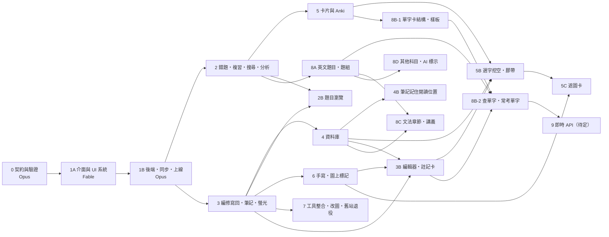

# 分階段計畫

2026-11-10 v3：已併入使用者對 Q1–Q27 的回答；新增由 Fable 製作的第 1A 階段（介面與 UI 系統）。

2026-11-11 v4：Fable 規劃了三項新功能——題目瀏覽（新增第 2B 階段）、選字挖空與膠帶（新增第 5B 階段）、圖上標記（併入第 6 階段）與改圖入口（補進第 7 階段）。只有規劃，還沒實作；規格在規格書 §9.7–§9.9。同日使用者回覆後再補：資料庫筆記記住上次閱讀位置（新增第 4B 階段）；**使用者決定下一個做第 6 階段**；5B 等使用者補截圖後由 Fable 定案。

2026-11-12 v5：使用者補了克漏字與膠帶的說明，並提出所見即所得編輯、註記框改版、英文三塊。Fable 規劃的結果：新增第 3B 階段（編輯器與註記卡）、改寫第 5B 階段（克漏字與膠帶，定案）、新增第 5C 階段（遮圖卡）、把第 8 階段拆成 8A（英文題目上站與題組）、8B（單字）、8C（文法）、8D（原本的擴充科目與 AI 內容標示），新增第 9 階段（即時呼叫 Google Cloud API，待使用者確認範圍）。只有規劃，還沒實作；規格在規格書 §9.8、§9.10、§9.11。總表在本文件最後的「2026-11-12 的規劃結果」。

每個階段都能單獨交給一個模型。後面的階段不做，前面的照樣能用。

## 模型分工

使用者的決定（2026-11-10）：**介面與 UI 的第一版由 Fable 做，其餘由 Opus 做；之後的維護與功能調整都交給 Opus。** Fable 比 Opus 耗額度，所以 Fable 只做「整體介面與基本操作」，不做細部功能；做完後除非錯誤很多，不再回頭修改。

| 階段 | 誰做 | 內容 |
|---|---|---|
| 0 | Opus | 資料契約、轉接器、驗證報告、給介面用的樣本資料 |
| **1A** | **Fable** | **UI 系統、App 外殼、核心畫面與基本操作（用本機樣本資料，不接後端）** |
| 1B | Opus | 登入、同步、發佈、離線、備份、部署；把 1A 的介面接上真實資料 |
| 2–9（含 2B、3B、4B、5B、5C、8A–8D） | Opus | 各項功能，一律用 1A 的 UI 系統與樣板來做 |

交接方式：每個階段開一個新對話（工作目錄 `~/Projects/postmed-qbank`），請模型讀 `docs/規劃/` 的四份文件與最新的驗收紀錄，並指定「做第 N 階段」。

**1A 以外，還值得換回 Fable 的情況**（都是短時間的，目的是省掉更貴的返工；要不要做由使用者決定）：

| 情況 | 為什麼 | 大約多大 |
|---|---|---|
| 第 0 階段結束 | 看驗證報告，決定哪些警告要先修。會和 1A 開工併在同一個對話，不另外花 | 併入 1A |
| 第 3 階段結束 | 那是唯一會寫主檔的程式，寫錯會改壞題庫 | 只看寫回的那幾個檔案 |
| 要改資料庫欄位，而雲端已有作答紀錄 | 改錯會影響真實資料 | 一次討論 |
| 出現資料不一致：兩台裝置數字不同、作答重複或遺失、主檔被改到不該改的地方 | 要先查清原因再動手 | 視情況 |
| 同一個問題 Opus 修了兩三次還沒好 | 換角度比重試省 | 視情況 |
| 有新需求、想調整階段順序、或要決定規格書 §14 的事項 | 要更新規格書 | 一次討論 |
| 第 3B 階段的試作結果不過關（iPad 輸入法、落進原始碼區塊的比例） | 要換編輯器的做法，會影響之後所有編輯畫面 | 一次討論 |
| 第 8A 階段寫回英文（共用格式）主檔的程式寫完 | 和第 3 階段相同：會寫主檔的程式 | 只看寫回的那幾個檔案 |

第 1B 階段（登入與同步）結束後原本建議由 Fable 審一次；考慮額度，改為**由 Opus 另開一個新對話、只做審查**（請它對照完成標準逐條重驗，並跑 `security-review`）。同一個模型寫的程式由同一個對話自己審，容易漏；新對話至少沒有先入為主。

其餘（照規格寫功能、寫測試、修一般錯誤、跑 UI 檢查、日常發佈）都不需要 Fable。

---

## 給實作模型的共同規則

1. 先讀完 [01_規格書.md](01_規格書.md)。規格書 §14 列的事項，以及任何規格沒寫到的決定，停下來問，不要自己選。
2. **不得更動護理國考網站**：規格書 §11 的八條是硬性規則。只碰名稱為 `postmed-qbank` 的資源。護理站的專案資料夾（`~/Projects/多保命*`）只可讀取配色，不得寫入。
3. **部署由使用者本人執行**（規格書 §11 第 8 條）。不要求、不讀取 Cloudflare 的 token 或登入憑證；把要執行的指令和預期結果寫清楚交給使用者。
4. **主檔唯讀**：`82_考題整理/` 底下的檔案，除了 `pmq patches pull`（第 3 階段）之外不得寫入；`01_題庫製作/生化/03_分章題庫/` 任何情況都不得寫入。程式放 `~/Projects/postmed-qbank/`，不放 iCloud。主檔路徑只寫在 `tools/pmq/pmq.toml`。
5. **磁碟**：動手前看 `df -h /`，低於 2 GB 就停。不留建置暫存、不產生 zip、無頭瀏覽器的設定檔用完就刪。上限見規格書 §3.2。
6. iCloud 的檔案可能是未下載狀態，讀檔慢是正常的；不要因此改成整批複製到別處。
7. 題目一律寫成「來源｜ID」。回覆與介面文字用繁體中文。
8. **iPad 與電腦功能一致**（規格書 §2.5）：不做只有其中一邊才有的功能。
9. **UI**：第 1A 階段之後，所有畫面都用 `app/src/ui/` 的元件與 `docs/UI規範.md` 的樣板來做（規格書 §13.4）。不得另外寫顏色、圓角、間距的數值；不得繞過現有元件自己刻一個類似的。確實缺元件時，先加進 `app/src/ui/` 與 `/dev/ui` 展示頁，再拿去用。有畫面的階段在交付前跑 §13.3 列的 Skill，結果寫進驗收紀錄。
10. 每階段結束交一份驗收紀錄：逐條列出下面的完成標準、實際結果、沒做到的項目。測試沒過就寫沒過。iPad 實機項目由使用者本人驗，模型不得代為宣稱通過。

---

## 第 0 階段　資料契約與驗證（沒有網站）｜Opus

**要做**

- 建 `~/Projects/postmed-qbank/`（git）與目錄骨架（`app/` 先留空，由 1A 建立）。
- `pmq sample`：把真實資料轉成介面開發用的樣本，寫到 `app/fixtures/`（不進版本庫的大檔除外，總量 < 10 MB）：
  - 兩科**完整的索引**與章節樹（讓篩選器顯示真實題數）。
  - 約 300 題本文：每科、每個來源類別各 15–20 題，並刻意包含——最長的題幹、最長的公式、含表格、含圖（SVG 與 PNG 各有）、有題目版與解答版兩張圖、選項擠在同一行、選項是圖、非選擇題、題組、選項解析失敗、有疑點（`issues`）、沒有詳解。
  - 這些題用到的圖檔。
  - 一份生化筆記與一份物理筆記轉成的區塊樹（給資料庫閱讀頁的樣板用；轉接器可以是簡化版，第 4 階段再做完整的）。
- 內容 git 追蹤（搬遷步驟 2）。
- `schema/`：內容契約的 JSON Schema、選項解析的共用測試案例（≥ 40 個）、KaTeX 巨集表。
- `pmq check`：章節樹、物理轉接器、生化轉接器、圖的對應、驗證報告。
- `pmq check math`。
- 生化答案抽查：每個來源類別 4 題，共 20 題，對照 `01_來源索引/` 的答案。

**完成標準**

- [ ] `pmq check` 跑完，題數等於基準：物理 9,302、生化 3,742（3,743 扣掉完全相同的重複題 `KMU-111-16` 一筆；兩筆若不完全相同則視為錯誤並回報）。
- [ ] 所有題目通過 JSON Schema。
- [ ] 驗證報告包含：選項解析失敗清單、對應不到的 status 字串、找不到的章節代碼、圖的三類去處與數量、公式排版失敗清單、SVG 字型與大小警告、生化答案抽查結果、主檔裡所有相對連結指向哪些資料夾的統計。
- [ ] 選項解析：Python 與 TypeScript 對同一份測試案例結果完全相同。
- [ ] 跑完後 `cgit status` 顯示主檔沒有任何變更；`82_考題整理/` 下沒有新增檔案。
- [ ] 第二次執行 `pmq check`（雜湊快取已建立）在 60 秒內完成。
- [ ] 沒有留下暫存檔；`~/Projects/postmed-qbank` 整個資料夾（含 `node_modules`）< 500 MB。
- [ ] `app/fixtures/` 的樣本包含上面列的每一種情況（附一張對照表：哪一題是哪種情況），並通過同一份 JSON Schema。

**結束後**：換回 Fable。先看驗證報告（決定哪些警告要先在主檔修、哪些可以帶著上線），接著同一個對話直接做第 1A 階段。

---

## 第 1A 階段　介面與 UI 系統｜Fable

目的：定下整個網站的樣子與手感，並留下一套 Opus 之後照著用的元件與樣板。**只做介面與基本操作，資料來自 `app/fixtures/` 與瀏覽器本機，不接後端、不部署。**

**要做**

1. **App 骨架**：`app/`（Vite＋React＋TypeScript＋Tailwind）、路由、導覽外殼（寬螢幕側欄、窄螢幕底部分頁列）、深淺色切換。
2. **UI 系統**（規格書 §13.4）：色彩與字級代碼（深色那一欄用 `taste-color` 驗算後定案，更新回規格書 §13.1）、基礎元件、`/dev/ui` 展示頁、`docs/UI規範.md`。
3. **內容顯示元件**：Markdown＋KaTeX＋表格橫向捲動、題圖與全螢幕檢視器（雙指縮放）、來源徽章。
4. **核心畫面，操作要真的能用**（資料存在瀏覽器本機）：
   - 今日頁、出題設定（篩選器對真實索引即時算題數）、刷題畫面（選擇題、自評題、作答回饋、詳解、左右滑、鍵盤快捷鍵、星號與存疑、續做）、結束頁、單題頁、設定頁（外觀）、登入頁（只有畫面）。
5. **之後各階段要用的樣板，只做版面與互動、放假資料、不做功能**：
   - 清單頁（錯題本、題庫瀏覽、修訂佇列共用）與搜尋列
   - 複習卡片（翻面、四顆評分鈕）
   - 原卷方格（學校 × 年份）與模擬考計時列
   - 統計與考題分析的圖表卡
   - 資料庫閱讀頁（列點收合、螢光色票、區塊旁的編輯鈕）
   - 編輯面板（Markdown 原始碼＋即時預覽）
   - 題目下方的個人筆記區與手寫區的外框
   - 同步狀態、離線、錯誤、空白、載入中的各種狀態
6. **資料存取介面**：`app/src/data/` 定義畫面取用資料的函式介面（讀內容、寫作答、讀寫標記與設定），1A 提供只用本機的版本；1B 換成有同步的版本時，畫面程式不用改。本機資料表的欄位照規格書 §4.6。

**不做**（留給 Opus）：Worker、登入邏輯、同步、發佈、Service Worker 與離線、備份、搜尋、間隔複習的計算、統計的計算、修訂寫回、Anki、手寫引擎、SVG 與 LaTeX 編輯器。

**控制額度的做法**

- 範圍就是上面六項，不順手加功能。
- 使用者看畫面的回饋集中成一輪：1A 做完後，使用者在電腦與 iPad（同一個 Wi-Fi 下開本機預覽網址）各看一次，把意見一次列出，Fable 修一輪後交付。之後的調整交給 Opus。

**完成標準**

- [ ] `/dev/ui` 展示頁列出每個元件的每種狀態，淺色與深色都有；色彩表每一組的對比數字列出且合格（內文 ≥ 4.5:1、大字與圖示 ≥ 3:1）。
- [ ] `docs/UI規範.md` 寫明：有哪些元件與樣板、各用在什麼情況、新畫面怎麼組、什麼不准做。Opus 只讀這份文件與展示頁就能做出風格一致的新頁面。
- [ ] 用樣本資料可以走完：開首頁 → 設定條件 → 刷 20 題（含選擇題、自評題、有圖、長公式、表格）→ 結束頁 → 重做錯題；重新整理後可以續做。
- [ ] 樣本裡每一種特殊情況的題目都顯示正常，沒有撐破版面或重疊（`break-ui`）。
- [ ] 圖放大到 8 倍線條仍銳利；深色模式下圖在白色紙卡上；純黑白圖可反相。
- [ ] 所有可點區域 ≥ 44×44 px；選項列 ≥ 56 px；左右滑不會和上下捲動打架。
- [ ] 同一份程式在電腦寬螢幕、iPad 橫向、iPad 直向、手機寬度下都能用，功能相同。
- [ ] 規格書 §13.3 的檢查都跑過，結果在驗收紀錄裡。
- [ ] 畫面程式沒有直接讀寫 IndexedDB 或 fixtures，全部經過 `app/src/data/`。
- [ ] `app/` 建置成品 < 5 MB（不含樣本資料）；沒有留下暫存檔。
- [ ] **使用者在 iPad 與電腦上看過並同意**外觀與基本操作。主畫面 App 的行為（加入主畫面、離線）要等 1B 部署後才能驗，不在這一階段。

---

## 第 1B 階段　後端、同步、上線｜Opus

目的：把 1A 的介面接上真實資料，讓 iPad 能刷題、兩台裝置同步。**不改 1A 的外觀與互動；發現介面問題時記在驗收紀錄，小的直接修，會改變設計的先問使用者。**

**要做**

- `wrangler.toml`、`scripts/deploy.sh`（含名稱檢查）、`docs/部署步驟.md`（規格書 §11 第 8 條）。資源由使用者照文件建立：Worker、D1、R2 各一個，名稱 `postmed-qbank`。
- 登入（規格書 §10），接上 1A 的登入頁。
- 管理 API 與 `pmq publish`。
- `app/src/data/` 的正式版本：內容包下載到 IndexedDB、待送佇列、同步（規格書 §8）；`attempt`、`session`、`flag(wrong／star／doubt)`、`setting`。
- Service Worker 快取 App 外殼與看過的圖。
- 今日頁與設定頁補上：同步狀態、裝置名稱、手動同步、匯出全部、登出。
- 每晚備份到 R2；`pmq backup pull`、`pmq restore`。
- 移除對 `app/fixtures/` 的依賴（樣本只留給 `/dev/ui` 與測試用）。

**不做**：間隔複習、錯題本頁、搜尋、編輯、筆記、螢光、卡片、手寫、工具。

**完成標準**

- [ ] `docs/部署步驟.md` 寫到使用者不需要再問就能完成第一次部署；使用者照著做一次，卡住的地方補進文件。
- [ ] 沒登入時，直接開內容包、圖檔、API 的網址都回 401；密碼連錯 5 次後被鎖 15 分鐘。
- [ ] Cloudflare 帳號裡新增的資源只有三個且名稱都是 `postmed-qbank`；其他專案的設定、部署版本、最後修改時間與動工前相同（使用者在動工前後各列一次清單比對）。
- [ ] `pmq publish` 後，首頁各科題數等於基準；改一題主檔再發佈，只上傳 1 個包與 manifest，iPad 同步後看到新內容。
- [ ] 篩選器可依科目、來源類別、學校、年份、書與單元、章節組合，符合題數即時顯示；用三組條件與 `pmq` 的獨立計數核對相同。
- [ ] 題目標題顯示「來源｜ID」，抽 20 題與現有圖庫的寫法一致。
- [ ] 搬遷步驟 8 的核對表（約 40 題）全部通過。
- [ ] 在 iPad 做 20 題，60 秒內電腦上看得到同一場的 20 筆作答與答對率；反向亦同。
- [ ] iPad 開飛航模式：能開 App、能做已下載科目的題目 20 題；關飛航後 60 秒內同步完成，沒有重複或遺失（伺服器 `attempt` 筆數正好多 20）。
- [ ] 同一批作答重送兩次，伺服器筆數不變。
- [ ] 1A 的畫面元件與樣式檔沒有被改動（`git diff` 只有 `app/src/data/`、新增的檔案，以及驗收紀錄裡逐項說明的小修正）。
- [ ] 同一個網址在電腦與 iPad 上功能相同，只有版面與按鈕大小不同。
- [ ] 「匯出全部」的 zip 用 `pmq restore` 灌進一個空的本機 SQLite，各表筆數相同。
- [ ] 隔天 R2 出現 `backup/` 的當日檔。
- [ ] **使用者在 iPad 實機確認**：加入主畫面、橫直向、左右滑不會和捲動打架、飛航模式重開 App。

**結束後**：另開一個 Opus 新對話只做審查——對照上面的完成標準逐條重驗登入、同步、部署腳本，並跑 `security-review`。

---

## 第 2 階段　錯題、間隔複習、原卷、搜尋、統計、考題分析｜Opus

第 2 階段起的每個新畫面，都從 1A 留下的樣板開始接功能（清單頁、複習卡片、原卷方格、圖表卡、閱讀頁、編輯面板…），不重新設計版面。

**要做**

- 錯題規則、「粗心錯，不追蹤」、錯題本頁（規格書 §5.3）。
- FSRS：`srs_state`、`review_log`、今日複習頁、今日頁的到期數；每日上限複習 200、新卡 20，目標記憶率 0.90，設定頁可改（§5.4）。
- 原卷頁與模擬考模式（計時、交卷後才顯示答案、得分只算答對題數與用時）。
- 題庫瀏覽與搜尋（在裝置上搜尋題幹、詳解、ID、來源；在背景執行緒做，不卡畫面）。
- 統計頁；弱點章節。
- 考題分析頁 `/analysis`：各科通用的章節 × 學校 × 年份出題比例。
- 出題設定加狀態條件：沒做過／做錯過／有星號／存疑／已確認／未確認。
- 同題群組共用排程。

**完成標準**

- [ ] 答錯的題目出現在錯題本並排進複習；之後在不同日連續答對 2 次（猜對不算）或按「已掌握」後離開錯題本。
- [ ] 按「粗心錯，不追蹤」的題目不在錯題本、不在複習排程，作答紀錄仍是答錯；可從 ⋯ 選單恢復。
- [ ] 用固定的評分序列測試，`srs_state` 與 `ts-fsrs` 直接計算的結果相同。
- [ ] 兩台裝置離線各複習同一題，同步後兩筆 `review_log` 都在，`srs_state` 取較新的那次；「重算排程」的結果與逐筆重播 `review_log` 相同。
- [ ] 超過每日上限的到期項目不出現在今日複習，隔天出現。
- [ ] 模擬考：交卷前看不到答案；時間到自動交卷；得分正確；中途關掉 App 再開可以續考，計時不歸零。
- [ ] 搜尋「PHY-007836」「高醫 115」與一個題幹裡的中文詞、一個英文詞，結果正確，在 iPad 上 1 秒內出現。
- [ ] 統計頁與考題分析頁的數字與直接查資料一致（各抽三個指標核對）；物理的出題比例與舊站考題分析相同。
- [ ] 規格書 §13.3 的檢查都跑過。

---

## 第 2B 階段　題目瀏覽（閱讀頁）｜Opus

2026-11-11 Fable 規劃，規格書 §9.9。和其他新階段互不相依，只需要第 2、3 階段（已完成）。

**開工前**：方向與「記住位置」使用者已確認（規格書 §14-7、§14-8）。使用者說還會用截圖補功能——開工前先問使用者要不要補；補的內容寫進規格書 §9.9 的「待補」再動手。

**要做**

- `/browse` 改成入口頁：繼續瀏覽、搜尋（沿用現有的）、依來源／依章節選範圍。
- 閱讀頁 `/browse/:subject/s/:sid`、`/browse/:subject/c/:chap`：分頁、三種顯示方式、每題的星號與 ⋯、「從這一題開始刷題」。
- 唯讀的題目顯示元件（放 `app/src/ui/content/`，加進 `/dev/ui` 與 `docs/UI規範.md`）：和 `QuestionView` 共用題幹、選項解析、螢光、來源徽章，但沒有作答流程。不要複製一份 `QuestionView` 來改。
- 記住上次瀏覽的位置（`setting` 的 `browse.recent`）與「繼續瀏覽」。
- 不改資料庫的表；不改 Worker。

**完成標準**

- [ ] 從入口頁依來源點進「高醫 115 物理化學」：題目順序與原卷相同，題數與 `/papers` 顯示的相同。依章節點進一章：題數與出題設定只勾這一章時相同。
- [ ] 三種顯示方式切換正確；「只看題目」時可單獨展開一題的答案與詳解；重新整理後維持上次的顯示方式。
- [ ] 在閱讀頁看 30 題：`attempt` 筆數不變；這些題目在出題設定的「沒做過」條件下仍然算沒做過。
- [ ] 看到第 23 題後關掉分頁再開：入口頁的「繼續瀏覽」第一列是這個範圍、寫第 23 題；點了直接到那一題。把每頁題數從 10 改成 20 再回來，仍是那一題。
- [ ] 在 iPad 看到第 23 題，同步後 Mac 的「繼續瀏覽」顯示同一題；反向亦同（依 §14-8 的決定）。
- [ ] 閱讀頁上畫的螢光、寫的筆記，在單題頁與刷題畫面看得到（同一份資料）。
- [ ] 「從這一題開始刷題」建立的那一場，第一題就是目前這一題，順序與閱讀頁相同。
- [ ] 一頁 50 題（含長公式、圖、表格）在 iPad 上換頁 2 秒內可操作；捲動不卡。
- [ ] 離線且沒下載本文的題目顯示「本文未下載」，不擋其他題。
- [ ] 規格書 §13.3 的檢查都跑過（含 `break-ui`）。

---

## 第 3 階段　即時編修與寫回、個人筆記、螢光筆、已確認標記

**要做**

- 題目各欄位的編輯器（題幹與選項、思路、詳解、**答案**、章節、標籤）：Markdown 原始碼＋即時預覽；貼上 AI 回覆時自動轉成 Markdown（規格書 §9.4）。改答案時多一步確認，並留下「答案曾修訂」的紀錄；已有的作答紀錄不回頭重算對錯。
- 修訂疊加顯示、修訂佇列頁。
- `pmq patches list／pull／resolve`（規格書 §7.3）。
- 已確認標記：修訂答案或詳解時自動標記；⋯ 選單可手動標記；設定頁可選是否顯示「未確認」（§4.4）。
- 題目的個人筆記（Markdown）。
- 題目與詳解上的螢光筆與註記。

**完成標準**

- [ ] 在 iPad 改一題詳解的錯字：存檔後 iPad 與電腦（同步後）都顯示新內容並標「已修訂・待寫回」。在電腦上做同樣的事，結果相同。
- [ ] `pmq patches pull` 後，`cgit diff` 只有那一題的那一段不同，front matter 其他行與 YAML 錨點不變；產生一個 commit。物理與生化各測一題。
- [ ] 生化的修訂只改到 `02_原卷題庫/`；`03_分章題庫/` 沒有任何變更；`pull` 結束時列出改到的生化題 ID。
- [ ] 再 `pmq publish` 後，修訂狀態變 `merged`，標記消失，內容仍是新的。
- [ ] 先在 Mac 改同一段、再 `pull`：該筆變 `conflict`，主檔沒被動，修訂佇列頁同時顯示兩個版本。
- [ ] 主檔有未 commit 變更時，`pull` 拒絕執行並說明。
- [ ] 改答案：有確認步驟；寫回後主檔的答案更新；該題顯示「答案曾修訂」；舊作答的對錯沒變。
- [ ] 修訂詳解後該題顯示「✓ 已確認」；出題設定可用這個條件篩選；預設畫面上沒有任何「未確認」字樣。
- [ ] 從 ChatGPT 網頁選取一段含標題、兩層列點、表格、公式的回答貼進編輯器，轉出的 Markdown 預覽與原文結構相同。
- [ ] 螢光筆：選字後可上色、加註；題目內容被修訂後，螢光仍在正確的字上；原文被刪掉時，進「失聯的螢光」清單而不是消失。
- [ ] 個人筆記可寫公式與表格，兩台裝置同步；「匯出全部」裡有每題筆記的 Markdown。
- [ ] 規格書 §13.3 的檢查都跑過。

**結束後**：換回 Fable 審寫回主檔的程式。

---

## 第 3B 階段　所見即所得編輯與註記卡｜Opus

2026-11-12 Fable 規劃，規格書 §9.10。需要第 3、4、6 階段（都已完成）。**5B、8B 都要用到這裡的編輯器與註記卡，所以排在它們前面。**

規格書 §14-13 已決定（2026-11-12）：拿掉「筆記模式」。

**要做**

1. **試作**（先做這一步，結果寫進驗收紀錄再繼續）：一個筆記區塊就地編輯＋表格＋公式＋存成修訂；在 iPad Safari 測注音輸入、Apple Pencil 隨手寫、鍵盤上方的工具列；跑全庫往返測試，回報有多少內容落進「原始碼區塊」。任何一項不過關就停下來回報。
2. `RichEditor`（`app/src/ui/editor/`）：打字規則、表格工具列、公式小框、貼上、`/` 選單、顯示原始碼；原始碼保留規則的四條全做。進入編輯時才載入。
3. 三種放法：就地、註記卡、整頁。把現有用到 `MarkdownEditor` 的地方全部換掉（題目欄位、筆記區塊、新增的筆記、區塊筆記、題目的個人筆記、螢光註記、卡片編輯），最後刪掉 `MarkdownEditor` 與 `EditPanel`。
4. 資料庫閱讀頁：三種進入編輯的方式；Enter／Tab 對應到現有的 `insert_after`／`insert_child` 修訂；存檔與復原；拿掉「筆記模式」，區塊筆記就地編輯；區塊的 ⋯ 在電腦上滑過出現。
5. 註記卡（`app/src/ui/`）：電腦貼著字、觸控在下緣；顏色、文字、手寫都在同一張卡裡；滑過預覽。取代 `HighlightPanel` 的小框與展開面板。
6. `/dev/ui` 加上編輯器（空白、長內容、寬表格、公式、原始碼區塊）與註記卡（兩種位置、有無手寫）；改寫 `docs/UI規範.md`：編輯內容不開 `Sheet`。
7. 不改資料庫的表、不改 Worker、不改 `pmq` 的寫回程式。

**完成標準**

- [ ] 打 `### 標題`、`- 列點`、`1. `、`> `、`**粗體**`、`$x^2$`、`$$`，都當場變成排好的樣子；⌘B、⌘I、⌘Z 可用。
- [ ] 表格：用 `/表格` 插入；上下插入列、左右插入欄、刪除列與欄、對齊、Tab 換格、最後一格 Tab 加列，都可用；從 Google 試算表複製 3×4 的表格貼上是一張表；存出來的 Markdown 在 Typora 開啟是同一張表。iPad 上不接鍵盤也能完成同樣的操作。
- [ ] 全庫往返測試 (a)：每個題目欄位、筆記區塊、卡片讀入後不改直接存，與原文逐字相同（0 筆不同）。
- [ ] 全庫往返測試 (b)：強迫重新產生後，閱讀頁排出來的 HTML 相同；不相同的清單附在驗收紀錄，且這些內容在編輯器裡是「原始碼區塊」。
- [ ] 改一個有五段的詳解的第三段裡一個字：存成的修訂與原文相比只有那一行不同。
- [ ] 改筆記一個列點的錯字、在它下面按 Enter 新增一個列點：`pmq patches pull --dry-run` 的 diff 只有這兩處，縮排與原檔風格一致；Typora 開啟正常。
- [ ] 含 `<style>`、有合併儲存格的 HTML 表格、圖寬度屬性、`[sound:…]` 的內容：編輯別的段落後存檔，這些部分逐字不變。
- [ ] 打開編輯又直接關掉、或改了又改回來：不產生修訂。
- [ ] 電腦上點一個有註記的螢光：卡片貼在那段字旁邊，背景不變暗、頁面可以捲動、捲動時卡片跟著字走；點外面關閉並存檔。
- [ ] 在註記卡裡展開手寫：紙與工具列出現在同一張卡裡，沒有側邊面板；Apple Pencil 可寫、手指可捲。
- [ ] 全站找不到為了編輯內容而開的 `Sheet`；`MarkdownEditor`、`EditPanel` 已刪除。
- [ ] 沒進過編輯時，首頁與閱讀頁載入的檔案不含編輯器；`app/` 建置成品 < 5 MB。
- [ ] 第 3、4 階段與編輯有關的完成標準重跑一次仍然通過（改詳解、改答案的確認、貼上 AI 回答、插入列點、刪除區塊、新增筆記）。
- [ ] 規格書 §13.3 的檢查都跑過（含 `break-ui`：超寬表格、超長公式、500 行的筆記）。
- [ ] **使用者在 iPad 與電腦實機確認**：注音打字、表格操作、註記卡的位置與手寫。

---

## 第 4 階段　資料庫（講義筆記）

**§14-2 已決定（2026-11-11）**：要做「新增一份空白筆記」，寫回時放 `02_學習筆記/<科目>/_收件匣/`。

**使用者的額度安排（2026-11-11）**：可以先做前半（筆記轉接器、目錄、閱讀頁、互連、螢光與個人筆記、匯出與列印），區塊編輯與寫回 `.md` 的後半等 Fable 審完第 3 階段的寫回程式再做。

**要做**

- 筆記轉接器與 `c/kb/` 內容包（搬遷步驟 9）：生化 B1–B4 與物理；生物、化學、英文只建章節目錄。
- structure_db 圖上傳。
- `/kb` 目錄、`/kb/:doc` 閱讀頁：列點收合、表格橫向捲動、圖放大。
- 筆記 ↔ 題目互連。
- 筆記上的螢光、註記、區塊編輯、插入列點、刪除區塊（走修訂佇列）；貼上轉換同第 3 階段。
- 單份匯出 `.md`、列印。

**完成標準**

- [ ] 生化 B1–B4 與物理的每份筆記：網站上的標題數、列點數、表格數、圖數與來源 `.md` 相同。
- [ ] 生物、化學、英文在目錄裡看得到章節名稱，點進去是空頁並說明尚無內容。
- [ ] 抽 3 份與 Typora 並排：層級、表格、公式、圖寬比例一致。
- [ ] 生化筆記裡的考古題出處可點到題目；題目頁列出引用它的筆記段落；對不到的出處有清單。
- [ ] 改一個列點、在某列點下插入一個新列點：`pmq patches pull` 後 `.md` 的差異只有這兩處，縮排與原檔風格一致，Typora 開啟正常；`.md` 裡沒有被插入任何輔助標記。
- [ ] Mac 上用 Typora 改了筆記並重新發佈後，原有螢光仍在正確位置，找不到的進「失聯」清單。
- [ ] 寬表格在 iPad 直向可橫向捲動，不撐破頁面。
- [ ] 規格書 §13.3 的檢查都跑過（含 `break-ui` 與 `taste-typography`）。

---

## 第 4B 階段　資料庫：記住上次閱讀的位置｜Opus

**狀態（2026-11-11）：Opus 已實作，測試站驗過；跨裝置待使用者驗。紀錄見 [../第4B階段驗收紀錄.md](../第4B階段驗收紀錄.md)。**

2026-11-11 Fable 規劃，規格書 §9.4 最後一項。很小，只需要第 4 階段；不改資料庫的表、不改 Worker。可以單獨做，也可以和 2B 一起做（兩邊「記住位置」的寫法相同，共用一個函式）。

**要做**

- 閱讀頁記錄與還原位置（`setting` 的 `kb.recent`）；還原時展開上層、捲到該區塊、提示可「從頭讀」。
- `/kb` 目錄頁的「繼續閱讀」；今日頁一列。

**完成標準**

- [ ] 讀一份長筆記到中段、關掉分頁再開同一份：停在同一個區塊（上層自動展開），提示「回到上次讀到的地方」；按「從頭讀」回到最上面。
- [ ] 從題目的「相關筆記」連結（網址有 `#b-…`）進來：到的是連結指定的區塊，不是上次的位置。
- [ ] `/kb` 的「繼續閱讀」第一列是剛剛那份，寫出讀到的標題；點了直接到位。
- [ ] iPad 讀到某處，同步後 Mac 的「繼續閱讀」顯示同一份、同一處；反向亦同。
- [ ] 在 Mac 改了那個區塊的前幾個字並重新發佈（`bid` 會變）：再開時落在同一個標題底下，不是回到最上面。
- [ ] 只是捲動不會一直寫設定：停在同一個區塊時 `setting` 沒有新的寫入；連續捲動 10 秒，寫入不超過 5 次。
- [ ] 上次的「展開到第幾層」有記住。

---

## 第 5 階段　卡片與 Anki

**開工前**：使用者從 Anki 匯出 `.apkg`（勾選包含排程與媒體）→ 先只做 `pmq anki inspect` → 換回 Fable 看報告，與使用者確認規格書 §14-3（以牌組為單位搬家）、匯入哪些牌組、要不要聲音。

**要做**

- `pmq anki inspect`（只讀）。
- `deck`、`card`、`media`；卡片頁、卡片編輯、克漏字。
- 題目與筆記列點「做成卡片」。
- 卡片併入今日複習。
- `pmq anki import／export`（含進度）；網站上的 TSV 匯入匯出。

**完成標準**

- [ ] `inspect` 報告列出：各牌組卡片數、卡片樣板種類、是否使用 FSRS、圖片與聲音各自的檔數與總大小；執行後 `.apkg` 與磁碟上沒有多出解壓縮的殘留檔。
- [ ] 匯入後：卡片數、牌組階層、標籤與 Anki 內相同；含圖片的卡片顯示正常；克漏字正確遮蓋。
- [ ] 進度：匯入後抽 20 張，到期日與 Anki 內相差不超過 1 天；Anki 的複習紀錄筆數與匯入的 `review_log` 筆數相同。
- [ ] 同一個檔匯入兩次不產生重複卡片（以 Anki 的 guid 判斷）。
- [ ] 匯出的 `.apkg` 匯進一個空的 Anki 設定檔：卡片數相同，抽 20 張到期日相差不超過 1 天。
- [ ] 卡片在 iPad 與電腦的複習進度同步。
- [ ] 規格書 §13.3 的檢查都跑過。

---

## 第 5B 階段　克漏字與膠帶｜Opus

規格書 §9.8（2026-11-12 定案；使用者已說明用法，不再等截圖）。需要第 4、5 階段與**第 3B 階段**（選字框、註記卡、卡片編輯器裡的克漏字都在 3B 的元件上做）。

**開工前**：把規格書 §14-10（牌組照筆記階層）的預設唸給使用者確認；§14-12（答錯的算法與降級）使用者已同意先照預設做。Fable 對第 5 階段的補審（`anki_import.py`／`anki_export.py`／`Cards.tsx`）不擋這一階段；但補審若要改 `card-core.ts` 的克漏字函式，先改完再開工。

**要做**

- 新表 `cloze_mark`（規格書 §4.6；**沒有顏色欄位**）：D1 migration `0002`，只新增這一張表與它的 seq 觸發器，不改任何既有的表；加進 `schema/ts/sync-tables.ts`（較新者勝）、Dexie、`@/data`。
- 選字框加「克漏字」；快捷鍵 ⌘⇧C（新編號）、⌘⌥⇧C（同編號），在筆記閱讀頁與卡片編輯器都有效；設定頁可改組合鍵。
- 原文上的克漏字標示（淺藍底＋底線）與克漏字小卡（用 3B 的註記卡）。
- `tokens.css` 加 `--tape-blue`／`-orange`／`-red`、`--cloze-bg`／`--cloze-line`（用 `taste-color` 驗算後把數值寫回規格書 §13.1）；膠帶元件放 `app/src/ui/`；`/dev/ui` 展示三色、貼著與撕開、有無提示、淺色深色；`docs/UI規範.md` 補一列。
- 「答錯幾次」的純函式（從 `review_log` 算，含降級規則）與測試。
- 筆記閱讀頁的膠帶模式；頁首「這份筆記 N 張卡・到期 M」與「複習這份筆記」。
- 卡片複習的膠帶顯示（`clozeSide` 多一種輸出；公式裡的克漏字不變）。
- 牌組照筆記階層自動建立。
- 原文改版後：重新定位、更新卡片內容、「失聯的克漏字」清單。
- 卡片 `origin` 多記路徑（標題＋上層列點）；複習畫面顯示路徑與「看原文」。
- 資料庫驗收後，再打開題目的思路與詳解（同一套元件，一個設定值）。

**完成標準**

- [ ] 在生化筆記選一段字按「克漏字」：不跳頁；選的字變淺藍底；卡片出現在 `筆記::生化::…::<筆記標題>`，內容是那個列點的全文、選的字是克漏字；今日新卡數加 1；提示上的「復原」能整個取消。
- [ ] 選字後按 ⌘⇧C 兩次（選不同的字）：c1、c2 兩張卡。再選第三段字按 ⌘⌥⇧C：併進 c2，仍是兩張卡。Safari、加到 Dock 的 App、iPad 外接鍵盤各測一次；有攔不到的環境就在驗收紀錄寫明，並確認設定頁改鍵後可用。
- [ ] 卡片編輯器裡選字按 ⌘⇧C：包成 `{{c1::…}}`，顯示為淺藍底。
- [ ] 選取碰到公式時自動擴大成整個公式；跨兩個區塊的選取不能挖並說明原因；表格裡挖的卡片是表頭列＋那一列。
- [ ] 平常模式：所有克漏字都是淺藍底，和藍色螢光並排時分得出來；同一段字又有螢光又是克漏字時兩者都看得出來。
- [ ] 膠帶模式：沒錯過的是藍色膠帶；把某張卡在複習時按一次「重來」→ 它在筆記裡變橘色；再按一次 → 紅色。之後在不同的兩天答對 → 降回橘色（用假造的複習紀錄測）。
- [ ] 膠帶模式下撕 10 處：`review_log` 筆數與 `srs_state` 都沒變，膠帶顏色也沒變。
- [ ] 撕開與貼回時版面不位移；「全部貼回」可用；被蓋住的字選取複製不到、螢幕報讀讀不到；鍵盤可操作；列印時沒有膠帶。
- [ ] 卡片複習：要考的那一處是膠帶（顏色照答錯次數），其他編號照常顯示；點膠帶或按空白鍵就是翻面，評分照常；Anki 匯入的克漏字卡同樣適用；公式裡的克漏字仍是方框問號。
- [ ] 複習畫面上方有路徑（含上層列點）與「看原文」，點了回到筆記的那個區塊。
- [ ] 「複習這份筆記」只出這份筆記的卡。
- [ ] 改一個有克漏字的列點的錯字（走修訂佇列）：克漏字仍在正確的字上、卡片內容變成新的、複習進度不變。把那幾個字刪掉：進「失聯的克漏字」，卡片保留舊內容並標「原文已改」。
- [ ] 在卡片編輯器改過內文的卡，之後原文再改也不會被自動覆寫。
- [ ] 刪除克漏字 → 該編號沒有其他克漏字時卡片一起刪，複習紀錄還在；刪卡片 → 原文上的標示消失。
- [ ] 做了 20 處克漏字後：主檔 `.md` 沒有任何變更（`cgit status` 乾淨）；`pmq patches list` 沒有新增修訂。
- [ ] iPad 挖的，同步後 Mac 上看得到標示與卡片；反向亦同。
- [ ] `pmq anki export` 匯出這些卡，在 Anki 裡是正常的克漏字卡。
- [ ] migration 前後，既有各表的筆數與內容相同（跑之前先備份本機測試資料庫）。
- [ ] 規格書 §13.3 的檢查都跑過；膠帶的點擊區高度不足 44 px 的部分用外擴補足；三色膠帶上的提示文字對比 ≥ 4.5:1。
- [ ] **使用者在 iPad 與電腦實機確認**：選字挖空的手感、膠帶模式。

---

## 第 5C 階段　遮圖卡（圖上膠帶）｜Opus

規格書 §9.8 最後一段。需要 5B（膠帶元件、答錯次數）與第 6B 階段的圖上疊層。**使用者說「可以考慮」：5B 驗收後先問使用者要不要做，再開工。**

**要做**

- 上傳 API：登入後才能用；只收 PNG、JPEG、WebP；單檔 ≤ 3 MB；存 R2 `m/<sha>` 並登記 `media`。裝置上先縮圖（長邊 ≤ 2400 px）。
- `card.kind = "occlusion"`（不改資料表）；內容照 Anki 內建遮圖卡的寫法——開工第一步用官方 anki 套件建一張實際的遮圖卡，把語法與欄位核對後寫進驗收紀錄。
- 遮圖卡編輯器：選圖／貼上／拖進來、拖出矩形、移動與縮放、「一起遮」、兩種遮法；滑鼠、手指、Apple Pencil 都能用。
- 複習顯示：圖上疊層畫膠帶（三色）、點一下或空白鍵撕開、評分。
- 圖片檢視器的 ⋯ →「做成遮圖卡」（筆記的圖）。
- 編輯器（3B）的「貼圖」：卡片與個人筆記可以貼上圖片（用同一個上傳 API）。
- `pmq anki export`／`import` 認得遮圖卡（Anki 內建格式）。

**完成標準**

- [ ] 上傳一張圖、畫 4 塊膠帶、其中 2 塊「一起遮」：產生 3 張卡。複習時每張只考自己那一塊（或那一組）。
- [ ] 「全部蓋住、一次猜一塊」與「只蓋要考的那一塊」兩種遮法顯示正確。
- [ ] 圖放大 8 倍、換到另一台裝置：膠帶都貼在圖的同一個位置。
- [ ] 編輯既有的遮圖卡：移動一塊膠帶、再加一塊 → 原有卡片的複習進度不變，多一張新卡。
- [ ] 答錯一次的那一塊變橘色、兩次變紅色（和克漏字同一個函式）。
- [ ] 沒登入呼叫上傳 API 回 401；上傳非圖片或超過大小被拒絕並說明；同一張圖上傳兩次只存一份。
- [ ] 匯出的 `.apkg` 在 Anki 裡是可以正常複習的 Image Occlusion 卡；Anki 內建功能做的遮圖卡匯入後膠帶位置相同。
- [ ] iPad 上用手指與 Apple Pencil 都能完成「畫矩形、移動、刪除」。
- [ ] R2 用量在規格書 §11 的上限內（`pmq usage`）。
- [ ] 規格書 §13.3 的檢查都跑過。

---

## 第 6 階段　Apple Pencil 手寫與圖上標記

**2026-11-11 Opus 本機完成 6A、6B（分支 `stage-6`）**；結果與待使用者驗的 iPad 項目見 [../第6階段驗收紀錄.md](../第6階段驗收紀錄.md)。規格書 §14-9 已回答：

- 物理做題當作空白紙：重新作答時，手寫區與這一題圖上的標記（題目版、解答版）全部清空。其他科保留。
- 圖上標記主要是給**資料庫筆記**用的：筆記的圖上的標記永久保留，可以用橡皮擦擦掉幾筆或整張清除。6B 先做筆記的圖，再做題目與卡片的圖。

**要做**：規格書 §9.6（題目下方的手寫區）與 §9.7 的「圖上標記」。兩者共用一套手寫引擎；先做 6A，做完就能單獨用，再做 6B。

- **6A 手寫引擎與手寫區**：`app/src/ui/ink/`（畫布、工具列、筆畫格式）；`tokens.css` 加 `--ink-*` 八色；`ink` 加進同步表與 `@/data`（D1 的表在 `0001` 已經建好，不需要 migration）；題目下方的手寫區；每科的保存規則。
- **6B 圖上標記**：圖上的標記疊層（內文與檢視器共用）；Apple Pencil 直接在內文的圖上畫；檢視器的「標記」模式與「顯示／隱藏標記」；設定頁的「Apple Pencil 直接在圖上畫」開關；圖改版後的處理。標記是個人資料，不進修訂佇列。

**完成標準（6A）**

- [ ] 筆可以畫、手指只會捲動；手掌靠在螢幕上不產生筆畫。
- [ ] 物理題重新作答時手寫區是空白的；生化題的手寫隔天還在。
- [ ] 寫滿一頁（約 200 筆）後存檔大小 < 300 KB；重開頁面 1 秒內重現。
- [ ] iPad 寫的內容在電腦上看得到；電腦上可用滑鼠畫。
- [ ] 手寫區使用中，左右滑換題不會被觸發。
- [ ] **使用者在 iPad 實機確認**延遲與筆觸可接受。

**完成標準（6B）**

- [ ] 在筆記的圖、題目的圖、詳解的圖、卡片的圖上各畫一筆：重新整理後還在；另一台裝置同步後看得到。
- [ ] 同一張圖在內文裡、在檢視器 1 倍與 8 倍時，標記都貼在圖的同一個位置，放大後線條銳利。
- [ ] Apple Pencil 直接在內文的圖上拖會畫出來、點一下是開檢視器；手指在圖上拖是捲動頁面。設定關掉後，筆在圖上拖也是捲動。
- [ ] 電腦上：檢視器按「標記」後滑鼠拖曳是畫，沒按時拖曳是移動圖；標記模式下雙指（觸控板捏合）仍可縮放。
- [ ] 螢光筆畫過的地方，底下的線條與字仍看得清楚；反相顯示時標記顏色不變。
- [ ] 物理題重新作答：手寫區與這一題圖上的標記（題目版、解答版）都清空；生化題的都還在。
- [ ] 筆記的圖：畫了標記後隔天、重新發佈筆記後都還在；橡皮擦可以只擦掉一筆；「清除這張圖的標記」要確認才清。
- [ ] 筆記的圖檔被換掉（`fid` 變了）：原本的標記出現在這份筆記最下面的「失聯的圖上標記」，可以刪除或移到另一張圖。
- [ ] 同一張圖用在兩題時，在其中一題畫的標記不出現在另一題。
- [ ] 畫了標記之後：主檔沒有變更，`pmq patches list` 沒有新增。
- [ ] 一張圖畫 100 筆，存檔 < 150 KB；有標記的圖在題目裡顯示不比沒標記時慢到看得出來。
- [ ] 刷題畫面裡在圖上畫的時候，左右滑換題不會被觸發。
- [ ] **使用者在 iPad 實機確認**：在小圖上直接畫的手感、不會在捲動時誤畫。

---

## 第 7 階段　工具整合與舊站退役

**開工前要問**：規格書 §14-4（物理圖庫）、§14-6（生化資料卡）。

**開工前要測**：SVG 編輯器核心原本是在 Mac 上用的。先在 iPad 上用手指與 Apple Pencil 實際操作一次（Mac 的 `serve.py` 8766 用區網網址開），列出不能用的地方給使用者看。要修的話，改的是 `scripts/svg_editor/` 那唯一的一份（在主檔資料夾裡，動手前先取得使用者同意），不在新站另改一份。

**要做**

- `/tools/svg`：建置時從 `scripts/svg_editor/` 複製核心，延遲載入；題目圖的「✎ 編輯圖」→ 修訂佇列（`field: svg`）→ `pmq patches pull` 寫回 registry 或 `data/manual/`。
- 改圖的入口與規則照規格書 §9.7「改圖本身」：入口在圖片檢視器的 ⋯；物理的題目版與解答版分開改（`svg_q`／`svg`，寫回 `traced_q.svg`／`traced.svg`）；PNG 不能改、要說明；新 SVG 經登入後的上傳 API 進 R2（只收 SVG、≤ 2 MB）；存檔後所有用到這張圖的地方立刻顯示新圖並標「已修訂・待寫回」；圖上的個人標記（第 6 階段）留著。
- `/tools/latex`：搬入現有 LaTeX 編輯器（含 MathJax 4 字型，進入時才載入）。
- `/figures`：生化圖庫（搜尋、看圖、貼紙下載；不含資料卡）。
- 考題分析的物理加值：各章公式與易錯提示（來自 `build_exam_analysis.py` 的 `CHAPTER_PLAYBOOK`）。
- 舊站退役（搬遷步驟 10）。舊站的草稿不搬。

**完成標準**

- [ ] 沒開工具頁時，首頁載入的檔案不含編輯器與 MathJax。
- [ ] 新站的 SVG 編輯器與 `scripts/svg_editor/svg_editor.js` 是同一份內容（建置時比對雜湊）；Mac 的 `serve.py`（8766）仍可正常使用編輯器。
- [ ] 編輯一張物理圖並儲存：題目立刻顯示新圖；`pull` 後 `traced.svg` 更新、舊檔在 `手修備份/`、registry 有 `manual_edit`。
- [ ] 只改題目版：`pull` 後只有 `traced_q.svg` 變，`traced.svg` 沒動；詳解裡的圖不變。
- [ ] 同一張圖用在兩題：改完後兩題都顯示新圖。Mac 上先改了同一張圖再 `pull`：標 `conflict`，主檔沒被動。
- [ ] 圖上原本有個人標記的圖改完後，標記還在；檢視器提示「這張圖在你標記之後改過」。
- [ ] 沒登入時呼叫上傳 API 回 401；上傳非 SVG 或超過 2 MB 被拒絕並說明。
- [ ] iPad 上能用編輯器完成一次「移動一個標籤文字並存檔」（開工前要測的結果決定這條的範圍）。
- [ ] 生化圖庫：用分子名、別名、標籤搜尋得到與舊站相同的結果（抽 10 個關鍵字）；貼紙可下載。
- [ ] 舊工具站的既有自動測試（`web_tools/tests/`）搬過來後仍通過。
- [ ] 使用者明確同意後，由使用者本人下架 `postmed-tools`、`postmed-library` 與 structure_db 的 GitHub Pages；下架前後護理站不受影響。
- [ ] **不刪除** `~/Projects/structure_db` 與 `82_考題整理/structure_db/out/svg`（原因見搬遷步驟 10）。

---

## 第 8A 階段　英文題目上站與題組｜Opus

**狀態（2026-11-12）：Opus 已實作，測試站驗過（英文 927 題）；iPad 實機、物理題組對照待驗；寫回英文主檔的程式未做。紀錄見 [../第8A階段驗收紀錄.md](../第8A階段驗收紀錄.md)。**

2026-11-12 Fable 規劃，規格書 §9.11「8A」。這就是原本第 8 階段的「以一科走一遍新增科目」，科目定為英文（主檔已有 401 題）。需要第 2 階段；題組頁面裡的螢光與註記用 3B 的元件，3B 還沒做也可以先做本階段的其餘部分。

**開工前要讀**：`82_考題整理/01_題庫製作/共用規格/README.md`（英文、生物、化學共用的主檔格式）。這套格式與 `scripts/題庫/bank.py` 由另一套工具維護，**不要改它們**。

**要做**

- 「共用格式」轉接器（之後生物、化學的新題庫也用）：`pmq.toml` 加英文的路徑；對應規則照規格書 §9.11 的表；`pmq check` 的基準加英文（題數以主檔 README 當時的數字為準，2026-11-12 是 401）。
- 題組元件（放 `app/src/ui/content/`，加進 `/dev/ui` 與 `docs/UI規範.md`）：寬螢幕左文章右小題、窄螢幕文章收成上緣一列；用在刷題、模擬考與原卷、錯題與複習、單題頁。物理、生化既有的題組（`group`）也改用它。
- 題組的出題規則：篩到任何一小題就整組出；題號顯示「41–45 / 50」；答案卡一題一格。
- 螢光、註記掛在題組上（`g:<gid>`）。
- `xchap` 算進章節篩選、題目瀏覽、考題分析（一題屬於多個章節）。
- 送分題、多個可接受答案、自評題（作文、問答）的顯示與計分。
- 英文題目的修訂照常進佇列；**寫回共用格式主檔的程式另外做，寫完交 Fable 審，審過才對真主檔執行**。

**完成標準**

- [ ] `pmq check` 英文題數等於基準；所有英文題目通過 JSON Schema；跑完後主檔沒有任何變更。
- [ ] 新增英文這一科時，`app/` 裡與科目有關的程式沒有寫死「英文」；考題分析頁自動出現英文。（原第 8 階段的標準。）
- [ ] 115 私醫聯招英文的閱讀測驗：同一篇文章的小題在同一頁；寬螢幕左右並排、各自捲動；iPad 直向文章收成上緣一列、可展開。
- [ ] 模擬考：題組佔一頁，交卷前看不到答案；答案卡點 43 跳到 41–45 那一頁；得分照小題算。
- [ ] 一般刷題只勾「閱讀理解」出 10 題：出來的是完整的題組，不會只有某篇文章的其中一題。
- [ ] 答錯題組裡的一小題：錯題本與複習裡出現時帶著文章，其他小題收合。
- [ ] 在文章上畫的螢光，在同一組的每一小題都看得到。
- [ ] 一題有主章節與兩個 `xchap`：三個章節的篩選都找得到它；總題數不重複計算。
- [ ] 送分題任何作答都算對並標示「送分」；作文是自評題。
- [ ] 物理、生化原有的題組顯示沒有變差（各抽 3 組比對）。
- [ ] 規格書 §13.3 的檢查都跑過（含 `break-ui`：最長的文章、10 個小題的題組）。
- [ ] **使用者在 iPad 實機確認**：題組頁在橫向與直向的閱讀與作答。

---

## 第 8B 階段　英文單字｜Opus

規格書 §9.11「8B」。分三步，每一步做完都能單獨用。

**8B-1　單字卡的結構與樣板（不需要 8A；做完使用者就可以匯入英文的 Anki 牌組）**

- migration `0003`：`card` 加 `fields`、新增 `vocab_mark`（只增不改；跑之前先備份）。**2026-11-12 實作：8B-1 先做，所以實際檔名是 `0002_vocab.sql`；5B 的 `cloze_mark` 改用 `0003`。** 驗收見 `docs/第8B-1階段驗收紀錄.md`。
- `card.kind = "vocab"`；`pmq anki import` 把「0_後醫單字基本型」匯成 `vocab`；`pmq anki export` 還原成原本的筆記類型。
- 單字卡樣板（正面：單字、提示／例句鈕與中文遮罩、標籤鈕；背面：照規格書的順序）；加進 `/dev/ui`。
- 單字卡的編輯表單（11 格；3B 做完後每格用 `RichEditor`，3B 之前先用純文字輸入框）。

完成標準：

- [ ] 匯入英文牌組後：卡片數、牌組階層、標籤與 Anki 相同；抽 20 張，11 個欄位的內容與 Anki 裡相同；有聲音的卡可播放。
- [ ] 正面只有單字；按「提示／例句」才出現例句，例句裡的中文是遮住的，點了才顯示；按「標籤」才出現標籤。
- [ ] 背面的順序與使用者的 Anki 樣板相同；空的欄位整塊不顯示；「辨析與易混淆」左邊有紅線。
- [ ] 匯出的 `.apkg` 匯進空的 Anki：筆記類型是「0_後醫單字基本型」、11 個欄位內容相同、進度相差不超過 1 天。
- [ ] migration 前後，既有各表的筆數與內容相同。
- [ ] 第 5 階段的完成標準（進度、同一個檔匯入兩次不重複）對英文仍然成立。

**8B-2　查單字、自動連結、常考單字（需要 8A 與 3B）**

**狀態（2026-11-12）：Opus 已實作（查單字卡先用畫面下緣的小卡，3B 註記卡做好後換過去），測試站驗過；iPad 實機、與主檔逐字對照待驗。同日英文文法講義（8C 的講義部分）也已上站。紀錄見 [../第8B-2階段驗收紀錄.md](../第8B-2階段驗收紀錄.md)。**

- `pmq publish` 產生英文的單字索引（原形、字形對應表、出現位置、當過選項與答案的次數）；詞形還原用離線的 Python 套件，寫進 `tools/pmq` 的相依清單。
- 選字框的「查單字」與註記卡的三種情況（有卡、沒有卡、連到現有的卡）；查過的字留虛線底線；`vocab_mark` 的同步。
- 單字卡背面的「出現在」；題目作答後的「這一題的單字」。
- `/vocab` 常考單字頁。

完成標準：

- [ ] 在英文題目選 `mitigated`（卡片是 `mitigate`）按「查單字」：註記卡顯示那張卡的字義與狀態。
- [ ] 按「我不會這個字」：那張卡出現在今天的卡片複習裡（原本暫停的恢復）。
- [ ] 選一個沒有卡的字 →「新增單字卡」：Word 是原形、Sentence 是那一句、Source 是「來源｜ID」；存檔後卡片在預設牌組，題目上那個字有虛線底線。
- [ ] 單字卡背面的「出現在」列出的題目與用 `grep` 在主檔找原形及其變化形的結果一致（抽 5 個字）。
- [ ] `/vocab`：抽 5 個字，出現的考卷數、題數、當過選項與答案的次數與直接數主檔一致；「常考而我不會」的結果符合規格書的定義。
- [ ] 題庫新增一份英文考卷並發佈後，索引與 `/vocab` 自動更新，不需要 AI。
- [ ] iPad 查的字，同步後 Mac 上看得到虛線底線；反向亦同。
- [ ] 索引檔大小與載入時間寫進驗收紀錄；`/vocab` 在 iPad 上 2 秒內可操作。

**8B-3　交給 Antigravity 3.8 Flash 的批次工作（不是網站功能；Opus 只做工具與任務單）**

- `pmq vocab todo`（列出常考但沒有卡片的字、每個字附原句，同時產生任務單）、`pmq vocab check <檔>`、`pmq vocab import <檔>`。
- 任務單的範本放 `docs/外包任務單/`（單字欄位、片語、義項三種），內容照規格書 §9.11「防止跑偏的做法」。

完成標準：

- [ ] 故意給 `check` 一份有問題的檔（多一個字、少一個字、例句不是原句、有簡體字、詞性不在清單裡）：每一種都被擋下並指出是哪一筆。
- [ ] 通過檢查的檔 `import` 後：卡片是新卡、標籤 `AI`、在預設牌組；同一個檔匯入兩次不重複。
- [ ] 整個流程中主檔與 `Anki file/` 沒有任何變更。
- [ ] 使用者用任務單實際跑一批（100 個字），把 Flash 跑偏的地方回報，補進任務單與 `check`。

---

## 第 8C 階段　英文文法：章節與講義｜Opus（工具）＋ Antigravity 3.8 Flash（轉錄與分類）

規格書 §9.11「8C」。需要 8A。

規格書 §14-16 已決定（2026-11-12）：文法章節就是現有文法筆記的 Ch1–Ch25。

**要做**

- 章節樹：EN02 底下加文法章節（`ENG:G01`…）；章節表放 `01_題庫製作/英文/01_來源索引/`，由使用者確認名稱與順序。
- 文法分類檔 `grammar_chapters.json` → `xchap`；`pmq check` 的檢查；網站上改一題的文法章節走修訂佇列寫回這個檔。
- `pmq kb lint <檔>`；講義轉錄與文法分類的任務單（放 `docs/外包任務單/`）。
- `pmq.toml` 的英文筆記從「只建章節目錄」改成匯入內容；章節 ↔ 講義的對應（題目的「相關筆記」、講義頁首的「這一章的考古題」）。

**完成標準**

- [ ] 出題設定的章節樹：文法底下有各章，題數等於分類檔裡的數字；一題標了兩章，兩章都找得到。
- [ ] 分類檔有不存在的 ID 或章節代碼時，`pmq check` 報錯並指出是哪一筆。
- [ ] `pmq kb lint` 對一份故意做壞的講義（跳級的標題、缺一頁、某一頁字數只有 OCR 的一半）每一種都擋下。
- [ ] 一章講義發佈後：資料庫的英文底下看得到，標題數、列點數、表格數與 `.md` 相同；可以螢光、加註、挖克漏字。
- [ ] 文法題詳解下方的「相關筆記」列出它的章節的講義；講義頁首「這一章的考古題」的題數與篩選結果相同。
- [ ] 把英文筆記那一行從 `pmq.toml` 拿掉再發佈：網站上英文講義全部消失，其他科不受影響（之後若要公開分享時用）。
- [ ] 使用者用任務單實際轉一章，把 Flash 跑偏的地方回報，補進任務單與 `lint`。

---

## 第 8D 階段　其他科目與 AI 生成內容的標示｜Opus

原第 8 階段剩下的部分。

**要做**

- 生物、化學的新題庫用 8A 的轉接器上站，補上過程中發現的缺口。搬這兩科的 Anki 牌組時，處理 Image Occlusion Enhanced 的 1,277 張卡（需要 5C；規格書 §9.8）。
- AI 生成內容的標示與篩選：與考古題分開統計，出題設定預設不勾。

**完成標準**

- [ ] 新增一科時，`app/` 與 `worker/` 的程式碼沒有任何修改，只新增設定；考題分析頁自動出現這一科。
- [ ] 出題設定可排除或只選 AI 生成的題目；統計頁把它們分開算。

---

## 第 9 階段　即時呼叫 Google Cloud 的 API｜Opus

**還不能開工**：使用者說預計接 Google Cloud 的 API，但要用在哪些功能還沒定（規格書 §14-14）。使用者決定後，先由 Fable 把範圍寫進規格書，再交給 Opus。

已經定下來的規則（規格書 §12 的修訂）：金鑰只放 Worker 的 secret、由使用者本人設定；登入後才能呼叫；每天有次數上限；產生的內容要使用者確認才存，並標示是 AI 產生的；不新增 Cloudflare 資源。

使用者 2026-11-12 想到的三種用途（還沒有細節），以及初步的放法：

| 用途 | 放在哪裡 | 產生的東西存成什麼 |
|---|---|---|
| 看不懂詳解，請它加一段更深入的解釋 | 題目詳解下方一顆「請 AI 再解釋」 | 這一題的個人筆記（標示 AI 產生），不改詳解本身；想併進詳解再走修訂佇列 |
| 請它做一份整理檔，放進資料庫並和這一題連結 | 題目的 ⋯ →「產生整理筆記」 | 一份網站上新增的筆記（現有的 `_收件匣/` 流程），開頭寫出處，題目的「相關筆記」連到它 |
| 產生卡片 | 題目或筆記區塊的「做成卡片」多一個「用 AI 產生」；查單字時沒有卡片的「用 AI 填欄位」 | 卡片草稿，使用者確認後才建立，標籤 `AI` |

三種都是「按了才呼叫、看過才存」，都不會直接改主檔。使用者想清楚後補上：用哪個模型、每天的上限、提示詞要帶哪些內容（題目、詳解、相關筆記）。

---

## 新功能的規劃結果（2026-11-11，Fable）

使用者提出的功能都已規劃，只有規劃、還沒實作。實作的模型照下表找規格與階段。**其中 5B（挖空與膠帶）已於 2026-11-12 改寫定案，以下一節為準。**使用者同日已回答規格書 §14-7、8、9、11；還沒定的是 §14-10 與整個 §9.8（挖空與膠帶），等使用者補截圖。

| 使用者要的 | 規格 | 階段 | 還要使用者決定 |
|---|---|---|---|
| 題目瀏覽頁（照章節，或照考試與年份看整份考卷）；記住上次的位置 | 規格書 §9.9 | 2B（新增） | 方向已確認；使用者之後會用截圖補功能，補在 §9.9 的「待補」 |
| 資料庫筆記記住上次讀到哪裡 | 規格書 §9.4 最後一項 | 4B（新增） | 無 |
| 選字直接變克漏字卡；用膠帶遮住挖空處自我測驗 | 規格書 §9.8（初稿，未定案）、§4.6 `cloze_mark` | 5B（新增，暫緩） | 等使用者補截圖後 Fable 改寫；§14-10 |
| 在圖上手寫、手畫螢光（主要給資料庫筆記用） | 規格書 §9.7「圖上標記」、§4.6 `ink` | 6（併入，6B） | 無（§14-9 已回答） |
| 在網站上直接改 SVG | 規格書 §9.7「改圖本身」 | 7（原有，補了入口與規則） | 開工前要先在 iPad 上測編輯器 |

規劃時定下來的幾件事（細節在規格書）：

1. **圖上標記是個人資料，改圖是內容修訂**，兩者分開存、分開同步，入口都在圖片檢視器。標記不會動主檔。
2. **手寫引擎只做一份**：題目下方的手寫區和圖上標記共用。
3. **挖空的卡片仍是普通的克漏字卡**，另外用一張表記它在原文的位置；筆記的 `.md` 不插入任何標記。
4. **膠帶是一種顯示方式**，用在筆記閱讀頁的膠帶模式（不算複習）和卡片複習（照常評分）。
5. **題目瀏覽不算作答**；位置記的是題目 ID 不是頁碼，跟著同步。
6. 新增的資料表只有 `cloze_mark` 一張（5B）；其他都用現有的表。

**順序（使用者 2026-11-11 決定先做第 6 階段）**：6 → 4B（很小，隨時可插）→ 2B、5B（各自等使用者補截圖）→ 7 → 8。這幾個階段互不相依。（6、4B 已完成；之後的順序見下一節。）

這一輪刻意沒排、之後可加的：圖上膠帶（遮住圖的一部分）、把手寫標記併進圖裡、膠帶模式下評分並排入複習、把某個顏色的螢光當膠帶、題目瀏覽頁的膠帶模式。

使用者的常用色已寫進規格書 §13.1（`--tape-*` 膠帶五色、`--ink-*` 筆八色；螢光六色是既有的 `--hl-*`）。

---

## 2026-11-12 的規劃結果（Fable）

使用者這一天補了克漏字與膠帶的說明，並提出：所見即所得的編輯、加註與手寫的框在電腦上不自然、英文（單字、文法、閱讀測驗）。都已規劃，只有規劃、還沒實作。

| 使用者要的 | 規格 | 階段 | 還要使用者決定 |
|---|---|---|---|
| 像 Notion 一樣直接打出標題與表格，不要左右並排 | 規格書 §9.10 | 3B（新增） | 無；試作不過關時會回報 |
| 加註、編輯、手寫不要側邊面板；電腦上的框要自然 | 規格書 §9.10「註記卡」 | 3B | §14-13（拿掉筆記模式，預設拿掉） |
| 選字變克漏字、Anki 的快捷鍵、淺藍底、藍橘紅膠帶、膠帶模式不算複習 | 規格書 §9.8 | 5B（改寫，定案） | §14-10、§14-12（都有預設） |
| 圖上膠帶，像 Image Occlusion，用在自己放的圖 | 規格書 §9.8「遮圖卡」 | 5C（新增） | 5B 之後要不要做 |
| 同一大題的閱讀測驗放在同一頁；其他科的題組也一樣 | 規格書 §9.11「8A」 | 8A | 無 |
| 做題時預覽、新增、連結單字；篩出常考而我不會的字 | 規格書 §9.11「8B」 | 8B | §14-15（新卡放哪副牌，有預設） |
| 文法照老師的章節、一題多章、講義搬進資料庫 | 規格書 §9.11「8C」 | 8C | §14-16（章節是不是 Ch1–Ch25） |
| 接 Google Cloud 的 API | 規格書 §12 的修訂 | 9（待定） | §14-14（用在哪些功能） |

規劃時定下來的幾件事（細節在規格書）：

1. **存的仍然是 Markdown**；所見即所得只改變打字的方式。沒改到的區塊原始碼一個字都不動，有全庫往返測試把關——這是為了不讓寫回主檔的 diff 變髒。
2. **編輯內容不再開側邊面板**：就地編輯、註記卡、整頁三種放法，共用一個編輯器。
3. **膠帶顏色不是自己選的**，是由那張卡的複習紀錄算出來的（藍、橘、紅）。
4. **克漏字的牌組照筆記的階層**，可以只複習一份筆記的卡。
5. **遮圖卡照 Anki 內建的寫法存**，不用改資料表，匯出就是 Anki 的遮圖卡。
6. **單字的連結與常考度是程式算的**（`pmq publish` 時），不花 AI 額度；AI 只做產生欄位、片語、義項，而且是批次、產生成檔案、經 `pmq` 檢查才匯入。
7. **Flash 只產生指定的檔案**：文法分類是一個獨立的分類檔、講義與單字放工作暫存資料夾，它碰不到題庫主檔。
8. 資料表的改動：`0002` 新增 `cloze_mark`（5B）；`0003` `card` 加 `fields`、新增 `vocab_mark`（8B-1）。都是只增不改。**（2026-11-12 更正：8B-1 先做，實際是 `0002_vocab.sql`＝單字；5B 的 `cloze_mark` 用 `0003`。）**

**建議的順序**：

1. **8B-1**（單字卡的結構與樣板）——很小，做完就可以匯入英文的 Anki 牌組，不必等其他階段。
2. **3B**（編輯器與註記卡）——5B、8B-2 都建在它上面，而且它改的是每天都會用到的操作。
3. **5B**（克漏字與膠帶）。
4. **8A**（英文題目上站與題組）→ **8B-2**（查單字與常考單字）→ **8C**（文法）。8B-3、8C 裡交給 Flash 的批次工作可以和其他階段同時進行。
5. **5C**（遮圖卡，使用者決定要不要做）、**2B**（題目瀏覽，等使用者補截圖）、**7**、**8D**、**9**。

如果使用者比較急著做英文的題目，可以把第 4 項提到第 2 項之前：8A 不需要 3B，只是題組頁面裡的螢光與註記會先用舊的框。

---

## 階段相依

第 2 階段以後都是 Opus（8B-3、8C 裡的批次轉錄與分類由使用者用 Antigravity 3.8 Flash 執行，Opus 只做工具、任務單與檢查程式）。第 2 與第 3 階段互不相依，可以對調。建議照編號做：先讓刷題好用，再碰寫回主檔的部分。

1A 排在 1B 前面的原因：介面先定下來，後端只要照著資料存取介面接上去；反過來做的話，Opus 得先自己刻一版介面，之後整個換掉。1A 不必等任何 Cloudflare 的設定，只需要第 0 階段產出的樣本資料。
