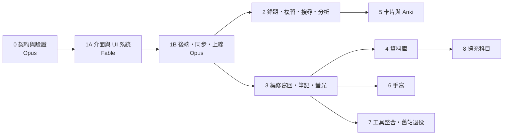

# 分階段計畫

2026-11-10 v3：已併入使用者對 Q1–Q27 的回答；新增由 Fable 製作的第 1A 階段（介面與 UI 系統）。

每個階段都能單獨交給一個模型。後面的階段不做，前面的照樣能用。

## 模型分工

使用者的決定（2026-11-10）：**介面與 UI 的第一版由 Fable 做，其餘由 Opus 做；之後的維護與功能調整都交給 Opus。** Fable 比 Opus 耗額度，所以 Fable 只做「整體介面與基本操作」，不做細部功能；做完後除非錯誤很多，不再回頭修改。

| 階段 | 誰做 | 內容 |
|---|---|---|
| 0 | Opus | 資料契約、轉接器、驗證報告、給介面用的樣本資料 |
| **1A** | **Fable** | **UI 系統、App 外殼、核心畫面與基本操作（用本機樣本資料，不接後端）** |
| 1B | Opus | 登入、同步、發佈、離線、備份、部署；把 1A 的介面接上真實資料 |
| 2–8 | Opus | 各項功能，一律用 1A 的 UI 系統與樣板來做 |

交接方式：每個階段開一個新對話（工作目錄 `~/Projects/postmed-qbank`），請模型讀 `docs/規劃/` 的四份文件與最新的驗收紀錄，並指定「做第 N 階段」。

**1A 以外，還值得換回 Fable 的情況**（都是短時間的，目的是省掉更貴的返工；要不要做由使用者決定）：

| 情況 | 為什麼 | 大約多大 |
|---|---|---|
| 第 0 階段結束 | 看驗證報告，決定哪些警告要先修。會和 1A 開工併在同一個對話，不另外花 | 併入 1A |
| 第 3 階段結束 | 那是唯一會寫主檔的程式，寫錯會改壞題庫 | 只看寫回的那幾個檔案 |
| 要改資料庫欄位，而雲端已有作答紀錄 | 改錯會影響真實資料 | 一次討論 |
| 出現資料不一致：兩台裝置數字不同、作答重複或遺失、主檔被改到不該改的地方 | 要先查清原因再動手 | 視情況 |
| 同一個問題 Opus 修了兩三次還沒好 | 換角度比重試省 | 視情況 |
| 有新需求、想調整階段順序、或要決定規格書 §14 的事項 | 要更新規格書 | 一次討論 |

第 1B 階段（登入與同步）結束後原本建議由 Fable 審一次；考慮額度，改為**由 Opus 另開一個新對話、只做審查**（請它對照完成標準逐條重驗，並跑 `security-review`）。同一個模型寫的程式由同一個對話自己審，容易漏；新對話至少沒有先入為主。

其餘（照規格寫功能、寫測試、修一般錯誤、跑 UI 檢查、日常發佈）都不需要 Fable。

---

## 給實作模型的共同規則

1. 先讀完 [01_規格書.md](01_規格書.md)。規格書 §14 列的事項，以及任何規格沒寫到的決定，停下來問，不要自己選。
2. **不得更動護理國考網站**：規格書 §11 的八條是硬性規則。只碰名稱為 `postmed-qbank` 的資源。護理站的專案資料夾（`~/Projects/多保命*`）只可讀取配色，不得寫入。
3. **部署由使用者本人執行**（規格書 §11 第 8 條）。不要求、不讀取 Cloudflare 的 token 或登入憑證；把要執行的指令和預期結果寫清楚交給使用者。
4. **主檔唯讀**：`82_考題整理/` 底下的檔案，除了 `pmq patches pull`（第 3 階段）之外不得寫入；`01_題庫製作/生化/03_分章題庫/` 任何情況都不得寫入。程式放 `~/Projects/postmed-qbank/`，不放 iCloud。主檔路徑只寫在 `tools/pmq/pmq.toml`。
5. **磁碟**：動手前看 `df -h /`，低於 2 GB 就停。不留建置暫存、不產生 zip、無頭瀏覽器的設定檔用完就刪。上限見規格書 §3.2。
6. iCloud 的檔案可能是未下載狀態，讀檔慢是正常的；不要因此改成整批複製到別處。
7. 題目一律寫成「來源｜ID」。回覆與介面文字用繁體中文。
8. **iPad 與電腦功能一致**（規格書 §2.5）：不做只有其中一邊才有的功能。
9. **UI**：第 1A 階段之後，所有畫面都用 `app/src/ui/` 的元件與 `docs/UI規範.md` 的樣板來做（規格書 §13.4）。不得另外寫顏色、圓角、間距的數值；不得繞過現有元件自己刻一個類似的。確實缺元件時，先加進 `app/src/ui/` 與 `/dev/ui` 展示頁，再拿去用。有畫面的階段在交付前跑 §13.3 列的 Skill，結果寫進驗收紀錄。
10. 每階段結束交一份驗收紀錄：逐條列出下面的完成標準、實際結果、沒做到的項目。測試沒過就寫沒過。iPad 實機項目由使用者本人驗，模型不得代為宣稱通過。

---

## 第 0 階段　資料契約與驗證（沒有網站）｜Opus

**要做**

- 建 `~/Projects/postmed-qbank/`（git）與目錄骨架（`app/` 先留空，由 1A 建立）。
- `pmq sample`：把真實資料轉成介面開發用的樣本，寫到 `app/fixtures/`（不進版本庫的大檔除外，總量 < 10 MB）：
  - 兩科**完整的索引**與章節樹（讓篩選器顯示真實題數）。
  - 約 300 題本文：每科、每個來源類別各 15–20 題，並刻意包含——最長的題幹、最長的公式、含表格、含圖（SVG 與 PNG 各有）、有題目版與解答版兩張圖、選項擠在同一行、選項是圖、非選擇題、題組、選項解析失敗、有疑點（`issues`）、沒有詳解。
  - 這些題用到的圖檔。
  - 一份生化筆記與一份物理筆記轉成的區塊樹（給資料庫閱讀頁的樣板用；轉接器可以是簡化版，第 4 階段再做完整的）。
- 內容 git 追蹤（搬遷步驟 2）。
- `schema/`：內容契約的 JSON Schema、選項解析的共用測試案例（≥ 40 個）、KaTeX 巨集表。
- `pmq check`：章節樹、物理轉接器、生化轉接器、圖的對應、驗證報告。
- `pmq check math`。
- 生化答案抽查：每個來源類別 4 題，共 20 題，對照 `01_來源索引/` 的答案。

**完成標準**

- [ ] `pmq check` 跑完，題數等於基準：物理 9,302、生化 3,742（3,743 扣掉完全相同的重複題 `KMU-111-16` 一筆；兩筆若不完全相同則視為錯誤並回報）。
- [ ] 所有題目通過 JSON Schema。
- [ ] 驗證報告包含：選項解析失敗清單、對應不到的 status 字串、找不到的章節代碼、圖的三類去處與數量、公式排版失敗清單、SVG 字型與大小警告、生化答案抽查結果、主檔裡所有相對連結指向哪些資料夾的統計。
- [ ] 選項解析：Python 與 TypeScript 對同一份測試案例結果完全相同。
- [ ] 跑完後 `cgit status` 顯示主檔沒有任何變更；`82_考題整理/` 下沒有新增檔案。
- [ ] 第二次執行 `pmq check`（雜湊快取已建立）在 60 秒內完成。
- [ ] 沒有留下暫存檔；`~/Projects/postmed-qbank` 整個資料夾（含 `node_modules`）< 500 MB。
- [ ] `app/fixtures/` 的樣本包含上面列的每一種情況（附一張對照表：哪一題是哪種情況），並通過同一份 JSON Schema。

**結束後**：換回 Fable。先看驗證報告（決定哪些警告要先在主檔修、哪些可以帶著上線），接著同一個對話直接做第 1A 階段。

---

## 第 1A 階段　介面與 UI 系統｜Fable

目的：定下整個網站的樣子與手感，並留下一套 Opus 之後照著用的元件與樣板。**只做介面與基本操作，資料來自 `app/fixtures/` 與瀏覽器本機，不接後端、不部署。**

**要做**

1. **App 骨架**：`app/`（Vite＋React＋TypeScript＋Tailwind）、路由、導覽外殼（寬螢幕側欄、窄螢幕底部分頁列）、深淺色切換。
2. **UI 系統**（規格書 §13.4）：色彩與字級代碼（深色那一欄用 `taste-color` 驗算後定案，更新回規格書 §13.1）、基礎元件、`/dev/ui` 展示頁、`docs/UI規範.md`。
3. **內容顯示元件**：Markdown＋KaTeX＋表格橫向捲動、題圖與全螢幕檢視器（雙指縮放）、來源徽章。
4. **核心畫面，操作要真的能用**（資料存在瀏覽器本機）：
   - 今日頁、出題設定（篩選器對真實索引即時算題數）、刷題畫面（選擇題、自評題、作答回饋、詳解、左右滑、鍵盤快捷鍵、星號與存疑、續做）、結束頁、單題頁、設定頁（外觀）、登入頁（只有畫面）。
5. **之後各階段要用的樣板，只做版面與互動、放假資料、不做功能**：
   - 清單頁（錯題本、題庫瀏覽、修訂佇列共用）與搜尋列
   - 複習卡片（翻面、四顆評分鈕）
   - 原卷方格（學校 × 年份）與模擬考計時列
   - 統計與考題分析的圖表卡
   - 資料庫閱讀頁（列點收合、螢光色票、區塊旁的編輯鈕）
   - 編輯面板（Markdown 原始碼＋即時預覽）
   - 題目下方的個人筆記區與手寫區的外框
   - 同步狀態、離線、錯誤、空白、載入中的各種狀態
6. **資料存取介面**：`app/src/data/` 定義畫面取用資料的函式介面（讀內容、寫作答、讀寫標記與設定），1A 提供只用本機的版本；1B 換成有同步的版本時，畫面程式不用改。本機資料表的欄位照規格書 §4.6。

**不做**（留給 Opus）：Worker、登入邏輯、同步、發佈、Service Worker 與離線、備份、搜尋、間隔複習的計算、統計的計算、修訂寫回、Anki、手寫引擎、SVG 與 LaTeX 編輯器。

**控制額度的做法**

- 範圍就是上面六項，不順手加功能。
- 使用者看畫面的回饋集中成一輪：1A 做完後，使用者在電腦與 iPad（同一個 Wi-Fi 下開本機預覽網址）各看一次，把意見一次列出，Fable 修一輪後交付。之後的調整交給 Opus。

**完成標準**

- [ ] `/dev/ui` 展示頁列出每個元件的每種狀態，淺色與深色都有；色彩表每一組的對比數字列出且合格（內文 ≥ 4.5:1、大字與圖示 ≥ 3:1）。
- [ ] `docs/UI規範.md` 寫明：有哪些元件與樣板、各用在什麼情況、新畫面怎麼組、什麼不准做。Opus 只讀這份文件與展示頁就能做出風格一致的新頁面。
- [ ] 用樣本資料可以走完：開首頁 → 設定條件 → 刷 20 題（含選擇題、自評題、有圖、長公式、表格）→ 結束頁 → 重做錯題；重新整理後可以續做。
- [ ] 樣本裡每一種特殊情況的題目都顯示正常，沒有撐破版面或重疊（`break-ui`）。
- [ ] 圖放大到 8 倍線條仍銳利；深色模式下圖在白色紙卡上；純黑白圖可反相。
- [ ] 所有可點區域 ≥ 44×44 px；選項列 ≥ 56 px；左右滑不會和上下捲動打架。
- [ ] 同一份程式在電腦寬螢幕、iPad 橫向、iPad 直向、手機寬度下都能用，功能相同。
- [ ] 規格書 §13.3 的檢查都跑過，結果在驗收紀錄裡。
- [ ] 畫面程式沒有直接讀寫 IndexedDB 或 fixtures，全部經過 `app/src/data/`。
- [ ] `app/` 建置成品 < 5 MB（不含樣本資料）；沒有留下暫存檔。
- [ ] **使用者在 iPad 與電腦上看過並同意**外觀與基本操作。主畫面 App 的行為（加入主畫面、離線）要等 1B 部署後才能驗，不在這一階段。

---

## 第 1B 階段　後端、同步、上線｜Opus

目的：把 1A 的介面接上真實資料，讓 iPad 能刷題、兩台裝置同步。**不改 1A 的外觀與互動；發現介面問題時記在驗收紀錄，小的直接修，會改變設計的先問使用者。**

**要做**

- `wrangler.toml`、`scripts/deploy.sh`（含名稱檢查）、`docs/部署步驟.md`（規格書 §11 第 8 條）。資源由使用者照文件建立：Worker、D1、R2 各一個，名稱 `postmed-qbank`。
- 登入（規格書 §10），接上 1A 的登入頁。
- 管理 API 與 `pmq publish`。
- `app/src/data/` 的正式版本：內容包下載到 IndexedDB、待送佇列、同步（規格書 §8）；`attempt`、`session`、`flag(wrong／star／doubt)`、`setting`。
- Service Worker 快取 App 外殼與看過的圖。
- 今日頁與設定頁補上：同步狀態、裝置名稱、手動同步、匯出全部、登出。
- 每晚備份到 R2；`pmq backup pull`、`pmq restore`。
- 移除對 `app/fixtures/` 的依賴（樣本只留給 `/dev/ui` 與測試用）。

**不做**：間隔複習、錯題本頁、搜尋、編輯、筆記、螢光、卡片、手寫、工具。

**完成標準**

- [ ] `docs/部署步驟.md` 寫到使用者不需要再問就能完成第一次部署；使用者照著做一次，卡住的地方補進文件。
- [ ] 沒登入時，直接開內容包、圖檔、API 的網址都回 401；密碼連錯 5 次後被鎖 15 分鐘。
- [ ] Cloudflare 帳號裡新增的資源只有三個且名稱都是 `postmed-qbank`；其他專案的設定、部署版本、最後修改時間與動工前相同（使用者在動工前後各列一次清單比對）。
- [ ] `pmq publish` 後，首頁各科題數等於基準；改一題主檔再發佈，只上傳 1 個包與 manifest，iPad 同步後看到新內容。
- [ ] 篩選器可依科目、來源類別、學校、年份、書與單元、章節組合，符合題數即時顯示；用三組條件與 `pmq` 的獨立計數核對相同。
- [ ] 題目標題顯示「來源｜ID」，抽 20 題與現有圖庫的寫法一致。
- [ ] 搬遷步驟 8 的核對表（約 40 題）全部通過。
- [ ] 在 iPad 做 20 題，60 秒內電腦上看得到同一場的 20 筆作答與答對率；反向亦同。
- [ ] iPad 開飛航模式：能開 App、能做已下載科目的題目 20 題；關飛航後 60 秒內同步完成，沒有重複或遺失（伺服器 `attempt` 筆數正好多 20）。
- [ ] 同一批作答重送兩次，伺服器筆數不變。
- [ ] 1A 的畫面元件與樣式檔沒有被改動（`git diff` 只有 `app/src/data/`、新增的檔案，以及驗收紀錄裡逐項說明的小修正）。
- [ ] 同一個網址在電腦與 iPad 上功能相同，只有版面與按鈕大小不同。
- [ ] 「匯出全部」的 zip 用 `pmq restore` 灌進一個空的本機 SQLite，各表筆數相同。
- [ ] 隔天 R2 出現 `backup/` 的當日檔。
- [ ] **使用者在 iPad 實機確認**：加入主畫面、橫直向、左右滑不會和捲動打架、飛航模式重開 App。

**結束後**：另開一個 Opus 新對話只做審查——對照上面的完成標準逐條重驗登入、同步、部署腳本，並跑 `security-review`。

---

## 第 2 階段　錯題、間隔複習、原卷、搜尋、統計、考題分析｜Opus

第 2 階段起的每個新畫面，都從 1A 留下的樣板開始接功能（清單頁、複習卡片、原卷方格、圖表卡、閱讀頁、編輯面板…），不重新設計版面。

**要做**

- 錯題規則、「粗心錯，不追蹤」、錯題本頁（規格書 §5.3）。
- FSRS：`srs_state`、`review_log`、今日複習頁、今日頁的到期數；每日上限複習 200、新卡 20，目標記憶率 0.90，設定頁可改（§5.4）。
- 原卷頁與模擬考模式（計時、交卷後才顯示答案、得分只算答對題數與用時）。
- 題庫瀏覽與搜尋（在裝置上搜尋題幹、詳解、ID、來源；在背景執行緒做，不卡畫面）。
- 統計頁；弱點章節。
- 考題分析頁 `/analysis`：各科通用的章節 × 學校 × 年份出題比例。
- 出題設定加狀態條件：沒做過／做錯過／有星號／存疑／已確認／未確認。
- 同題群組共用排程。

**完成標準**

- [ ] 答錯的題目出現在錯題本並排進複習；之後在不同日連續答對 2 次（猜對不算）或按「已掌握」後離開錯題本。
- [ ] 按「粗心錯，不追蹤」的題目不在錯題本、不在複習排程，作答紀錄仍是答錯；可從 ⋯ 選單恢復。
- [ ] 用固定的評分序列測試，`srs_state` 與 `ts-fsrs` 直接計算的結果相同。
- [ ] 兩台裝置離線各複習同一題，同步後兩筆 `review_log` 都在，`srs_state` 取較新的那次；「重算排程」的結果與逐筆重播 `review_log` 相同。
- [ ] 超過每日上限的到期項目不出現在今日複習，隔天出現。
- [ ] 模擬考：交卷前看不到答案；時間到自動交卷；得分正確；中途關掉 App 再開可以續考，計時不歸零。
- [ ] 搜尋「PHY-007836」「高醫 115」與一個題幹裡的中文詞、一個英文詞，結果正確，在 iPad 上 1 秒內出現。
- [ ] 統計頁與考題分析頁的數字與直接查資料一致（各抽三個指標核對）；物理的出題比例與舊站考題分析相同。
- [ ] 規格書 §13.3 的檢查都跑過。

---

## 第 3 階段　即時編修與寫回、個人筆記、螢光筆、已確認標記

**要做**

- 題目各欄位的編輯器（題幹與選項、思路、詳解、**答案**、章節、標籤）：Markdown 原始碼＋即時預覽；貼上 AI 回覆時自動轉成 Markdown（規格書 §9.4）。改答案時多一步確認，並留下「答案曾修訂」的紀錄；已有的作答紀錄不回頭重算對錯。
- 修訂疊加顯示、修訂佇列頁。
- `pmq patches list／pull／resolve`（規格書 §7.3）。
- 已確認標記：修訂答案或詳解時自動標記；⋯ 選單可手動標記；設定頁可選是否顯示「未確認」（§4.4）。
- 題目的個人筆記（Markdown）。
- 題目與詳解上的螢光筆與註記。

**完成標準**

- [ ] 在 iPad 改一題詳解的錯字：存檔後 iPad 與電腦（同步後）都顯示新內容並標「已修訂・待寫回」。在電腦上做同樣的事，結果相同。
- [ ] `pmq patches pull` 後，`cgit diff` 只有那一題的那一段不同，front matter 其他行與 YAML 錨點不變；產生一個 commit。物理與生化各測一題。
- [ ] 生化的修訂只改到 `02_原卷題庫/`；`03_分章題庫/` 沒有任何變更；`pull` 結束時列出改到的生化題 ID。
- [ ] 再 `pmq publish` 後，修訂狀態變 `merged`，標記消失，內容仍是新的。
- [ ] 先在 Mac 改同一段、再 `pull`：該筆變 `conflict`，主檔沒被動，修訂佇列頁同時顯示兩個版本。
- [ ] 主檔有未 commit 變更時，`pull` 拒絕執行並說明。
- [ ] 改答案：有確認步驟；寫回後主檔的答案更新；該題顯示「答案曾修訂」；舊作答的對錯沒變。
- [ ] 修訂詳解後該題顯示「✓ 已確認」；出題設定可用這個條件篩選；預設畫面上沒有任何「未確認」字樣。
- [ ] 從 ChatGPT 網頁選取一段含標題、兩層列點、表格、公式的回答貼進編輯器，轉出的 Markdown 預覽與原文結構相同。
- [ ] 螢光筆：選字後可上色、加註；題目內容被修訂後，螢光仍在正確的字上；原文被刪掉時，進「失聯的螢光」清單而不是消失。
- [ ] 個人筆記可寫公式與表格，兩台裝置同步；「匯出全部」裡有每題筆記的 Markdown。
- [ ] 規格書 §13.3 的檢查都跑過。

**結束後**：換回 Fable 審寫回主檔的程式。

---

## 第 4 階段　資料庫（講義筆記）

**§14-2 已決定（2026-11-11）**：要做「新增一份空白筆記」，寫回時放 `02_學習筆記/<科目>/_收件匣/`。

**使用者的額度安排（2026-11-11）**：可以先做前半（筆記轉接器、目錄、閱讀頁、互連、螢光與個人筆記、匯出與列印），區塊編輯與寫回 `.md` 的後半等 Fable 審完第 3 階段的寫回程式再做。

**要做**

- 筆記轉接器與 `c/kb/` 內容包（搬遷步驟 9）：生化 B1–B4 與物理；生物、化學、英文只建章節目錄。
- structure_db 圖上傳。
- `/kb` 目錄、`/kb/:doc` 閱讀頁：列點收合、表格橫向捲動、圖放大。
- 筆記 ↔ 題目互連。
- 筆記上的螢光、註記、區塊編輯、插入列點、刪除區塊（走修訂佇列）；貼上轉換同第 3 階段。
- 單份匯出 `.md`、列印。

**完成標準**

- [ ] 生化 B1–B4 與物理的每份筆記：網站上的標題數、列點數、表格數、圖數與來源 `.md` 相同。
- [ ] 生物、化學、英文在目錄裡看得到章節名稱，點進去是空頁並說明尚無內容。
- [ ] 抽 3 份與 Typora 並排：層級、表格、公式、圖寬比例一致。
- [ ] 生化筆記裡的考古題出處可點到題目；題目頁列出引用它的筆記段落；對不到的出處有清單。
- [ ] 改一個列點、在某列點下插入一個新列點：`pmq patches pull` 後 `.md` 的差異只有這兩處，縮排與原檔風格一致，Typora 開啟正常；`.md` 裡沒有被插入任何輔助標記。
- [ ] Mac 上用 Typora 改了筆記並重新發佈後，原有螢光仍在正確位置，找不到的進「失聯」清單。
- [ ] 寬表格在 iPad 直向可橫向捲動，不撐破頁面。
- [ ] 規格書 §13.3 的檢查都跑過（含 `break-ui` 與 `taste-typography`）。

---

## 第 5 階段　卡片與 Anki

**開工前**：使用者從 Anki 匯出 `.apkg`（勾選包含排程與媒體）→ 先只做 `pmq anki inspect` → 換回 Fable 看報告，與使用者確認規格書 §14-3（以牌組為單位搬家）、匯入哪些牌組、要不要聲音。

**要做**

- `pmq anki inspect`（只讀）。
- `deck`、`card`、`media`；卡片頁、卡片編輯、克漏字。
- 題目與筆記列點「做成卡片」。
- 卡片併入今日複習。
- `pmq anki import／export`（含進度）；網站上的 TSV 匯入匯出。

**完成標準**

- [ ] `inspect` 報告列出：各牌組卡片數、卡片樣板種類、是否使用 FSRS、圖片與聲音各自的檔數與總大小；執行後 `.apkg` 與磁碟上沒有多出解壓縮的殘留檔。
- [ ] 匯入後：卡片數、牌組階層、標籤與 Anki 內相同；含圖片的卡片顯示正常；克漏字正確遮蓋。
- [ ] 進度：匯入後抽 20 張，到期日與 Anki 內相差不超過 1 天；Anki 的複習紀錄筆數與匯入的 `review_log` 筆數相同。
- [ ] 同一個檔匯入兩次不產生重複卡片（以 Anki 的 guid 判斷）。
- [ ] 匯出的 `.apkg` 匯進一個空的 Anki 設定檔：卡片數相同，抽 20 張到期日相差不超過 1 天。
- [ ] 卡片在 iPad 與電腦的複習進度同步。
- [ ] 規格書 §13.3 的檢查都跑過。

---

## 第 6 階段　Apple Pencil 手寫

**要做**：規格書 §9.6。

**完成標準**

- [ ] 筆可以畫、手指只會捲動；手掌靠在螢幕上不產生筆畫。
- [ ] 物理題重新作答時手寫區是空白的；生化題的手寫隔天還在。
- [ ] 寫滿一頁（約 200 筆）後存檔大小 < 300 KB；重開頁面 1 秒內重現。
- [ ] iPad 寫的內容在電腦上看得到；電腦上可用滑鼠畫。
- [ ] 手寫區使用中，左右滑換題不會被觸發。
- [ ] **使用者在 iPad 實機確認**延遲與筆觸可接受。

---

## 第 7 階段　工具整合與舊站退役

**開工前要問**：規格書 §14-4（物理圖庫）、§14-6（生化資料卡）。

**要做**

- `/tools/svg`：建置時從 `scripts/svg_editor/` 複製核心，延遲載入；題目圖的「✎ 編輯圖」→ 修訂佇列（`field: svg`）→ `pmq patches pull` 寫回 registry 或 `data/manual/`。
- `/tools/latex`：搬入現有 LaTeX 編輯器（含 MathJax 4 字型，進入時才載入）。
- `/figures`：生化圖庫（搜尋、看圖、貼紙下載；不含資料卡）。
- 考題分析的物理加值：各章公式與易錯提示（來自 `build_exam_analysis.py` 的 `CHAPTER_PLAYBOOK`）。
- 舊站退役（搬遷步驟 10）。舊站的草稿不搬。

**完成標準**

- [ ] 沒開工具頁時，首頁載入的檔案不含編輯器與 MathJax。
- [ ] 新站的 SVG 編輯器與 `scripts/svg_editor/svg_editor.js` 是同一份內容（建置時比對雜湊）；Mac 的 `serve.py`（8766）仍可正常使用編輯器。
- [ ] 編輯一張物理圖並儲存：題目立刻顯示新圖；`pull` 後 `traced.svg` 更新、舊檔在 `手修備份/`、registry 有 `manual_edit`。
- [ ] 生化圖庫：用分子名、別名、標籤搜尋得到與舊站相同的結果（抽 10 個關鍵字）；貼紙可下載。
- [ ] 舊工具站的既有自動測試（`web_tools/tests/`）搬過來後仍通過。
- [ ] 使用者明確同意後，由使用者本人下架 `postmed-tools`、`postmed-library` 與 structure_db 的 GitHub Pages；下架前後護理站不受影響。
- [ ] **不刪除** `~/Projects/structure_db` 與 `82_考題整理/structure_db/out/svg`（原因見搬遷步驟 10）。

---

## 第 8 階段　擴充科目與 AI 生成內容

**要做**

- 以化學（或使用者指定的科目）走一遍「新增科目」四步（搬遷文件最後一節），補上過程中發現的缺口。
- 題組（共用題幹，英文閱讀測驗會用到）的完整作答介面。
- AI 生成內容的標示與篩選：與考古題分開統計，出題設定預設不勾。

**完成標準**

- [ ] 新增一科時，`app/` 與 `worker/` 的程式碼沒有任何修改，只新增轉接器與設定；考題分析頁自動出現這一科。
- [ ] 題組的子題共用題幹顯示，各自計分。
- [ ] 出題設定可排除或只選 AI 生成的題目；統計頁把它們分開算。

---

## 待 Fable 規劃的新功能（使用者 2026-11-11 提出，目前只是紀錄）

這兩項還沒有規格，**實作前要先由 Fable 做詳細規劃**（更新規格書與本文件），不要直接開工。可能要調整第 5、6、7 階段的內容。

1. **在圖片上手寫、畫螢光、直接編輯 SVG**
   - 題目或筆記裡的圖上，可以直接用 Apple Pencil（或滑鼠）手寫標記、用手畫螢光筆。
   - 也可以直接在網站上用 SVG 編輯器改這張圖。
   - 相關：第 6 階段手寫（目前只規劃題目下方的手寫區）、第 7 階段 `/tools/svg` 與「✎ 編輯圖」。要釐清的事，例如：圖上的標記是個人資料（同步、不改主檔），還是改圖本身（走修訂佇列寫回）；兩者怎麼並存。
2. **Anki 的克漏字（cloze），做成像 RemNote 那樣**
   - 可以把筆記或題目裡的**特定句子直接變成克漏字卡片**（選字 → 做成卡片）。
   - 複習時可以選擇**用「膠帶」把挖空處擋住**，自己做小測驗（點一下撕開膠帶看答案）。
   - 相關：第 5 階段卡片（規格書 §9.5 已有 `{{c1::…}}` 克漏字）、第 4 階段筆記閱讀頁。膠帶顏色參考使用者常用色：綠 #7EC636、橘 #F59A23、紅 #D20000、淺藍 #53BDEB、淺灰 #E4E2DC。

使用者常用的筆色（手寫功能的預設色盤可參考）：藍（寫字）#3355BB、紅 #D20000、暗橘 #D35000、橘 #F59A23、綠 #7EC636、紫 #BF55FF、黑、白。螢光筆六色已用在第 3 階段（`app/src/ui/tokens.css` 的 `--hl-*`）。

---

## 階段相依

第 2 階段以後都是 Opus。第 2 與第 3 階段互不相依，可以對調。建議照編號做：先讓刷題好用，再碰寫回主檔的部分。

1A 排在 1B 前面的原因：介面先定下來，後端只要照著資料存取介面接上去；反過來做的話，Opus 得先自己刻一版介面，之後整個換掉。1A 不必等任何 Cloudflare 的設定，只需要第 0 階段產出的樣本資料。
